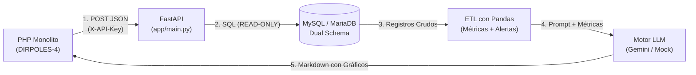

# Documentación Técnica: Microservicio DIRPOLES-IA

Guía explicativa para desarrolladores: arquitectura, flujo de datos, funcionamiento del modo simulado (Mock) y defensa técnica ante jurados evaluadores.

---

## 1. ¿Qué es y qué problema resuelve?

* **Contexto:** El sistema institucional principal (**DIRPOLES-4**) es un monolito en **PHP 8.3** que gestiona la atención médica, inventario y bienestar estudiantil en la UPTAEB.
* **El Problema:** Procesar miles de registros en MySQL, calcular agregaciones estadísticas complejas, estructurar prompts para IA y conectarse a APIs generativas en PHP saturaría el servidor web e interrumpiría la operación administrativa diaria.
* **La Solución:** Un **microservicio desacoplado en Python (FastAPI)** enfocado exclusivamente en analítica de datos e inferencia de IA.
* **Principio de Resiliencia:** Si el microservicio o la IA de Google fallan, **el monolito PHP sigue funcionando al 100%** en todas sus operaciones normales (crear citas, ver beneficiarios, etc.).

---

## 2. Flujo de Datos en 5 Pasos (Backend-to-Backend)



1. **Invocación B2B:** PHP valida la sesión del usuario y envía una petición HTTP `POST` a `/api/v1/reportes/generar` con los filtros seleccionados, la intención del informe y la cabecera secreta `X-API-Key`.
2. **Extracción Segura (`READ-ONLY`):** Python valida los datos de entrada con Pydantic y consulta la base de datos MySQL con un usuario de privilegios exclusivos `SELECT`.
3. **Pipeline ETL con Pandas:** En memoria (`etl_service.py`), limpia nulos, agrupa datos, calcula porcentajes, variaciones mensuales y detecta anomalías (ej. insumos con stock $< 10$).
4. **Orquestación de Prompts:** Inyecta un **Rol Especializado** según el módulo consultado (hay 10 roles: médico, psicológico, transporte, etc.) y genera un prompt estructurado con las métricas ya calculadas.
5. **Respuesta en Markdown:** El informe resultante (con tablas y diagramas Mermaid) se devuelve a PHP, el cual simplemente lo renderiza en la vista web.

---

## 3. ¿Cómo funciona el MOCK (Generador Simulado)? — *Al detalle*

Uno de los mayores méritos técnicos del proyecto es su **arquitectura de resiliencia ante fallos externos**.

### ¿Por qué existe el Mock?
1. **Defensa ante jurados / Sin Internet:** Si en la presentación universitaria no hay conexión a internet o falla el WiFi, el sistema **no se cae**: sigue generando informes completos.
2. **Protección de Cuota y Costos:** Evita consumir tokens de la API de Gemini durante pruebas automáticas o desarrollo local (`pytest`).
3. **Degradación Elegante:** Si la API de Google da error 429 (límite de peticiones), error 500 o timeout, el usuario final no recibe una pantalla de error.

### ¿Cómo está implementado a nivel de código?
Se aplica el **Patrón Strategy (Estrategia)** usando un protocolo común `ClienteIA` (`app/services/gemini_service.py`):

```python
class ClienteIA(Protocol):
    modo: str
    def generar_informe(self, system_prompt: str, user_prompt: str, contexto: dict) -> str: ...
```

Existen dos implementaciones concretas:
* **`ClienteGemini`**: Consume la API de Google AI Studio mediante el SDK oficial `google-genai` (modelo `gemini-3.5-flash`).
* **`ClienteSimulado`**: Motor determinista basado en reglas.

### ¿Qué hace exactamente `ClienteSimulado`?
**No genera texto falso ni lorem ipsum.** Toma el diccionario de métricas procesadas por **Pandas** y construye programáticamente un informe en Markdown idéntico al que entregaría la IA:
1. **Resumen Ejecutivo:** Vuelca los totales del periodo y las comparativas de variación mensual calculadas.
2. **Hallazgos Clave:** Clasifica las alertas detectadas por nivel (`🔴 Crítico`, `🟡 Advertencia`, `🔵 Info`).
3. **Distribuciones y Gráficos:** Genera tablas de porcentajes y código nativo de gráficos circulares **Mermaid.js** (`pie title ...`).
4. **Recomendaciones Operativas:** Sugiere acciones automáticas en función de si hubo o no alertas críticas.

### Los 3 modos de salida (`meta.modo_informe`):
En el JSON de respuesta devuelto por la API, el campo `meta.modo_informe` indica exactamente quién redactó el texto:
* **`gemini`**: Informe redactado por el modelo de Google AI Studio.
* **`simulado`**: Modo forzado localmente (`MOCK_LLM=True` o API Key vacía en `.env`).
* **`simulado_fallback`**: Se intentó consultar a Gemini, pero falló la red o la API externa; el microservicio activó el respaldo local automáticamente en el bloque `except` de `app/api/v1/endpoints/reportes.py`.

---

## 4. Pilares Clave de Ingeniería de Software

### A. Privacidad de Datos e Inferencia Inteligente
* **¿Se envían los datos crudos de los estudiantes a Google Gemini?**  
  **No.** Por seguridad y privacidad (datos sensibles de salud y bienestar), la base de datos cruda se procesa localmente en el servidor con **Pandas**. A la IA solo se le envía un JSON sintetizado con métricas agregadas (totales, promedios, porcentajes), nunca nombres, cédulas ni fichas clínicas completas. Esto además **reduce drásticamente el consumo de tokens y la latencia**.

### B. Seguridad Backend-to-Backend (B2B)
* La comunicación PHP ↔ Python no usa contraseñas de usuario, sino la cabecera HTTP `X-API-Key`.
* La validación se hace con `hmac.compare_digest` en `app/core/security.py` para evitar **ataques de temporización (timing attacks)**.

### C. Base de Datos en Modo `READ-ONLY`
* El microservicio utiliza un usuario MySQL exclusivo (`dirpoles_ia_reader`) que **únicamente posee permisos `SELECT`** sobre los esquemas `dirpoles_business` y `dirpoles_security`.
* Es imposible que un bug o una inyección en este microservicio altere, borre o corrompa datos de la institución.

---

## 5. Chuleta para defender el proyecto ante el Profesor

| Pregunta típica del jurado | Respuesta técnica directa |
| :--- | :--- |
| **¿Por qué no hicieron esto directamente en PHP?** | *«Para desacoplar la carga analítica pesada. Pandas ofrece agregaciones vectorizadas en memoria que en PHP serían muy lentas, y si la IA externa experimenta latencia o caídas, el monolito institucional no se bloquea ni se degrada.»* |
| **¿Qué pasa si la UPTAEB se queda sin internet?** | *«El microservicio implementa el patrón Fallback: conmuta automáticamente al motor `ClienteSimulado`, el cual procesa los datos de MySQL localmente y genera el informe estructurado con gráficos Mermaid sin depender de la nube.»* |
| **¿La IA puede inventar datos (alucinación)?** | *«Minimizamos la alucinación inyectando métricas deterministas precalculadas por Pandas en el prompt del sistema y fijando una temperatura baja (0.3). La IA solo sintetiza y redacta los números que el pipeline local le entrega.»* |
| **¿Cómo garantizan que la IA no modifique la base de datos?** | *«Por diseño arquitectónico de mínimo privilegio: la conexión SQLAlchemy utiliza credenciales con permiso exclusivo `SELECT`. No existen sentencias `INSERT`, `UPDATE` ni `DELETE` en el microservicio.»* |
