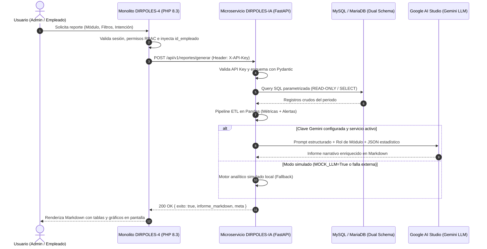

# DIRPOLES-IA

<div align="center">


-2BAF2B?style=for-the-badge&logo=pytest&logoColor=white)


**Microservicio B2B de Analítica Avanzada e Inteligencia Artificial Generativa**  
*Sistema de Control e Inventario de Beneficiarios de Bienestar Estudiantil (**DIRPOLES-4**)*  
**Universidad Politécnica Territorial de Lara Andrés Eloy Blanco (UPTAEB) — PNF en Informática**

[Características](#-características-principales) •
[Arquitectura](#-arquitectura-y-flujo-de-datos) •
[Requisitos](#-requisitos-del-sistema) •
[Instalación Paso a Paso](#-instalación-y-configuración-paso-a-paso) •
[Verificación y Pruebas](#-verificación-y-pruebas) •
[API REST](#-referencia-de-la-api-rest) •
[Integración PHP](#-integración-con-el-monolito-php)

</div>

---

## 📖 Descripción General

**DIRPOLES-IA** es el componente de inteligencia artificial y analítica de datos desacoplado de la plataforma **DIRPOLES-4**. Opera como un microservicio independiente en Python (FastAPI) que se comunica de forma segura Backend-to-Backend (B2B) con el monolito principal en PHP.

El microservicio se encarga de:
1. **Extraer datos en modo solo lectura (`READ-ONLY`)** de los 10 módulos operativos del sistema universitario.
2. **Procesar agregaciones, tendencias, distribuciones y umbrales críticos** en memoria mediante un pipeline ETL en **Pandas**.
3. **Orquestar prompts analíticos multidominio** inyectando roles técnicos especializados según el módulo consultado.
4. **Sintetizar informes ejecutivos estructurados en Markdown** con tablas y gráficos visuales **Mermaid.js** mediante los modelos generativos **Gemini** de Google AI Studio.
5. **Garantizar resiliencia total**: ante caídas de red o ausencia de credenciales de IA, conmuta automáticamente a un generador simulado determinista local sin interrumpir la operación del sistema.

> [!NOTE]
> Para consultar la especificación técnica profunda de arquitectura consulta [`AGENTS.md`](./AGENTS.md). Para los pipelines analíticos exhaustivos revisa [`docs/PIPELINES_IA.md`](./docs/PIPELINES_IA.md). Para la guía de consumo desde el monolito PHP revisa [`docs/INTEGRACION_DIRPOLES4.md`](./docs/INTEGRACION_DIRPOLES4.md). Para la guía operativa del servidor consulta [`docs/MANUAL.md`](./docs/MANUAL.md), para la guía conceptual [`docs/Documentacion_componenteIA.md`](./docs/Documentacion_componenteIA.md) y para la entrega formal de grado revisa [`docs/ENTREGA_FASE_II_COMPONENTE_IA.md`](./docs/ENTREGA_FASE_II_COMPONENTE_IA.md).

---

## ✨ Características Principales

* 🛡️ **Seguridad Estricta y READ-ONLY:** Conexión a base de datos con privilegios exclusivamente `SELECT`. El microservicio carece de endpoints o permisos de escritura, blindando los datos de producción.
* 📊 **10 Módulos de Análisis Cubiertos:** Cobertura total de los servicios de bienestar estudiantil: General, Medicina, Psicología, Orientación, Trabajo Social, Discapacidad, Referencias, Jornadas, Mobiliario y Transporte.
* ⚡ **Pipeline ETL de Alto Rendimiento:** Cálculos estadísticos en Pandas (porcentajes, deltas temporales, variaciones intermensuales y detección proactiva de anomalías).
* 🤖 **Ingeniería de Prompts Multidominio:** 10 roles analíticos contextualmente adaptados (ej. especialista en morbilidad clínica, analista de flotas, coordinador de remisiones, etc.).
* 📈 **Informes Ricos y Visuales:** Salida en Markdown optimizada con encabezados semánticos, tablas comparativas formateadas, bloques de alerta (`> ⚠️`) y diagramas nativos **Mermaid.js** (`pie` y `xychart-beta`).
* 🔄 **Doble Modo LLM y Resiliencia:** Funcionamiento híbrido: utiliza la API de Google Gemini en producción y conmuta fluidamente a un cliente simulado local ante contingencias o entornos de desarrollo sin conexión.
* 🔒 **Autenticación B2B Robusta:** Autenticación de llamadas máquina a máquina mediante cabecera `X-API-Key` validada en tiempo constante (`hmac.compare_digest`) para prevenir ataques de temporización.
* ✅ **Calidad de Código y Tipado Fuerte:** Contratos estrictos con Pydantic v2, tipado estático verificado con `mypy`, formateo con `ruff` y suite de **62 pruebas automatizadas** en `pytest`.

---

## 🏛️ Arquitectura y Flujo de Datos



---

## 📊 Módulos de Reportes Analíticos

| Módulo | Entidades Analizadas | Filtros Soportados | Alertas del Pipeline ETL |
| :--- | :--- | :--- | :--- |
| **`general`** | Atenciones en 7 servicios universitarios | Fechas, Género, PNF, Área | Concentración de demanda por servicio |
| **`medicina`** | Consultas médicas e inventario de fármacos | Fechas, Género, PNF | Medicamentos vencidos, por vencer (≤30d), stock crítico |
| **`psicologia`** | Morbilidad clínica y agenda de citas | Fechas, PNF, Tipo de consulta, Estado | Citas no asistidas, citas pendientes, patología dominante |
| **`orientacion`** | Expedientes psicopedagógicos y vocacionales | Fechas, Género, PNF | Distribución de motivos de consulta |
| **`trabajo_social`** | Becas, Exoneraciones, FAMES, Gestación | Fechas, PNF, Submódulo | Picos de solicitudes por programa social |
| **`discapacidad`** | Estudiantes con diversidad funcional | Fechas, Género, PNF, Tipo, Grado | Casos de alta severidad, beneficiarios sin carnet CONAPDIS |
| **`referencias`** | Remisiones e interconsultas entre áreas | Fechas, Estado, Servicio de destino | Tasa de resolución y referencias pendientes |
| **`jornadas`** | Jornadas de salud comunitarias | Fechas, Estado | Aforo superado, metas no alcanzadas, eventos inconclusos |
| **`mobiliario`** | Bienes públicos institucionales y equipos | Fechas, Tipo de bien, Estado | Ratio de desincorporación y bienes inactivos |
| **`transporte`** | Flota, rutas, repuestos, mantenimientos | Fechas, Estado, Tipo vehículo, Sección | Unidades fuera de servicio, repuestos bajo inventario mínimo |

---

## 📋 Requisitos del Sistema

Antes de iniciar la instalación, asegúrate de contar con los siguientes componentes en tu sistema operativo:

| Componente | Requisito Mínimo | Propósito |
| :--- | :--- | :--- |
| **Sistema Operativo** | Linux (Ubuntu 22.04+, Debian 12+), macOS o Windows (vía WSL2) | Plataforma de ejecución recomendada |
| **Python** | **3.12** o superior | Entorno de ejecución del microservicio |
| **Gestores Python** | `pip` y módulo `python3-venv` | Aislamiento de entorno y gestión de dependencias |
| **Base de Datos** | **MySQL 8.0+** o **MariaDB 10.5+** | Esquemas relacionales `dirpoles_business` y `dirpoles_security` |
| **Google AI Studio** *(Opcional)* | API Key gratuita para modelos Gemini | Habilita inferencia con IA generativa real |
| **Herramientas HTTP** | `curl`, Postman, Insomnia o navegador moderno | Pruebas de integración y exploración de endpoints |

---

## 🚀 Instalación y Configuración Paso a Paso

Sigue esta guía detallada para clonar, configurar y poner en marcha el microservicio desde cero.

### Paso 1: Clonar el Repositorio

Abre una terminal y clona el código fuente en tu máquina local:

```bash
git clone https://github.com/mroberth/DIRPOLES-IA.git
cd DIRPOLES-IA
```

---

### Paso 2: Crear y Activar el Entorno Virtual

Es fundamental aislar las dependencias de Python para evitar conflictos con paquetes globales del sistema.

**En Linux / macOS:**
```bash
# 1. Crear el entorno virtual (usando Python 3.12+)
python3 -m venv .venv

# 2. Activar el entorno
source .venv/bin/activate
```

**En Windows (PowerShell):**
```powershell
python -m venv .venv
.\.venv\Scripts\Activate.ps1
```

> [!TIP]
> Verifica que el entorno esté activo ejecutando `which python` (o `where python` en Windows). La ruta debe apuntar al directorio `.venv`.

---

### Paso 3: Instalar las Dependencias del Proyecto

Actualiza `pip` e instala los paquetes necesarios según tu caso de uso:

```bash
# Actualizar pip a la última versión
pip install --upgrade pip

# Opción A: Solo dependencias de producción / ejecución
pip install -r requirements.txt

# Opción B (Recomendada): Incluir herramientas de desarrollo, tests y linters
pip install -r requirements-dev.txt
```

* `requirements.txt`: FastAPI, Uvicorn, Pydantic v2, SQLAlchemy, PyMySQL, Pandas, Google GenAI SDK.
* `requirements-dev.txt`: Pytest, Pytest-Cov, HTTPX, Ruff, Mypy y stubs de tipado.

---

### Paso 4: Configurar la Base de Datos (Usuario READ-ONLY)

Por diseño arquitectónico, el microservicio **nunca debe conectarse con credenciales de escritura (root o administrador)**. Se debe crear un usuario exclusivo con privilegios únicamente de lectura (`SELECT`).

Accede a tu gestor de base de datos MySQL / MariaDB como administrador (`root`):

```bash
mysql -u root -p
```

Ejecuta las siguientes sentencias SQL:

```sql
-- 1. Crear el usuario de solo lectura
CREATE USER IF NOT EXISTS 'dirpoles_ia_reader'@'localhost' IDENTIFIED BY 'tu_contraseña_segura_aqui';

-- 2. Otorgar permisos SELECT sobre el esquema de negocio
GRANT SELECT ON dirpoles_business.* TO 'dirpoles_ia_reader'@'localhost';

-- 3. Otorgar permisos SELECT sobre el esquema de seguridad (requerido para cruces con la tabla 'empleado')
GRANT SELECT ON dirpoles_security.* TO 'dirpoles_ia_reader'@'localhost';

-- 4. Aplicar cambios
FLUSH PRIVILEGES;

-- 5. Salir
EXIT;
```

> [!IMPORTANT]
> **¿Por qué son necesarios ambos esquemas?**  
> El monolito utiliza arquitectura de doble esquema: `dirpoles_business` almacena las operaciones sustantivas de los módulos y `dirpoles_security` almacena el catálogo de empleados. Módulos como psicología y transporte cruzan información de ambas bases de datos.

> [!NOTE]
> **¿No tienes la base de datos MySQL disponible en este momento?**  
> ¡No te preocupes! Puedes continuar con la instalación. El microservicio puede iniciar y responder peticiones de salud, y la suite de pruebas unitarias (`pytest -m "not bd"`) funcionará al 100% de forma aislada.

---

### Paso 5: Configurar las Variables de Entorno (`.env`)

Copia la plantilla de configuración `.env.example` para crear tu archivo `.env` local:

```bash
cp .env.example .env
```

Abre `.env` con tu editor preferido (ej. `nano .env` o `code .env`) y ajusta los valores:

```ini
# ============================================================
# Servidor FastAPI
# ============================================================
HOST=0.0.0.0
PORT=8000
DEBUG=True

# ============================================================
# Seguridad B2B (Clave compartida con el monolito PHP)
# ============================================================
DIRPOLES_IA_API_KEY=tu_clave_secreta_b2b_super_segura

# ============================================================
# Conexión a Base de Datos (Credenciales de solo lectura)
# ============================================================
DB_HOST=127.0.0.1
DB_PORT=3306
DB_USER=dirpoles_ia_reader
DB_PASSWORD=tu_contraseña_segura_aqui
DB_NAME_BUSINESS=dirpoles_business
DB_NAME_SECURITY=dirpoles_security

# ============================================================
# Proveedor de Inteligencia Artificial (Google AI Studio)
# ============================================================
GEMINI_API_KEY=
GEMINI_MODEL=gemini-3.5-flash
MOCK_LLM=True

# ============================================================
# Parámetros del Motor Analítico
# ============================================================
UMBRAL_STOCK_CRITICO_INSUMOS=10
UMBRAL_STOCK_CRITICO_REPUESTOS=5
LIMITE_REGISTROS=5000

# ============================================================
# Configuración de CORS
# ============================================================
ALLOWED_ORIGINS=http://localhost,http://localhost:80
```

#### Modos de Funcionamiento de la Inteligencia Artificial

El microservicio admite dos modos operativos:

| Modo | Configuración en `.env` | Cuándo usarlo |
| :--- | :--- | :--- |
| **Modo Simulado (Mock)** | `MOCK_LLM=True`<br>`GEMINI_API_KEY=` | **Desarrollo local y pruebas:** No requiere internet, no gasta cuota, genera informes con métricas calculadas al instante. |
| **Modo Real (Google Gemini)** | `MOCK_LLM=False`<br>`GEMINI_API_KEY=AIzaSy...`<br>`GEMINI_MODEL=gemini-3.5-flash` | **Producción / Pruebas reales:** Inferencia generativa completa con síntesis analítica y diagramas Mermaid.js enriquecidos. Obtén una clave gratis en [Google AI Studio](https://aistudio.google.com/). |

---

### Paso 6: Puesta en Marcha del Microservicio

Con el entorno virtual activo y el archivo `.env` configurado, puedes levantar el microservicio eligiendo la modalidad más conveniente:

```
┌────────────────────────────────────────────────────────────────────────┐
│                        MODALIDADES DE EJECUCIÓN                        │
├────────────────────────────────────────────────────────────────────────┤
│ 1. Scripts Rápidos (.sh) → Segundo plano fácil (Linux / WSL / macOS).  │
│ 2. Modo Interactivo      → Consola en vivo con recarga (Multiplataforma)│
│ 3. Servicio Systemd      → Autoarranque en servidor de producción.     │
└────────────────────────────────────────────────────────────────────────┘
```

#### Opción A: Scripts de Control Rápido en Segundo Plano (Recomendado en Linux / WSL)

El proyecto incluye 4 scripts automatizados en la raíz para simplificar la gestión diaria del microservicio:

| Script | Comando | Descripción |
| :--- | :--- | :--- |
| **Encender** | `./iniciar.sh` | Valida el entorno virtual `.venv`, arranca Uvicorn en segundo plano (`127.0.0.1:8000`), guarda el PID en `logs/uvicorn.pid` y verifica la disponibilidad del servicio. |
| **Consultar Estado** | `./estado.sh` | Informa si el proceso está activo en memoria y consulta en vivo el endpoint de diagnóstico `/api/v1/salud`. |
| **Ver Logs en Vivo** | `./logs.sh` | Muestra el flujo continuo de peticiones y trazas HTTP. Presionar `Ctrl + C` sale del visor **sin apagar el microservicio**. |
| **Detener** | `./detener.sh` | Detiene limpiamente el proceso Uvicorn mediante su PID y limpia los archivos temporales. |

```bash
# Ejemplo de uso diario:
./iniciar.sh
./estado.sh
./logs.sh
./detener.sh
```

> [!NOTE]
> **Compatibilidad de los scripts `.sh` (Linux vs Windows):**  
> Los archivos `.sh` son scripts Bash diseñados para sistemas POSIX (Linux, macOS y entornos **WSL2** en Windows). Hacen uso de utilidades nativas como `nohup`, señales POSIX (`kill`), `pgrep`, `tail -f` y la ruta de ejecutables `.venv/bin/uvicorn`.  
> * **En Windows nativo (CMD / PowerShell):** Los scripts `.sh` no se ejecutan directamente. Para Windows, se recomienda utilizar **WSL2** (donde funcionan al 100%) o utilizar el comando interactivo de la **Opción B**.

---

#### Opción B: Modo Desarrollo Interactivo con Recarga en Caliente (Multiplataforma)

Ideal para desarrollo activo en cualquier sistema operativo. Muestra todas las salidas en pantalla y recarga el servidor automáticamente al editar código:

**En Linux / macOS:**
```bash
uvicorn app.main:app --host 0.0.0.0 --port 8000 --reload
```

**En Windows (PowerShell):**
```powershell
# 1. Activar el entorno virtual en Windows
.\.venv\Scripts\Activate.ps1

# 2. Iniciar Uvicorn con recarga automática
uvicorn app.main:app --host 127.0.0.1 --port 8000 --reload
```

---

#### Opción C: Modo Manual en Segundo Plano (Linux / Servidor)

Si prefieres gestionar el proceso manualmente sin usar los scripts:

```bash
# 1. Asegurar la carpeta de logs
mkdir -p logs

# 2. Iniciar en segundo plano
nohup uvicorn app.main:app --host 127.0.0.1 --port 8000 > logs/uvicorn.log 2>&1 &

# 3. Guardar el ID de proceso (PID) para facilitar su gestión
echo $! > logs/uvicorn.pid
```

* Para consultar los logs en tiempo real: `tail -f logs/uvicorn.log`
* Para detener el proceso: `kill "$(cat logs/uvicorn.pid)"`

> [!TIP]
> Si deseas configurar el microservicio como un demonio que autoarranque con el sistema operativo mediante **systemd**, consulta la sección dedicada en [`docs/MANUAL.md`](./docs/MANUAL.md#7-opcional-autoarranque-con-systemd--que-encienda-solo).

---

## 🧪 Verificación y Pruebas

Sigue este checklist secuencial para comprobar que el servicio está 100% operativo y listo para interactuar con el monolito PHP.

### 1. Comprobación del Healthcheck Público

Ejecuta una petición `GET` al endpoint de salud (no requiere autenticación):

```bash
curl -s http://localhost:8000/api/v1/salud
```

**Respuesta esperada:**
```json
{
  "estado": "ok",
  "servicio": "DIRPOLES-IA",
  "base_datos": "ok",
  "modo_llm": "simulado"
}
```

* `base_datos`: Retorna `"ok"` si la conexión a MySQL responde satisfactoriamente; retorna `"no_disponible"` si el servidor MySQL está apagado o las credenciales no coinciden.
* `modo_llm`: Informa `"gemini"` si la clave de Google AI Studio está configurada y activa; de lo contrario informa `"simulado"`.

---

### 2. Exploración de la Documentación Interactiva (Swagger UI)

Abre en tu navegador web:
* **Swagger UI:** [http://localhost:8000/docs](http://localhost:8000/docs)
* **ReDoc:** [http://localhost:8000/redoc](http://localhost:8000/redoc)

Desde Swagger puedes visualizar todos los esquemas de entrada y salida (`DTOs`), probar peticiones y autenticarte ingresando tu `DIRPOLES_IA_API_KEY`.

---

### 3. Prueba de Autenticación B2B y Catálogos

Verifica la protección de la cabecera `X-API-Key` consultando el catálogo de enums válidos:

```bash
curl -s -H "X-API-Key: tu_clave_secreta_b2b_super_segura" \
  http://localhost:8000/api/v1/reportes/catalogos
```

Debe retornar un JSON con la lista exhaustiva de los 10 módulos, las 4 intenciones y los filtros admitidos. Si envías una clave incorrecta o la omites, el servidor responderá `401 Unauthorized`.

---

### 4. Prueba de Generación de un Informe con IA

Ejecuta una petición `POST` enviando un payload analítico para el módulo de medicina:

```bash
curl -s -X POST http://localhost:8000/api/v1/reportes/generar \
  -H "Content-Type: application/json" \
  -H "X-API-Key: tu_clave_secreta_b2b_super_segura" \
  -d '{
    "modulo": "medicina",
    "intencion": "alertas_y_anomalias",
    "filtros": {
      "fecha_inicio": "2026-01-01",
      "fecha_fin": "2026-10-31"
    },
    "observacion_usuario": "Priorizar insumos con bajo stock o próximos a vencer.",
    "id_empleado": null
  }'
```

**Estructura de respuesta exitosa (HTTP 200):**
```json
{
  "exito": true,
  "modulo": "medicina",
  "intencion": "alertas_y_anomalias",
  "informe_markdown": "### 📊 Informe Ejecutivo de Salud: Módulo Medicina\n\n...",
  "meta": {
    "registros_procesados": 142,
    "tiempo_procesamiento_seg": 1.85,
    "modo_informe": "gemini"
  }
}
```

---

### 5. Ejecución de la Suite de Pruebas Automatizadas

El proyecto incluye pruebas con `pytest` que verifican contratos de API, serializadores, cálculos del ETL en Pandas, construcción de prompts y flujos end-to-end:

```bash
# Ejecutar pruebas unitarias y de simulación (NO requieren base de datos)
pytest -m "not bd"

# Ejecutar la suite completa de 62 pruebas (requiere MySQL local activo)
pytest

# Ejecutar con reporte de cobertura de código
pytest --cov=app tests/
```

---

### 6. Verificación de Calidad y Tipado Estático

Asegura la conformidad con los estándares de ingeniería de software del proyecto:

```bash
# Linter de código y reglas de estilo
ruff check app tests

# Comprobación de formato
ruff format app tests --check

# Análisis de tipado estático estricto
mypy app
```

---

## 🔌 Referencia de la API REST

### Endpoints Disponibles

| Método | Endpoint | Cabecera Requerida | Descripción |
| :--- | :--- | :--- | :--- |
| `GET` | `/api/v1/salud` | *Ninguna* | Comprobación pública de estado del microservicio, BD y LLM. |
| `GET` | `/api/v1/reportes/catalogos` | `X-API-Key: <key>` | Retorna los valores permitidos para módulos, intenciones y filtros. |
| `POST` | `/api/v1/reportes/generar` | `X-API-Key: <key>` | Ejecuta extracción, ETL y generación de informe narrativo en Markdown. |

### Detalle de `POST /api/v1/reportes/generar`

#### Parámetros del Payload de Entrada (`ReporteRequestDTO`)

| Campo | Tipo | Obligatorio | Descripción |
| :--- | :--- | :---: | :--- |
| `modulo` | `string` | **Sí** | Uno de los 10 módulos (`general`, `medicina`, `psicologia`, etc.). |
| `intencion` | `string` | **Sí** | `resumen_ejecutivo`, `alertas_y_anomalias`, `tendencias_y_patrones`, `recomendaciones`. |
| `filtros` | `objeto` | No | Filtros de consulta (fechas, género, PNF, estado, área, etc.). |
| `observacion_usuario` | `string` | No | Indicación libre de hasta 1000 caracteres inyectada en el prompt. |
| `id_empleado` | `int \| null` | No | ID del empleado si el usuario en PHP no es administrador; `null` para visibilidad global. |

#### Valores de `meta.modo_informe` en la Respuesta

* `"gemini"`: Informe generado exitosamente por Google AI Studio.
* `"simulado"`: Informe generado por el motor heurístico local (`MOCK_LLM=True` o sin key).
* `"simulado_fallback"`: Se intentó contactar a Google Gemini, pero ante un fallo o timeout se activó el respaldo local para garantizar disponibilidad.

---

## 🔗 Integración con el Monolito PHP

Para integrar el microservicio en el monolito PHP **DIRPOLES-4**, ten en cuenta las siguientes directrices arquitectónicas:

1. **El navegador nunca se comunica directamente con FastAPI:** El cliente JavaScript en el navegador envía una petición interna a un controlador de PHP.
2. **PHP inyecta credenciales y permisos server-side:** PHP valida la sesión, lee la `DIRPOLES_IA_API_KEY` de su propio archivo `.env`, inyecta el `id_empleado` según el RBAC del usuario y ejecuta la llamada HTTP hacia FastAPI con un timeout de 60 segundos.
3. **Resiliencia ante fallos:** Si el microservicio de IA está apagado o no responde, el monolito debe capturar el error y mantener operativa la vista tradicional de tablas y gráficos de Chart.js sin bloquear al usuario.

### Ejemplo de Consumo con cURL en PHP

```php
<?php

$url = 'http://127.0.0.1:8000/api/v1/reportes/generar';
$apiKey = getenv('DIRPOLES_IA_API_KEY');

$payload = [
    'modulo' => 'medicina',
    'intencion' => 'alertas_y_anomalias',
    'filtros' => [
        'fecha_inicio' => '2026-01-01',
        'fecha_fin'    => '2026-10-31',
    ],
    'observacion_usuario' => 'Analizar insumos críticos.',
    'id_empleado'         => $_SESSION['es_admin'] ? null : $_SESSION['id_empleado'],
];

$ch = curl_init($url);
curl_setopt_array($ch, [
    CURLOPT_POST           => true,
    CURLOPT_RETURNTRANSFER => true,
    CURLOPT_TIMEOUT        => 60,
    CURLOPT_HTTPHEADER     => [
        'Content-Type: application/json',
        'X-API-Key: ' . $apiKey,
    ],
    CURLOPT_POSTFIELDS     => json_encode($payload),
]);

$response = curl_exec($ch);
$httpCode = curl_getinfo($ch, CURLINFO_HTTP_CODE);
curl_close($ch);

if ($httpCode === 200) {
    $data = json_decode($response, true);
    $informeMarkdown = $data['informe_markdown'];
    // Renderizar en la vista con una librería como Showdown.js o Parsedown
} else {
    // Manejo de error o degradación elegante
}
```

> [!NOTE]
> Para el contrato exhaustivo de campos, validaciones de catálogo y plantillas de vista en PHP, consulta [`INTEGRACION_DIRPOLES4.md`](./INTEGRACION_DIRPOLES4.md).

---

## 🗂️ Estructura del Proyecto

```text
DIRPOLES-IA/
├── app/
│   ├── main.py                     # Inicialización de FastAPI, CORS y lifespan
│   ├── api/
│   │   └── v1/
│   │       └── endpoints/
│   │           └── reportes.py     # Endpoints /generar y /catalogos
│   ├── core/
│   │   ├── config.py               # Configuración tipada Pydantic Settings (.env)
│   │   └── security.py             # Verificación criptográfica X-API-Key en tiempo constante
│   ├── db/
│   │   ├── session.py              # Motor SQLAlchemy de solo lectura y ping
│   │   └── queries/                # Consultas SQL nativas parametrizadas por módulo
│   ├── schemas/                    # DTOs Pydantic y Enums de validación
│   │   ├── enums.py                # Modulo, Intencion, PNF, Estados, etc.
│   │   ├── request.py              # Esquema de validación ReporteRequestDTO
│   │   └── response.py             # Esquema de salida ReporteResponseDTO
│   └── services/                   # Lógica de negocio sustantiva
│       ├── etl_service.py          # Extracción SQL y transformaciones analíticas con Pandas
│       ├── prompt_service.py       # Roles analíticos de 10 dominios y sintaxis Mermaid
│       └── gemini_service.py       # Cliente Google GenAI y fallback simulado local
├── docs/                           # Documentación satélite de dominio y reglas analíticas
│   └── PIPELINES_IA.md             # Especificación profunda de los 10 pipelines analíticos
├── tests/                          # Suite de pruebas automatizadas
│   ├── conftest.py                 # Fixtures de Pytest y configuración
│   ├── test_api_contrato.py        # Pruebas de contrato y códigos de error HTTP
│   ├── test_etl_service.py         # Pruebas unitarias del pipeline de Pandas
│   ├── test_flujo_bd_api.py        # Pruebas de integración API + Base de datos
│   ├── test_gemini_simulado.py     # Pruebas del generador de contingencia
│   ├── test_integracion_bd.py      # Pruebas de consultas SQL contra esquemas reales
│   ├── test_prompt_service.py      # Validación de roles y ensamblado de prompts
│   └── test_schemas.py             # Pruebas de validación de esquemas Pydantic
├── logs/                           # Registro de eventos y PID del servidor
├── iniciar.sh                      # Script de arranque en segundo plano con validación de entorno
├── estado.sh                       # Script de diagnóstico de proceso y endpoint de salud
├── logs.sh                         # Visor de trazas y peticiones en tiempo real (tail -f)
├── detener.sh                      # Script de apagado limpio del proceso Uvicorn
├── AGENTS.md                       # Constitución técnica y reglas inmutables para agentes IA (<20 KB)
├── docs/                           # Documentación satélite, guías y entregas de grado
│   ├── AUDITORIA_ANTIGRAVITY.md    # Auditoría inicial y plan director
│   ├── Documentacion_componenteIA.md # Guía conceptual del microservicio
│   ├── ENTREGA_FASE_II_COMPONENTE_IA.md # Documento formal de entrega académica (PST IV)
│   ├── INTEGRACION_DIRPOLES4.md    # Contrato de integración técnica para el monolito PHP
│   ├── MANUAL.md                   # Manual de arranque y servicio systemd para autoarranque
│   └── PIPELINES_IA.md             # Especificación detallada de consultas y ETL
├── database/                       # Esquemas y semillas de la Base de Conocimiento (MariaDB)
├── config/                         # Perfiles de consumidores multitenant (JSON)
├── .env.example                    # Plantilla de variables de entorno
├── requirements.txt                # Dependencias base para producción
├── requirements-dev.txt            # Dependencias adicionales para desarrollo y pruebas
├── pyproject.toml                  # Configuración unificada de Ruff, Mypy y Pytest
└── README.md                       # Documentación principal del repositorio
```

---

## 🛠️ Solución de Problemas (Troubleshooting)

<details>
<summary><strong>1. Error al conectar a la base de datos (<code>OperationalError: Can't connect to MySQL server</code>)</strong></summary>

* **Causa:** El servicio de MySQL/MariaDB no está iniciado o las credenciales en `.env` son incorrectas.
* **Solución:**
  1. Verifica que el servicio esté corriendo en Linux: `sudo systemctl status mysql` o `mariadb`.
  2. Si está detenido, inícialo: `sudo systemctl start mysql`.
  3. Comprueba que el usuario `dirpoles_ia_reader` pueda autenticarse: `mysql -u dirpoles_ia_reader -p`.
</details>

<details>
<summary><strong>2. Error de puerto ocupado (<code>Address already in use</code>)</strong></summary>

* **Causa:** Hay otra instancia de Uvicorn u otro servicio utilizando el puerto 8000.
* **Solución:**
  1. Si guardaste el PID, apágalo: `kill "$(cat logs/uvicorn.pid)"`.
  2. Localiza el proceso ocupando el puerto: `lsof -i :8000` o `fuser 8000/tcp`.
  3. Finaliza el proceso o inicia Uvicorn en un puerto alternativo (ej. `--port 8001`).
</details>

<details>
<summary><strong>3. Respuesta HTTP 401 Unauthorized</strong></summary>

* **Causa:** No se envió la cabecera `X-API-Key` o su valor no coincide con `DIRPOLES_IA_API_KEY` en `.env`.
* **Solución:** Asegúrate de incluir `-H "X-API-Key: <tu_clave>"` en tus peticiones cURL y verifica que no contenga espacios accidentales.
</details>

<details>
<summary><strong>4. El informe siempre responde con <code>modo_informe: "simulado"</code></strong></summary>

* **Causa:** La variable `MOCK_LLM` está fijada en `True`, o `GEMINI_API_KEY` está vacía o inválida.
* **Solución:**
  1. En `.env`, configura `MOCK_LLM=False`.
  2. Ingresa una clave válida generada en [Google AI Studio](https://aistudio.google.com/) en `GEMINI_API_KEY`.
  3. Reinicia el servidor Uvicorn para que tome las nuevas variables.
</details>

<details>
<summary><strong>5. Error de permisos en entorno virtual de Linux (<code>externally-managed-environment</code>)</strong></summary>

* **Causa:** Distribuciones recientes de Debian/Ubuntu restringen la instalación con `pip` global sin entorno virtual.
* **Solución:** Asegúrate de haber creado y activado el entorno virtual (`source .venv/bin/activate`) antes de ejecutar `pip install`.
</details>

---

## 📚 Documentación Adicional

* 📜 **[Constitución Técnica para Agentes de IA (`AGENTS.md`)](./AGENTS.md):** Reglas inmutables de arquitectura, contratos B2B y anti-patrones para asistentes de codificación (<20 KB).
* 🎓 **[Documento Formal de Entrega - Fase II (`docs/ENTREGA_FASE_II_COMPONENTE_IA.md`)](./docs/ENTREGA_FASE_II_COMPONENTE_IA.md):** Informe académico exhaustivo para la evaluación universitaria en la UPTAEB.
* 💡 **[Guía Conceptual del Microservicio (`docs/Documentacion_componenteIA.md`)](./docs/Documentacion_componenteIA.md):** Explicación didáctica sobre LLMs, Pandas, arquitectura y justificación de ingeniería.
* 🔬 **[Especificación de Pipelines de Analítica e IA (`docs/PIPELINES_IA.md`)](./docs/PIPELINES_IA.md):** Mapeo detallado de consultas SQL, ETL en Pandas, roles de prompt y umbrales por módulo.
* 🔌 **[Guía de Integración PHP (`docs/INTEGRACION_DIRPOLES4.md`)](./docs/INTEGRACION_DIRPOLES4.md):** Manual completo con contratos JSON, DTOs y snippets para los desarrolladores del monolito.
* 🖥️ **[Manual de Operación y Scripts (`docs/MANUAL.md`)](./docs/MANUAL.md):** Guía de scripts rápidos (`iniciar.sh`, `estado.sh`, etc.) y configuración de servicio systemd.

---

## 📄 Licencia y Créditos

Desarrollado como componente tecnológico de grado para el **Programa Nacional de Formación (PNF) en Informática** de la **Universidad Politécnica Territorial de Lara Andrés Eloy Blanco (UPTAEB)**, Barquisimeto, Venezuela.

*Autor:* **mroberth**  
*Proyecto:* Sistema DIRPOLES-4 / Componente DIRPOLES-IA
