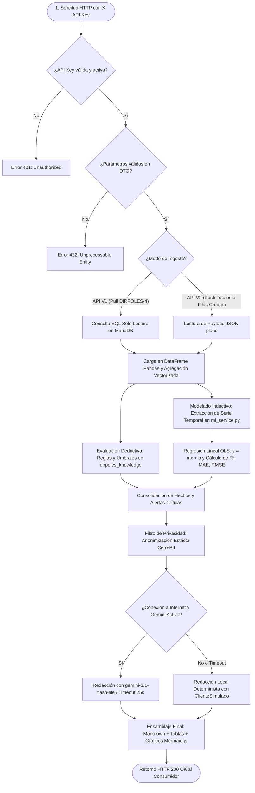
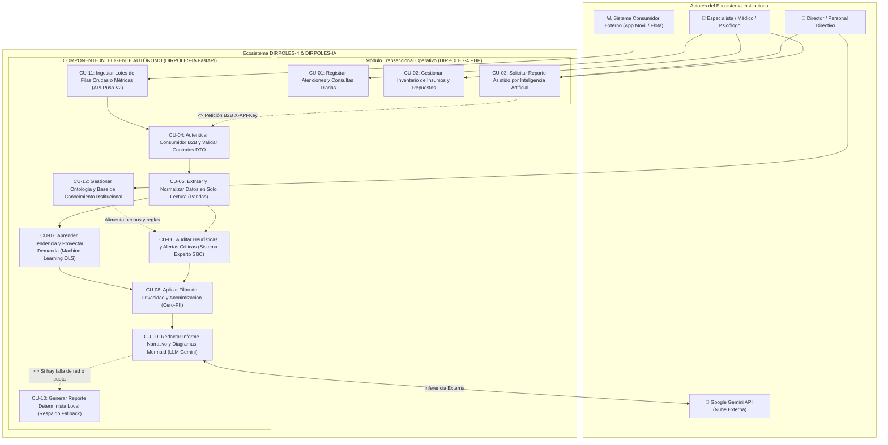
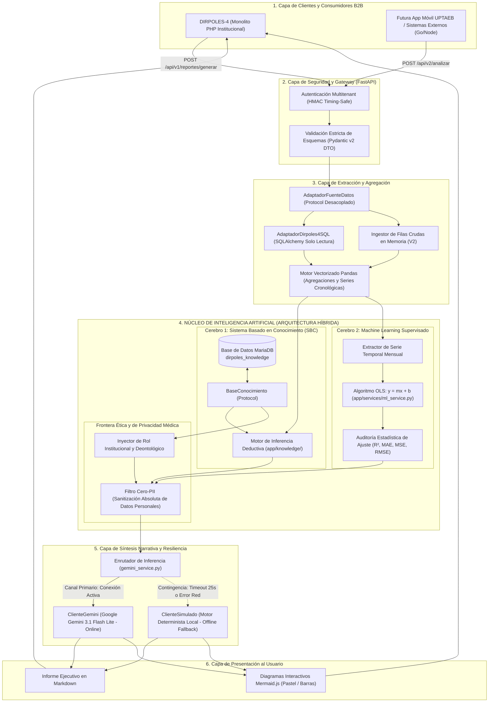
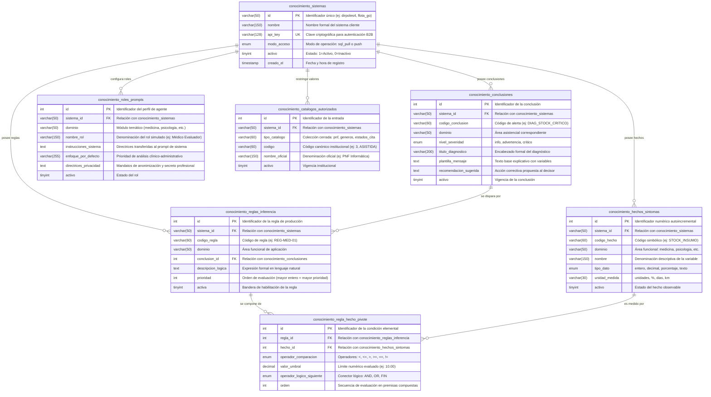

# ADENDA OFICIAL DE ACTUALIZACIÓN Y ANEXOS: FASE II (DIRPOLES-IA)

> **Documento Fuente para NotebookLM y Material de Sustentación para Impresión**  
> **Proyecto:** Sistema DIRPOLES-4 & Microservicio Autónomo DIRPOLES-IA  
> **Institución:** Universidad Politécnica Territorial de Lara Andrés Eloy Blanco (UPTAEB)  
> **Unidad Curricular:** Proyecto Socio-Tecnológico IV (PST IV) — Ingeniería en Informática  
> **Versión del Sistema:** 2.1.0 (Arquitectura Híbrida Tripartita y Desacoplada)  
> **Fecha:** Noviembre 2026  

---

## 📌 GUÍA DE USO PARA NOTEBOOKLM

Si estás utilizando **Gemini NotebookLM** para regenerar el informe de 20 páginas de la Fase II:
1. Agrega este archivo como **Fuente complementaria** junto con el documento base `FASE_II_SEGUNDO_AVANCE_IA.md`.
2. Utiliza el siguiente **Prompt en el chat de NotebookLM**:
   > *"Genera el informe técnico-académico formal de 20 páginas para la entrega de la Fase II de DIRPOLES-IA. Toma como base el documento FASE_II_SEGUNDO_AVANCE_IA.md pero incorpora OBLIGATORIAMENTE todas las actualizaciones, fórmulas matemáticas, diagramas y tablas especificadas en la ADENDA OFICIAL (la arquitectura híbrida de tres cerebros que incluye Machine Learning Supervisado OLS, las fórmulas de R², MAE y RMSE, la ingesta de registros crudos en la API V2, los 137 tests unitarios pasados, el modelo gemini-3.1-flash-lite con timeout de 25s, el diagrama de casos de uso general del sistema, el diagrama de arquitectura del componente inteligente y el modelo relacional de las 7 tablas de dirpoles_knowledge)."*

---

# PARTE 1: MODIFICACIONES Y AGREGADOS TÉCNICOS AL INFORME BASE

Las siguientes secciones reemplazan o amplían los apartados correspondientes del borrador anterior del 29 de octubre:

### 1.1. Actualización de la Definición del Sistema: Arquitectura Híbrida de Tres Cerebros
*(Sustituye la Sección 1.1 del informe anterior, pasando de 2 a 3 paradigmas integrados)*

El microservicio `DIRPOLES-IA` implementa una **Inteligencia Artificial Híbrida Tripartita** que integra tres paradigmas complementarios y coordinados en memoria RAM:

```
                               ┌────────────────────────────────────────────────────────┐
                               │     ARQUITECTURA DE IA TRIPARTITA (DIRPOLES-IA)        │
                               └───────────────────────────┬────────────────────────────┘
                                                           │
          ┌────────────────────────────────────────────────┼────────────────────────────────────────────────┐
          ▼                                                ▼                                                ▼
┌───────────────────────────────────┐    ┌───────────────────────────────────┐    ┌───────────────────────────────────┐
│ 1. SISTEMA BASADO EN CONOCIMIENTO │    │  2. MACHINE LEARNING SUPERVISADO  │    │  3. GENERADOR NARRATIVO Y XAI     │
│       (Enfoque Simbólico)         │    │      (Enfoque Estadístico)        │    │    (Enfoque Conexionista / LLM)   │
├───────────────────────────────────┤    ├───────────────────────────────────┤    ├───────────────────────────────────┤
│ • Base de Conocimiento Relacional │    │ • Regresión Lineal OLS en NumPy   │    │ • Google Gemini (3.1 Flash Lite)  │
│   (7 tablas en dirpoles_knowledge)│    │ • Serie temporal mensual (t+1)    │    │ • Respaldo Local (ClienteSimulado)│
│ • Deducción lógica (Si-Entonces)  │    │ • Inducción de tendencia (m, b)   │    │ • Redacción ejecutiva profesional │
│ • Alertas críticas: Stock < 10,   │    │ • Métricas de auditoría:          │    │ • Tablas comparativas y gráficos  │
│   repuestos < 5, ausentismo > 25% │    │   R², MAE, MSE y RMSE             │    │   interactivos en Mermaid.js      │
│ • Cero alucinaciones normativas   │    │ • Resiliencia en series cortas    │    │ • Filtro ético Cero-PII           │
└───────────────────────────────────┘    └───────────────────────────────────┘    └───────────────────────────────────┘
```

1. **Sistema Basado en Conocimiento (SBC / Sistema Experto Simbólico):**  
   Evalúa hechos numéricos y audita reglas de negocio institucionales mediante razonamiento deductivo formal. Garantiza certeza matemática absoluta en inventarios críticos y alertas asistenciales.
2. **Motor de Machine Learning Supervisado para Series Temporales (Regresión Lineal OLS):**  
   Aprende inductivamente de la secuencia cronológica histórica de atenciones mensuales mediante optimización matemática en NumPy (`app/services/ml_service.py`). Estima la tasa de cambio ($m$) y proyecta el volumen de consultas e insumos para el periodo futuro inmediato ($t+1$).
3. **Modelo Generativo de Lenguaje (LLM) con Respaldo Determinista Local:**  
   Transforma el contexto estadístico y las proyecciones en un informe directivo formal con gráficos Mermaid.js. Conecta con `gemini-3.1-flash-lite` y cuenta con conmutación automática al motor determinista `ClienteSimulado` ante caídas de internet o saturación de cuota (garantía de disponibilidad del 100%).

---

### 1.2. Especificación Matemática del Motor Predictivo (Machine Learning)
*(Agregar a la Sección 1.1 bajo la Formulación Matemática Operativa)*

El aprendizaje inductivo sobre series temporales mensuales se modela mediante el algoritmo de **Mínimos Cuadrados Ordinarios (OLS - *Ordinary Least Squares*)**:

#### a) Ecuación de la Recta de Regresión Aprendida
$$y = m \cdot x + b$$
Donde:
* $x \in \{1, 2, \dots, n\}$: Periodo cronológico mensual (variable independiente temporal).
* $y$: Volumen real de atenciones registradas en el mes $x$ (variable dependiente observada).
* $m$ (**Pendiente o Tasa de Cambio**): Parámetro aprendido que cuantifica la aceleración de la demanda.
  * Si $m > 0.05$: Tendencia **Creciente** (la demanda se incrementa en aproximadamente $m$ pacientes/mes).
  * Si $m < -0.05$: Tendencia **Decreciente** (la demanda disminuye).
  * Si $-0.05 \le m \le 0.05$: Tendencia **Estable / Constante**.
* $b$ (**Intercepto**): Nivel base de atenciones.

Fórmulas vectorizadas de estimación de parámetros aprendidos:
$$m = \frac{\sum_{i=1}^{n} (x_i - \bar{x})(y_i - \bar{y})}{\sum_{i=1}^{n} (x_i - \bar{x})^2}, \quad b = \bar{y} - m\bar{x}$$

#### b) Proyección para el Periodo Inmediato Siguiente ($t+1$)
$$\hat{y}_{n+1} = \max\Big(0, \; \text{round}\big(m(n+1) + b\big)\Big)$$

#### c) Métricas Estadísticas de Bondad de Ajuste y Auditoría del Modelo
Para evitar aceptar proyecciones a ciegas, el sistema evalúa su propio ajuste con cuatro métricas matemáticas:

1. **Coeficiente de Determinación ($R^2$):**  
   Mide la proporción de la varianza histórica explicada por el modelo temporal ($0.0 \le R^2 \le 1.0$).
   $$R^2 = 1 - \frac{\sum_{i=1}^{n} (y_i - \hat{y}_i)^2}{\sum_{i=1}^{n} (y_i - \bar{y})^2}$$
   * Si $R^2 \ge 0.70$: Proyección con **alta confiabilidad estadística**.
   * Si $R^2 < 0.40$: Demanda con alta volatilidad o dispersión errática.

2. **Error Absoluto Medio (MAE - *Mean Absolute Error*):**  
   Promedio aritmético de la discrepancia en unidades reales (número exacto de atenciones).
   $$\text{MAE} = \frac{1}{n} \sum_{i=1}^{n} |y_i - \hat{y}_i|$$
   *Indica el margen de error promedio esperado: $\pm \text{MAE}$ pacientes.*

3. **Error Cuadrático Medio (MSE) y Raíz del Error Cuadrático Medio (RMSE):**  
   Penaliza con severidad los picos atípicos o brotes estacionales y expresa la desviación estándar de los residuos en la misma escala de medición:
   $$\text{MSE} = \frac{1}{n} \sum_{i=1}^{n} (y_i - \hat{y}_i)^2, \quad \text{RMSE} = \sqrt{\text{MSE}}$$

#### d) Justificación Académica: Parsimonia y Prevención de Sobreajuste
* **Principio de Parsimonia (Navaja de Ockham):** Frente a series institucionales de entre 12 y 36 meses, el uso de redes neuronales profundas (LSTM, Transformers) provocaría **sobreajuste (*overfitting*)**, memorizando el ruido. OLS garantiza una solución óptima global, determinista, explicable (XAI) y con un tiempo de cómputo inferior a **2 milisegundos en CPU**.

---

### 1.3. Actualización del Diagrama de Flujo y Pseudocódigo
*(Reemplaza la Sección 1.2 del informe previo)*



#### Pseudocódigo del Algoritmo Principal Actualizado
```python
ALGORITMO GenerarReporteInteligenteHibrido(cliente, modulo, filtros):
    // 1. Autenticación y Control de Acceso B2B
    SI NO ValidarApiKeyTimingSafe(filtros.api_key):
        RETORNAR ExcepcionHTTP(401, "Credencial B2B inválida")

    // 2. Extracción o Ingesta Desacoplada
    SI cliente == "dirpoles4":
        df = AdaptadorSQLReadOnly.extraer_dataframe(modulo, filtros)
    SINO:
        df = IngestarFilasCrudasOAgregadas(filtros.payload_json)

    // 3. Cerebro 1: Deducción Simbólica (Sistema Experto)
    alertas_disparadas = []
    reglas = CargarReglasDesdeBaseConocimiento(modulo)
    PARA CADA regla EN reglas:
        valor_medido = df.calcular_hecho(regla.metrica)
        SI EvaluarOperador(valor_medido, regla.operador, regla.umbral):
            alertas_disparadas.agregar(regla.construir_mensaje(valor_medido))

    // 4. Cerebro 2: Aprendizaje Automático Supervisado (Machine Learning)
    serie_temporal = df.agrupar_por_mes_cronologico()
    SI longitud(serie_temporal) >= 3:
        modelo_ols = EntrenarRegresionLinealOLS(serie_temporal)
        proyeccion = {
            "pronostico_t1": modelo_ols.predecir(periodo_futuro),
            "tendencia": modelo_ols.tendencia,
            "r2": modelo_ols.r_cuadrado,
            "mae": modelo_ols.error_absoluto_medio,
            "rmse": modelo_ols.raiz_error_cuadratico
        }
    SINO:
        proyeccion = {"estado": "insuficiente", "mensaje": "Histórico menor a 3 periodos"}

    // 5. Filtro de Seguridad Cero-PII (Anonimización Total)
    contexto_seguro = AnonimizarEstrictamente(
        totales=df.totales(),
        distribuciones=df.distribuciones_pnf_genero(),
        alertas=alertas_disparadas,
        prediccion_ml=proyeccion
    ) // Se descartan cédulas, nombres, apellidos y expedientes médicos

    // 6. Cerebro 3: Síntesis Narrativa con Resiliencia (LLM / Fallback)
    INTENTAR:
        informe = InferenciaGemini(contexto_seguro, modelo="gemini-3.1-flash-lite", timeout_ms=25000)
    EXCEPTO (FallaRed, Timeout, ErrorCuota):
        informe = GenerarConClienteSimuladoLocal(contexto_seguro)

    RETORNAR RespuestaJSON(200, markdown=informe.texto, graficos=informe.mermaid)
FIN ALGORITMO
```

---

### 1.4. Ingesta Universal de Registros Crudos en la API V2
*(Actualizar la Sección 3.1 del informe previo)*

El endpoint `POST /api/v2/analizar` fue extendido para soportar dos modalidades de ingesta push en formato JSON:
1. **Modalidad Métrica Agregada:** Recepción directa de diccionarios de totales y distribuciones previamente consolidadas.
2. **Modalidad Registros Crudos (`registros_crudos`):** Recepción de un array de objetos JSON planos (filas de atenciones de cualquier aplicación móvil o sistema institucional). El microservicio utiliza Pandas en memoria para detectar automáticamente las columnas temporales, normalizar categorías, derivar la serie temporal mensual y entrenar el modelo de Machine Learning sin intervención de una base de datos relacional.

---

### 1.5. Humanización del Informe y Eliminación de Sintaxis LaTeX
*(Actualizar Secciones 4.1 y 4.3 del informe previo)*

Para garantizar la **Explicabilidad (XAI)** ante médicos y directivos universitarios no familiarizados con formulaciones matemáticas:
* Se rediseñaron las directrices de `prompt_service.py` y las plantillas de `ClienteSimulado`.
* Se eliminaron los delimitadores de sintaxis cruda de LaTeX (`$R^2$`, `$MAE$`, `$RMSE$`) que provocaban distorsiones visuales en el navegador.
* Se tradujeron a etiquetas ejecutivas intuitivas:
  * De `$R^2$` a: **Confiabilidad del Ajuste ($R^2$): 0.85 (Alta)**.
  * De `$MAE$` a: **Margen de Error Promedio (MAE): $\pm 2.0$ casos esperados**.
  * De `$RMSE$` a: **Desviación Cuadrática Típica (RMSE)**.
  * De tendencia $m$ a: **Tendencia Creciente (+3 pacientes/mes)**.

---

### 1.6. Actualización del Stack Tecnológico y Configuración de Conectividad
*(Actualizar Sección 6.1 del informe previo)*

* **NumPy 1.26+ / 2.0+:** Integrado formalmente al stack para cálculos matriciales vectorizados, sumatorias de residuos y regresión OLS en menos de 2 ms.
* **Google Gemini 3.1 Flash Lite (`gemini-3.1-flash-lite`):** Modelo oficial de inferencia semántica rápida seleccionado en el nuevo SDK `google-genai`.
* **Corrección de Timeout (25.000 ms):** En `HttpOptions`, el parámetro de espera se reconfiguró de `15.0` (interpretado por la librería como 15 milisegundos, provocando `[Errno 101] Network is unreachable`) a `timeout=25000` (25 segundos reales), garantizando estabilidad total en la conexión de red.

---

### 1.7. Métricas de Pruebas Unitarias Actualizadas (137 Tests OK)
*(Actualizar Sección 5.2 y 5.3 del informe previo)*

* **Total de Pruebas Unitarias:** **137 / 137 pasadas con éxito (100% de efectividad)** tras incorporar la suite [tests/test_ml_service.py](file:///home/mroberth/Proyectos/DIRPOLES-IA/tests/test_ml_service.py).
* **Nuevos Casos de Prueba en la Matriz de Resiliencia:**
  * **CP-07 (Proyección Predictiva de Serie Histórica):** Evaluación de serie mensual normal $\rightarrow$ Proyección exitosa de $t+1$, cálculo de pendiente y $R^2 \ge 0.80$ (Aprobado).
  * **CP-08 (Resiliencia ante Series Temporales Cortas):** Ingesta de serie menor a 3 periodos $\rightarrow$ Emisión de aviso por histórico insuficiente sin caída del servicio (Aprobado).
  * **CP-09 (Ingesta Push V2 de Filas Crudas):** Envío de array JSON `registros_crudos` a `/api/v2/analizar` $\rightarrow$ Autoagrupación y pronóstico ML correcto sin base de datos relacional (Aprobado).

---

# PARTE 2: ANEXOS PARA LLEVAR IMPRESOS (REQUERIMIENTO DEL PROFESOR)

A continuación se presentan los tres elementos solicitados de forma explícita por el docente para la entrega física de hoy:

---

## 📄 ANEXO IMPRESO 1: DIAGRAMA GENERAL DE CASOS DE USO DEL SISTEMA (Con Evidencia del Componente Inteligente)

### Diagrama UML de Casos de Uso del Ecosistema



### Matriz Descriptiva de Casos de Uso del Componente Inteligente

| Caso de Uso | Actor / Disparador | Componente de IA Responsable | Técnica Aplicada y Comportamiento |
| :--- | :--- | :--- | :--- |
| **CU-06: Auditar Heurísticas y Alertas** | Monolito DIRPOLES-4 | Sistema Basado en Conocimiento (SBC) | **Inferencia Simbólica Deductiva:** Compara hechos contra umbrales en `dirpoles_knowledge` (ej: Stock $<10$, Inasistencia $>25\%$). |
| **CU-07: Proyectar Demanda Futura** | Monolito / API V2 | Motor de Machine Learning (`ml_service.py`) | **Aprendizaje Estadístico Inductivo:** Regresión OLS ($y=mx+b$) sobre series mensuales, proyectando mes $t+1$ con $R^2$, MAE, RMSE. |
| **CU-08: Anonimización Cero-PII** | Pipeline Interno | Filtro de Seguridad (`prompt_service.py`) | **Privacidad Médica Determinista:** Descarte absoluto de cédulas, nombres y diagnósticos personales antes del LLM. |
| **CU-09: Redactar Informe y Gráficos** | Pipeline Interno | IA Generativa (`gemini-3.1-flash-lite`) | **Inferencia Semántica:** Transforma métricas en informe Markdown con directrices profesionales y diagramas Mermaid.js. |
| **CU-10: Reporte Local Fallback** | Conmutación por fallo | Motor Determinista (`ClienteSimulado`) | **Alta Disponibilidad:** Genera localmente el informe en caso de desconexión o latencia excesiva. |
| **CU-11: Ingesta Universal V2** | Apps Móviles / Externos | Pipeline Push V2 (`analisis_v2_service.py`) | **Autoagrupación en Memoria:** Procesa registros crudos sin base de datos SQL conectada. |

---

## 📄 ANEXO IMPRESO 2: DIAGRAMA DE ARQUITECTURA DEL COMPONENTE INTELIGENTE (Evidenciando los Tres Cerebros)

### Diagrama Arquitectónico por Capas de DIRPOLES-IA



---

## 📄 ANEXO IMPRESO 3: TABLAS QUE CONFORMAN LA BASE DE CONOCIMIENTO RELACIONADA (`dirpoles_knowledge`)

### Diagrama Entidad-Relación (DER) de la Base de Conocimiento



### Diccionario y Catálogo de las 7 Tablas Relacionales

| N° | Nombre de Tabla Relacional | Entidad en el Sistema Experto | Claves Primarias y Foráneas (FK) | Propósito Funcional en el Microservicio |
| :-: | :--- | :--- | :--- | :--- |
| **1** | `conocimiento_sistemas` | Tenants / Sistemas Clientes | **PK:** `id` | Registra las aplicaciones autorizadas a consumir la IA (`dirpoles4`, clientes externos) y almacena sus API Keys. |
| **2** | `conocimiento_hechos_sintomas` | Hechos Observables | **PK:** `id`<br>**FK:** `sistema_id` $\to$ `conocimiento_sistemas.id` | Catálogo de variables clínicas y operativas que Pandas puede medir (stock de insumos, tasas de ausentismo, kilómetros). |
| **3** | `conocimiento_conclusiones` | Conclusiones y Diagnósticos | **PK:** `id`<br>**FK:** `sistema_id` $\to$ `conocimiento_sistemas.id` | Dictámenes formales, niveles de criticidad (*info, advertencia, crítico*) y recomendaciones de acción para la directiva. |
| **4** | `conocimiento_reglas_inferencia` | Reglas de Producción | **PK:** `id`<br>**FK:** `sistema_id` $\to$ `conocimiento_sistemas.id`<br>**FK:** `conclusion_id` $\to$ `conocimiento_conclusiones.id` | Estructura formal que vincula premisas con una conclusión específica. Define prioridad y descripción de la regla. |
| **5** | `conocimiento_regla_hecho_pivote` | Tabla Intermedia / Pivote de Umbrales | **PK:** `id`<br>**FK:** `regla_id` $\to$ `conocimiento_reglas_inferencia.id`<br>**FK:** `hecho_id` $\to$ `conocimiento_hechos_sintomas.id` | Permite construir condiciones compuestas (`IF hecho_1 < 10 AND hecho_2 == 0`). Almacena el operador (`<, >, <=`) y el umbral numérico. |
| **6** | `conocimiento_roles_prompts` | Perfiles de Agentes Inteligentes | **PK:** `id`<br>**FK:** `sistema_id` $\to$ `conocimiento_sistemas.id` | Directrices de comportamiento inyectadas al LLM según el área médica consultada, garantizando un tono profesional y ético. |
| **7** | `conocimiento_catalogos_autorizados` | Ontología Cerrada Institucional | **PK:** `id`<br>**FK:** `sistema_id` $\to$ `conocimiento_sistemas.id` | Nomenclatura oficial de la UPTAEB (carreras PNF, estados de cita). Evita alucinaciones semánticas en el modelo generativo. |

---

### Justificación de Ingeniería de Software para la Defensa Oral

1. **Mantenibilidad sin Tocar Código:** Si la directiva de la UPTAEB decide elevar el umbral de stock crítico de medicamentos de 10 a 15 unidades, únicamente se modifica el campo `valor_umbral` en la tabla `conocimiento_regla_hecho_pivote`. No se modifica ni una sola línea de código Python ni se reinicia el servidor.
2. **Aislamiento Multitenant Institucional:** La columna `sistema_id` presente en todas las tablas permite que un solo microservicio gestione reglas diferenciadas para DIRPOLES-4, para la flota de transporte o para los comedores sin mezclar sus ontologías.
3. **Explicabilidad y Auditoría (XAI):** Cada alerta en el informe final incluye la referencia a su regla activada (`codigo_regla`), demostrando que el diagnóstico de la IA no es una caja negra arbitraria, sino un dictamen legal y normativo verificable.
