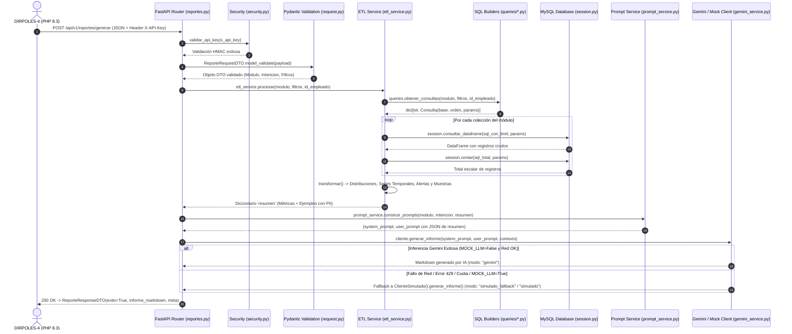
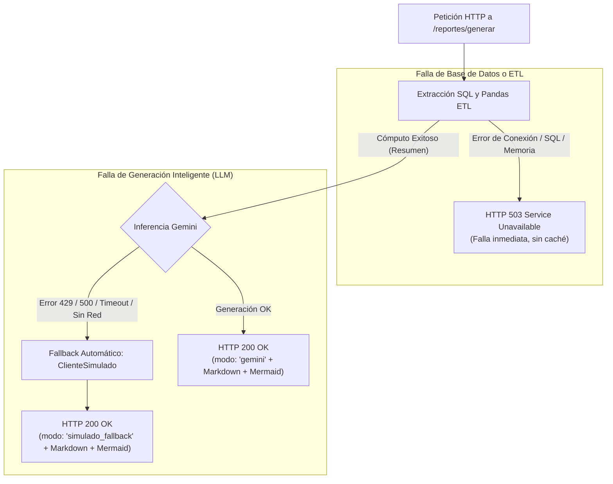
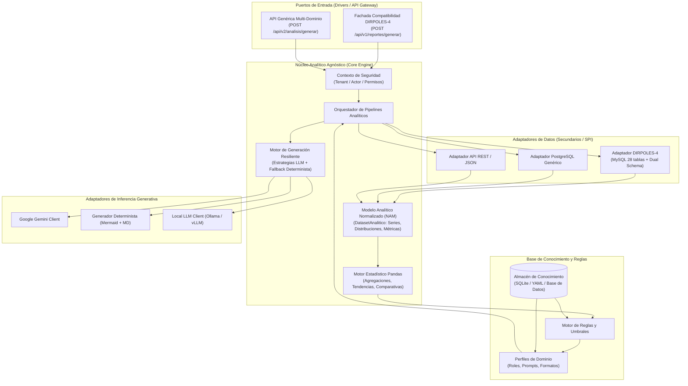
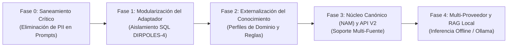

# INFORME DE AUDITORÍA TÉCNICA Y PLAN DIRECTOR DE EVOLUCIÓN: DIRPOLES-IA

> **Documento:** Auditoría Exhaustiva de Implementación y Arquitectura Objetivo  
> **Repositorio:** `DIRPOLES-IA` | **Versión Inspeccionada:** 1.0.0  
> **Fecha de Auditoría:** 25 de octubre de 2026  
> **Auditor Técnico:** Antigravity (Auditor de Sistemas de Inteligencia Artificial y Arquitectura de Software)  
> **Estado de Git:** Rama `main` limpia (`tree clean`, sin commits divergentes ni cambios locales sin confirmar)  
> **Entorno de Ejecución:** Linux (Fedora), Python 3.14 / `.venv` (especificación en `pyproject.toml`: `>=3.12`)

---

## ÍNDICE GENERAL

* [PARTE I: DIAGNÓSTICO INTEGRAL Y FLUJO REAL DE EJECUCIÓN](#parte-i-diagnóstico-integral-y-flujo-real-de-ejecución)
  * [1.1 Resumen Ejecutivo del Estado del Sistema](#11-resumen-ejecutivo-del-estado-del-sistema)
  * [1.2 Inventario de Componentes y Puntos de Entrada](#12-inventario-de-componentes-y-puntos-de-entrada)
  * [1.3 Trazabilidad End-to-End de una Petición](#13-trazabilidad-end-to-end-de-una-petición)
* [PARTE II: MAPA DE ACOPLAMIENTO, BASE DE CONOCIMIENTO Y DISCREPANCIAS](#parte-ii-mapa-de-acoplamiento-base-de-conocimiento-y-discrepancias)
  * [2.1 Matriz de Acoplamientos (DIRPOLES-4 vs. Núcleo Agnóstico)](#21-matriz-de-acoplamientos-dirpoles-4-vs-núcleo-agnóstico)
  * [2.2 Análisis Técnico de la "Base de Conocimiento"](#22-análisis-técnico-de-la-base-de-conocimiento)
  * [2.3 Matriz de Diferencias entre Documentación e Implementación](#23-matriz-de-diferencias-entre-documentación-e-implementación)
* [PARTE III: EVALUACIÓN DE SEGURIDAD, PRIVACIDAD, RESILIENCIA Y CALIDAD](#parte-iii-evaluación-de-seguridad-privacidad-resiliencia-y-calidad)
  * [3.1 Hallazgos Priorizados de Seguridad y Privacidad](#31-hallazgos-priorizados-de-seguridad-y-privacidad)
  * [3.2 Resiliencia y Comportamiento ante Fallos](#32-resiliencia-y-comportamiento-ante-fallos)
  * [3.3 Auditoría de la Suite de Pruebas y Cobertura](#33-auditoría-de-la-suite-de-pruebas-y-cobertura)
  * [3.4 Incertidumbres Operativas no Verificables desde el Repositorio](#34-incertidumbres-operativas-no-verificables-desde-el-repositorio)
* [PARTE IV: ARQUITECTURA OBJETIVO Y PLAN DIRECTOR DE MIGRACIÓN](#parte-iv-arquitectura-objetivo-y-plan-director-de-migración)
  * [4.1 Arquitectura Objetivo: Puertos y Adaptadores (Hexagonal)](#41-arquitectura-objetivo-puertos-y-adaptadores-hexagonal)
  * [4.2 Modelo Analítico Normalizado (NAM) y Perfiles de Dominio](#42-modelo-analítico-normalizado-nam-y-perfiles-de-dominio)
  * [4.3 Plan Director de Migración Incremental (Fases 0 a 4)](#43-plan-director-de-migración-incremental-fases-0-a-4)
  * [4.4 Salvaguardas de Compatibilidad para DIRPOLES-4](#44-salvaguardas-de-compatibilidad-para-dirpoles-4)

---

# PARTE I: DIAGNÓSTICO INTEGRAL Y FLUJO REAL DE EJECUCIÓN

### 1.1 Resumen Ejecutivo del Estado del Sistema

El microservicio `DIRPOLES-IA` opera actualmente como un **satélite analítico altamente especializado y firmemente acoplado** al sistema de bienestar estudiantil **DIRPOLES-4** (UPTAEB). Su diseño actual no es el de un motor analítico reutilizable o agnóstico, sino el de un procesador procedural de reportes para 10 módulos fijos de una institución universitaria concreta.

#### Capacidades Operativas Confirmadas:
1. **Pipeline Funcional B2B:** Atiende solicitudes internas mediante `POST /api/v1/reportes/generar` utilizando autenticación por cabecera HTTP `X-API-Key` calculada con algoritmos resistentes a ataques de temporización (`hmac.compare_digest`).
2. **Resiliencia Determinista de Alto Nivel:** Dispone de un generador local (`ClienteSimulado`) que intercepta cualquier fallo del proveedor externo (Google Gemini), entregando informes en Markdown con diagramas Mermaid sintácticamente válidos sin propagar códigos de error HTTP 500 al cliente PHP.
3. **Optimización de Memoria en Extracción:** Todas las consultas SQL implementan límites estrictos parametrizados (`LIMIT :limit`) validados por Pydantic (rango de 1 a 20.000 registros), previniendo saturación de memoria por DataFrames masivos.

#### Riesgos y Deudas Estructurales Mayores:
1. **Fuga Crítica de Datos Personales Identificables (PII) y Clínicos:** El servicio extrae y transmite a los servidores de Google Gemini nombres, apellidos, diagnósticos médicos y descripciones de casos de beneficiarios en la clave `"ejemplos"` del prompt, vulnerando la privacidad de datos y contradiciendo la regla constitucional de cero fuga de PII estipulada en `AGENTS.md`.
2. **Inexistencia de Base de Conocimiento Propia:** No hay modelos ORM, migraciones (Alembic), tablas relacionales ni almacenes vectoriales. Todo el conocimiento (roles de IA, umbrales de alerta y reglas de negocio) está disperso en cadenas de texto hardcodeadas dentro del código fuente de Python.
3. **Ausencia de Herramientas de Desarrollo en el Entorno:** El entorno `.venv` solo tiene instaladas las dependencias de producción (`requirements.txt`); las dependencias de testing y linters (`pytest`, `mypy`, `ruff`) no están presentes.

---

### 1.2 Inventario de Componentes y Puntos de Entrada

* **Punto de Entrada ASGI:** [`app/main.py`](file:///home/mroberth/Proyectos/DIRPOLES-IA/app/main.py) mediante `crear_app()` y la instancia global `app = crear_app()`.
* **Endpoints HTTP Expuestos:**
  * `POST /api/v1/reportes/generar` ([`app/api/v1/endpoints/reportes.py:30`](file:///home/mroberth/Proyectos/DIRPOLES-IA/app/api/v1/endpoints/reportes.py#L30)): Generación de informes analíticos (requiere `X-API-Key`).
  * `GET /api/v1/reportes/catalogos` ([`app/api/v1/endpoints/reportes.py:87`](file:///home/mroberth/Proyectos/DIRPOLES-IA/app/api/v1/endpoints/reportes.py#L87)): Lista de enumeraciones válidas (requiere `X-API-Key`).
  * `GET /api/v1/salud` ([`app/main.py:39`](file:///home/mroberth/Proyectos/DIRPOLES-IA/app/main.py#L39)): Health check del microservicio, estado de conexión a MySQL y modo del LLM (público).
* **Gestión de Configuración:** [`app/core/config.py`](file:///home/mroberth/Proyectos/DIRPOLES-IA/app/core/config.py) mediante la clase `Ajustes(BaseSettings)`, cacheada con `@lru_cache` en `obtener_ajustes()`.
* **Seguridad B2B:** [`app/core/security.py`](file:///home/mroberth/Proyectos/DIRPOLES-IA/app/core/security.py) con la dependencia `validar_api_key`.
* **Conexión a Base de Datos:** [`app/db/session.py`](file:///home/mroberth/Proyectos/DIRPOLES-IA/app/db/session.py) con SQLAlchemy Engine singleton (`pool_pre_ping=True`, `pool_recycle=1800`) y ejecución directa con PyMySQL.
* **Módulos de Consulta SQL:** 10 constructores en [`app/db/queries/`](file:///home/mroberth/Proyectos/DIRPOLES-IA/app/db/queries/) despachados por [`app/db/queries/__init__.py`](file:///home/mroberth/Proyectos/DIRPOLES-IA/app/db/queries/__init__.py).
* **Transformación Analítica (ETL):** [`app/services/etl_service.py`](file:///home/mroberth/Proyectos/DIRPOLES-IA/app/services/etl_service.py) con 10 funciones de transformación (`_transformar_{modulo}`) y agregaciones vectorizadas en Pandas.
* **Orquestación de Prompts:** [`app/services/prompt_service.py`](file:///home/mroberth/Proyectos/DIRPOLES-IA/app/services/prompt_service.py).
* **Capa de Inferencia LLM:** [`app/services/gemini_service.py`](file:///home/mroberth/Proyectos/DIRPOLES-IA/app/services/gemini_service.py) con el protocolo `ClienteIA`, `ClienteGemini` y `ClienteSimulado`.
* **Scripts Operativos de Shell:** `iniciar.sh`, `detener.sh`, `estado.sh`, `logs.sh` (gestión de Uvicorn desacoplado en segundo plano con PID).

---

### 1.3 Trazabilidad End-to-End de una Petición

El recorrido técnico de una solicitud `POST /api/v1/reportes/generar` se ilustra en el siguiente diagrama de secuencia Mermaid:



#### Detalle de Ejecución por Etapa:
1. **Autenticación B2B:** [`app/core/security.py:9-17`](file:///home/mroberth/Proyectos/DIRPOLES-IA/app/core/security.py#L9-L17) intercepta `X-API-Key` y la evalúa contra `obtener_ajustes().dirpoles_ia_api_key`.
2. **Validación de Esquema:** [`app/schemas/request.py:57-73`](file:///home/mroberth/Proyectos/DIRPOLES-IA/app/schemas/request.py#L57-L73) valida consistencia de fechas (`fecha_inicio <= fecha_fin`) y pertenencia de estados a los catálogos autorizados según el módulo (`ESTADOS_CONCATABLES`).
3. **Construcción y Despacho SQL:** [`app/services/etl_service.py:21-35`](file:///home/mroberth/Proyectos/DIRPOLES-IA/app/services/etl_service.py#L21-L35) obtiene las consultas parametrizadas de [`app/db/queries/__init__.py:35-41`](file:///home/mroberth/Proyectos/DIRPOLES-IA/app/db/queries/__init__.py#L35-L41).
4. **Ejecución y Extracción a Pandas:** [`app/db/session.py:29-45`](file:///home/mroberth/Proyectos/DIRPOLES-IA/app/db/session.py#L29-L45) conecta vía SQLAlchemy/PyMySQL, ejecutando las consultas con `LIMIT :limit` y cargando los resultados en DataFrames en memoria.
5. **Cómputo Analítico:** [`app/services/etl_service.py:623-640`](file:///home/mroberth/Proyectos/DIRPOLES-IA/app/services/etl_service.py#L623-L640) calcula frecuencias relativas, series mensuales, comparativas mes a mes, alertas de inventario y extrae 5 registros de muestra mediante `_muestra()`.
6. **Inyección de Prompts:** [`app/services/prompt_service.py:127-136`](file:///home/mroberth/Proyectos/DIRPOLES-IA/app/services/prompt_service.py#L127-L136) inyecta el rol del analista en el System Prompt y serializa todo el resumen (incluyendo las muestras individuales) en el User Prompt.
7. **Inferencia y Fallback:** [`app/api/v1/endpoints/reportes.py:63-72`](file:///home/mroberth/Proyectos/DIRPOLES-IA/app/api/v1/endpoints/reportes.py#L63-L72) invoca a `ClienteGemini`. Si se produce una excepción, conmuta en tiempo de ejecución a `ClienteSimulado()`.
8. **Respuesta Estructurada:** Retorna `ReporteResponseDTO` con tiempo de procesamiento, modo de informe y contenido Markdown renderizable.

---

# PARTE II: MAPA DE ACOPLAMIENTO, BASE DE CONOCIMIENTO Y DISCREPANCIAS

### 2.1 Matriz de Acoplamientos (DIRPOLES-4 vs. Núcleo Agnóstico)

| Componente / Dependencia | Ubicación en el Código | Clasificación del Acoplamiento | Impacto para la Reutilización | Estrategia de Desacoplamiento Futura |
| :--- | :--- | :--- | :--- | :--- |
| **Esquema Relacional MySQL (28 tablas)** | [`app/db/queries/*.py`](file:///home/mroberth/Proyectos/DIRPOLES-IA/app/db/queries/) | **DIRPOLES-4 Específico** | Crítico: Bloquea cualquier fuente que no sea la BD MySQL de DIRPOLES-4. | Encapsular en `DIRPOLES4SQLAdapter` bajo interfaz genérica `IDataSourceAdapter`. |
| **Esquema de Seguridad (`{seguridad}.empleado`)** | [`psicologia_queries.py:52`](file:///home/mroberth/Proyectos/DIRPOLES-IA/app/db/queries/psicologia_queries.py#L52), [`transporte_queries.py:88`](file:///home/mroberth/Proyectos/DIRPOLES-IA/app/db/queries/transporte_queries.py#L88) | **DIRPOLES-4 Específico** | Alto: Asume partición dual fija (`dirpoles_business` y `dirpoles_security`). | Delegar la resolución de personal al adaptador o federación de identidad. |
| **Catálogo de Módulos (`Modulo`)** | [`app/schemas/enums.py:4-15`](file:///home/mroberth/Proyectos/DIRPOLES-IA/app/schemas/enums.py#L4-L15) | **DIRPOLES-4 Específico** | Alto: Los 10 módulos institucionales están fijados como enum inmutable. | Reemplazar por identificador de dominio dinámico (`domain: str, dataset: str`). |
| **Catálogo de Intenciones (`Intencion`)** | [`app/schemas/enums.py:17-22`](file:///home/mroberth/Proyectos/DIRPOLES-IA/app/schemas/enums.py#L17-L22) | **Agnóstico / Reutilizable** | Bajo: `resumen_ejecutivo`, `alertas_y_anomalias`, etc. aplican a cualquier ámbito. | Promover al núcleo analítico agnóstico (Core). |
| **Filtros Especializados (`pnf`, `seccion_transporte`, etc.)** | [`app/schemas/request.py:21-37`](file:///home/mroberth/Proyectos/DIRPOLES-IA/app/schemas/request.py#L21-L37) | **DIRPOLES-4 Específico** | Alto: Campos acoplados al modelo operativo y académico de la UPTAEB. | Convertir `filtros` en un esquema dinámico o mapa de parámetros por dominio. |
| **Identidad `id_empleado` (RBAC)** | [`request.py:62`](file:///home/mroberth/Proyectos/DIRPOLES-IA/app/schemas/request.py#L62), [`_comunes.py:42-51`](file:///home/mroberth/Proyectos/DIRPOLES-IA/app/db/queries/_comunes.py#L42-L51) | **DIRPOLES-4 Específico** | Medio: Asume identificador entero de la sesión PHP del monolito. | Abstraer en un contexto de autorización genérico (`ActorContext` con tenants/roles). |
| **Roles de Inferencia Institucionales** | [`prompt_service.py:6-47`](file:///home/mroberth/Proyectos/DIRPOLES-IA/app/services/prompt_service.py#L6-L47) | **UPTAEB / DIRPOLES Específico** | Alto: Prompts mencionan explícitamente "UPTAEB" y sus departamentos. | Extraer a Perfiles de Dominio almacenados en archivos YAML o BD propia. |
| **Reglas y Umbrales de Alerta Hardcodeados** | [`etl_service.py:166-606`](file:///home/mroberth/Proyectos/DIRPOLES-IA/app/services/etl_service.py#L166-L606) | **Lógica de Negocio Mixta** | Alto: Umbrales empíricos (40% área, 15% inasistencia) codificados en Python. | Extraer a un motor de reglas desacoplado configurable por dominio. |
| **Motor de Series y Distribuciones** | [`etl_service.py:42-90`](file:///home/mroberth/Proyectos/DIRPOLES-IA/app/services/etl_service.py#L42-L90) | **Agnóstico / Reutilizable** | Nulo: `_distribucion`, `_serie_mensual`, `_comparativa` operan sobre DataFrames estándar. | Promover a la biblioteca analítica central del Core. |
| **Abstracción `ClienteIA` y Fallback** | [`gemini_service.py:6-14`](file:///home/mroberth/Proyectos/DIRPOLES-IA/app/services/gemini_service.py#L6-L14) | **Agnóstico / Reutilizable** | Nulo: Strategy Pattern puro con generador determinista independiente. | Mantener intacto en el subsistema de generación. |
| **Contrato Único de Entrada/Salida** | [`request.py:57-63`](file:///home/mroberth/Proyectos/DIRPOLES-IA/app/schemas/request.py#L57-L63), [`response.py:12-17`](file:///home/mroberth/Proyectos/DIRPOLES-IA/app/schemas/response.py#L12-L17) | **DIRPOLES-4 B2B** | Medio: Requiere estructura JSON y Markdown exacta para PHP. | Mantener como Fachada V1; crear contrato V2 para nuevas integraciones. |
| **Autenticación `X-API-Key` Simétrica** | [`app/core/security.py:9-18`](file:///home/mroberth/Proyectos/DIRPOLES-IA/app/core/security.py#L9-L18) | **Infraestructura Simple** | Medio: Clave compartida única, sin soporte multi-inquilino. | Evolucionar a un gestor de credenciales con asignación de tenant. |

---

### 2.2 Análisis Técnico de la "Base de Conocimiento"

La auditoría confirma que **DIRPOLES-IA carece por completo de una base de conocimiento persistente o estructurada**:

1. **Inexistencia de Modelos ORM y Migraciones:**
   - No hay rastro de Alembic (`alembic.ini`), ni carpetas de migración.
   - No se utiliza el sistema declarativo de SQLAlchemy (`DeclarativeBase`).
   - El microservicio no crea ni gestiona ninguna tabla en base de datos.
2. **Inexistencia de Persistencia Vectorial o RAG:**
   - No existen dependencias de bases vectoriales (`chromadb`, `faiss`, `qdrant`).
   - No se generan embeddings ni existe memoria semántica para recuperar normativas o documentos institucionales.
   - No se guardan los informes generados previamente ni las métricas de consumo de tokens.
3. **Dónde Reside Realmente el "Conocimiento":**
   * **En Cadenas de Texto de Python:** Roles institucionales en [`app/services/prompt_service.py:6-47`](file:///home/mroberth/Proyectos/DIRPOLES-IA/app/services/prompt_service.py#L6-L47) (`ROLES_POR_MODULO`) y reglas de redacción en `construir_system_prompt()`.
   * **En Sentencias Condicionales de Pandas:** Reglas heurísticas de negocio empotradas en [`app/services/etl_service.py`](file:///home/mroberth/Proyectos/DIRPOLES-IA/app/services/etl_service.py) (ej. concentraciones $\ge 40\%$, inasistencias $\ge 15\%$, aforos $\ge 100\%$).
   * **En Variables de Entorno Globales:** `UMBRAL_STOCK_CRITICO_INSUMOS=10` y `UMBRAL_STOCK_CRITICO_REPUESTOS=5` en [`.env`](file:///home/mroberth/Proyectos/DIRPOLES-IA/.env.example).
   * **En Código SQL Estático:** Las relaciones de 28 tablas relacionales hardcodeadas en [`app/db/queries/`](file:///home/mroberth/Proyectos/DIRPOLES-IA/app/db/queries/).

Cualquier ajuste en la lógica de negocio, incorporación de un nuevo dominio o cambio institucional **requiere modificar el código fuente en Python, invalidando el concepto de un motor reutilizable**.

---

### 2.3 Matriz de Diferencias entre Documentación e Implementación

| Aspecto | Especificación Documentada (`AGENTS.md` / `docs/PIPELINES_IA.md`) | Realidad en Código Fuente | Impacto Técnico |
| :--- | :--- | :--- | :--- |
| **Privacidad de PII** | *"Nunca enviar datos crudos, historias clínicas, cédulas o nombres a Google Gemini"* ([`AGENTS.md §2.5`](file:///home/mroberth/Proyectos/DIRPOLES-IA/AGENTS.md#L35-L37)). | [`etl_service.py`](file:///home/mroberth/Proyectos/DIRPOLES-IA/app/services/etl_service.py) extrae e incluye nombres, apellidos y diagnósticos en `resumen["ejemplos"]`, transmitiéndolos íntegramente a Gemini ([`prompt_service.py:114`](file:///home/mroberth/Proyectos/DIRPOLES-IA/app/services/prompt_service.py#L114)). | **Crítico:** Violación de la regla constitucional del microservicio y privacidad de datos. |
| **Alerta Inasistencia (Psicología)** | *"Alerta si la inasistencia ('No asistió' + 'Cancelada') supera el 25%"* ([`PIPELINES_IA.md §2.3`](file:///home/mroberth/Proyectos/DIRPOLES-IA/docs/PIPELINES_IA.md#L112-L113)). | [`etl_service.py:292`](file:///home/mroberth/Proyectos/DIRPOLES-IA/app/services/etl_service.py#L292) solo evalúa `no_asistio` (ignora canceladas) con un umbral de $\ge 15.0\%$ (no 25%). | **Medio:** Discrepancia en la sensibilidad de las alertas clínicas. |
| **Alerta Aforo (Jornadas)** | *"Alerta si: Jornadas finalizadas con aforo inferior al 40%"* ([`PIPELINES_IA.md §2.8`](file:///home/mroberth/Proyectos/DIRPOLES-IA/docs/PIPELINES_IA.md#L182-L183)). | [`etl_service.py:486-492`](file:///home/mroberth/Proyectos/DIRPOLES-IA/app/services/etl_service.py#L486-L492) solo alerta cuando la ocupación es $\ge 100.0\%$. La alerta por bajo aforo ($< 40\%$) no existe. | **Medio:** No se detectan convocatorias fallidas o jornadas desaprovechadas. |
| **Alerta Gestación (Trabajo Social)** | *"Alerta: Casos de gestación en semanas avanzadas (>= 34 semanas)"* ([`PIPELINES_IA.md §2.6`](file:///home/mroberth/Proyectos/DIRPOLES-IA/docs/PIPELINES_IA.md#L156-L157)). | [`etl_service.py:350-353`](file:///home/mroberth/Proyectos/DIRPOLES-IA/app/services/etl_service.py#L350-L353) descarta el parámetro de alertas (`del filtros, alertas`) y genera cero alertas. | **Medio:** Pérdida de alertas de protección prioritaria a estudiantes gestantes. |
| **Alerta Referencias Pendientes** | *"Referencias que permanecen en estado Pendiente por más de 15 días o tasa rechazo > 20%"* ([`PIPELINES_IA.md §2.7`](file:///home/mroberth/Proyectos/DIRPOLES-IA/docs/PIPELINES_IA.md#L170-L171)). | [`etl_service.py:429-436`](file:///home/mroberth/Proyectos/DIRPOLES-IA/app/services/etl_service.py#L429-L436) alerta si hay cualquier referencia pendiente (`pendientes > 0`), sin evaluar antigüedad ni rechazos. | **Medio:** Falsos positivos por falta de umbral temporal. |
| **Alerta Flota (Transporte)** | *"Unidades con más de 3 mantenimientos en el periodo o sin ruta activa"* ([`PIPELINES_IA.md §2.10`](file:///home/mroberth/Proyectos/DIRPOLES-IA/docs/PIPELINES_IA.md#L218-L219)). | [`etl_service.py:569-574`](file:///home/mroberth/Proyectos/DIRPOLES-IA/app/services/etl_service.py#L569-L574) solo detecta estatus `Mantenimiento` y bajo stock de repuestos. | **Bajo:** Falta de análisis de recurrencia mecánica en autobuses. |
| **Gráficos Mermaid en Simulado** | *"DEBES INCLUIR AL MENOS UN GRÁFICO VISUAL MERMAID.JS (pie o xychart-beta)"* ([`AGENTS.md §2.7`](file:///home/mroberth/Proyectos/DIRPOLES-IA/AGENTS.md#L39-L41)). | [`gemini_service.py:122-131`](file:///home/mroberth/Proyectos/DIRPOLES-IA/app/services/gemini_service.py#L122-L131) solo genera diagramas `pie`. `xychart-beta` no está implementado en `ClienteSimulado`. | **Bajo:** Menor variedad visual en modo sin internet/fallback. |
| **Alcance Filtro `id_empleado`** | *"Recibe id_empleado ... para restringir registros por empleado"* ([`AGENTS.md §2.8`](file:///home/mroberth/Proyectos/DIRPOLES-IA/AGENTS.md#L45-L48)). | Se descarta con `del id_empleado` en Referencias, Jornadas, Mobiliario y Transporte ([`queries/*.py`](file:///home/mroberth/Proyectos/DIRPOLES-IA/app/db/queries/)). | **Alto:** Inconsistencia en la política de control de acceso basada en rol. |

---

# PARTE III: EVALUACIÓN DE SEGURIDAD, PRIVACIDAD, RESILIENCIA Y CALIDAD

### 3.1 Hallazgos Priorizados de Seguridad y Privacidad

#### 🔴 [CRÍTICO] Fuga Activa de Datos Personales Identificables (PII) e Información Clínica a la API de Google Gemini
* **Evidencia en Código:**
  La función `_muestra(df, columnas, cantidad=5)` en [`app/services/etl_service.py:137-150`](file:///home/mroberth/Proyectos/DIRPOLES-IA/app/services/etl_service.py#L137-L150) extrae 5 filas crudas por módulo con nombres, apellidos y textos clínicos, almacenándolas en `resumen["ejemplos"]`:
  - General ([L245](file:///home/mroberth/Proyectos/DIRPOLES-IA/app/services/etl_service.py#L245)): `["fecha", "nombres", "apellidos", "area", "nombre_pnf"]`
  - Medicina ([L276](file:///home/mroberth/Proyectos/DIRPOLES-IA/app/services/etl_service.py#L276)): `["fecha", "nombres", "apellidos", "motivo", "diagnostico"]`
  - Psicología ([L327](file:///home/mroberth/Proyectos/DIRPOLES-IA/app/services/etl_service.py#L327)): `["fecha", "nombres", "apellidos", "tipo_consulta", "diagnostico"]`
  - Orientación ([L346](file:///home/mroberth/Proyectos/DIRPOLES-IA/app/services/etl_service.py#L346)): `["fecha", "nombres", "apellidos", "motivo_consulta"]`
  - Trabajo Social ([L366](file:///home/mroberth/Proyectos/DIRPOLES-IA/app/services/etl_service.py#L366)): `["fecha", "submodulo", "nombres", "apellidos", "detalle_extra"]`
  - Discapacidad ([L419](file:///home/mroberth/Proyectos/DIRPOLES-IA/app/services/etl_service.py#L419)): `["fecha", "nombres", "apellidos", "tipo_discapacidad", "grado"]`
  - Referencias ([L447](file:///home/mroberth/Proyectos/DIRPOLES-IA/app/services/etl_service.py#L447)): `["fecha", "nombres_benef", "apellidos_benef", "servicio_destino", "estado", "motivo"]`

  En [`app/services/prompt_service.py:113-114`](file:///home/mroberth/Proyectos/DIRPOLES-IA/app/services/prompt_service.py#L113-L114), todo `resumen` se serializa en el prompt:
  ```python
  "DATOS PROCESADOS (Métricas, Agregaciones y Alertas detectadas por Pandas):\n"
  f"{_json_resumen(resumen)}\n\n"
  ```
  En [`app/services/gemini_service.py:34-42`](file:///home/mroberth/Proyectos/DIRPOLES-IA/app/services/gemini_service.py#L34-L42), este texto se envía a Google Gemini.
* **Impacto:** Aunque las cédulas no se incluyen en `_muestra`, los nombres reales y diagnósticos médicos/psicológicos se envían a servidores de terceros en la nube, vulnerando la privacidad de los estudiantes y el mandato de `AGENTS.md`.

---

#### 🟠 [ALTO] Omisión del Filtro de Identidad (`id_empleado`) en Cuatro Módulos de Extracción
* **Evidencia en Código:**
  En [`referencias_queries.py:12`](file:///home/mroberth/Proyectos/DIRPOLES-IA/app/db/queries/referencias_queries.py#L12), [`jornadas_queries.py:12`](file:///home/mroberth/Proyectos/DIRPOLES-IA/app/db/queries/jornadas_queries.py#L12), [`mobiliario_queries.py:12`](file:///home/mroberth/Proyectos/DIRPOLES-IA/app/db/queries/mobiliario_queries.py#L12) y [`transporte_queries.py:15`](file:///home/mroberth/Proyectos/DIRPOLES-IA/app/db/queries/transporte_queries.py#L15), el parámetro `id_empleado` se elimina con `del id_empleado`.
* **Impacto:** Si un empleado solicita informes en estos módulos con su identificador, el servicio ignora la restricción y devuelve datos globales institucionales.

---

#### 🟠 [ALTO] Inexistencia de Forzado de Solo Lectura a Nivel de Código
* **Evidencia en Código:**
  [`app/db/session.py:29-33`](file:///home/mroberth/Proyectos/DIRPOLES-IA/app/db/session.py#L29-L33) ejecuta sentencias SQL arbitrarias mediante `conexion.execute(text(sql), params or {})`. No hay análisis léxico de sentencias prohibidas (`INSERT`, `UPDATE`, `DELETE`) ni configuración de solo lectura forzada a nivel de URL de PyMySQL.
* **Impacto:** El aislamiento de solo lectura depende exclusivamente de los privilegios del usuario MySQL en el servidor de base de datos (`dirpoles_ia_reader`). Si las credenciales en `.env` corresponden a un usuario estándar, el microservicio cuenta con capacidad de escritura.

---

#### 🟡 [MEDIO] Nomenclatura no Canónica de Modelo Gemini por Defecto
* **Evidencia en Código:**
  [`app/core/config.py:29`](file:///home/mroberth/Proyectos/DIRPOLES-IA/app/core/config.py#L29) define `gemini_model: str = "gemini-3.5-flash"`.
* **Impacto:** Este modelo no existe en la API oficial de Google AI Studio. Si se proporciona una API Key válida, las llamadas remotas fallan con error 404 y el servicio conmuta silenciosamente a `simulado_fallback`.

---

#### 🔵 [BAJO] Encapsulación de Respuestas de Error HTTP 503
* **Evidencia en Código:**
  En [`app/api/v1/endpoints/reportes.py:43-50`](file:///home/mroberth/Proyectos/DIRPOLES-IA/app/api/v1/endpoints/reportes.py#L43-L50), el diccionario de error se pasa como argumento `detail`. FastAPI lo serializa como `{"detail": {"exito": false, "detalle": "...", "error": "..."}}`.
* **Impacto:** Si el cliente PHP espera `exito` en el nivel raíz del JSON de error, la verificación de fallo puede no comportarse como se diseñó.

---

### 3.2 Resiliencia y Comportamiento ante Fallos

El diseño de resiliencia presenta dos realidades contrastantes:



1. **Generación LLM (Resiliencia Excelente):** La captura de excepciones en [`app/api/v1/endpoints/reportes.py:67-72`](file:///home/mroberth/Proyectos/DIRPOLES-IA/app/api/v1/endpoints/reportes.py#L67-L72) garantiza que cualquier fallo en la API externa de Google devuelva un informe completo generado localmente por `ClienteSimulado`.
2. **Capa de Datos y ETL (Sin Resiliencia):** Si la base de datos MySQL no responde o falla una consulta, el servicio responde de inmediato con HTTP 503. No existe caché de consultas ni entrega de informes pregenerados.

---

### 3.3 Auditoría de la Suite de Pruebas y Cobertura

#### Pruebas Existentes en `tests/`:
* `test_schemas.py` (85 líneas): Valida DTOs, límites de parámetros y normalización de cadenas.
* `test_api_contrato.py` (37 líneas): Verifica autenticación B2B (`401`) y endpoint de salud (`200`).
* `test_gemini_simulado.py` (81 líneas): Verifica secciones generadas, diagramas Mermaid y alertas en modo simulado.
* `test_prompt_service.py` (53 líneas): Valida roles por módulo e intenciones.
* `test_etl_service.py` (225 líneas): Prueba transformaciones estadísticas para 8 módulos.
* `test_flujo_bd_api.py` y `test_integracion_bd.py` (113 líneas): Pruebas de integración marcadas con `@pytest.mark.bd` contra una base de datos MySQL real.

#### Brechas de Cobertura Detectadas:
* **Mobiliario sin Pruebas ETL:** `test_etl_service.py` carece totalmente de pruebas unitarias para el transformador de mobiliario y equipos.
* **Trabajo Social y Orientación con Pruebas Mínimas:** Solo se prueban casos de borde (dataset vacío o truncamiento), sin validar agregaciones ni indicadores.
* **Ausencia de Mocks para Google GenAI:** No hay pruebas con dobles de prueba (`unittest.mock`) que simulen errores 429, 500 o respuestas malformadas de la API de Gemini.

#### Estado del Entorno de Pruebas:
El entorno virtual `.venv` no tiene instalado `pytest`. Para ejecutar pruebas offline en un entorno controlado se requiere instalar las dependencias de desarrollo y ejecutar:
```bash
# Instalación previa requerida
pip install -r requirements-dev.txt

# Ejecución offline segura (excluyendo terminantemente la base de datos real)
pytest -m "not bd" -v
```

---

### 3.4 Incertidumbres Operativas no Verificables desde el Repositorio

1. **Restricción de Acceso a Nivel de Red:** El servicio enlaza a `HOST=0.0.0.0` según `.env.example`. Se desconoce si existen reglas de cortafuegos o proxys inversos que impidan el acceso no autorizado al puerto 8000 desde fuera del servidor.
2. **Permisos Reales del Usuario MySQL:** El código confía en que `dirpoles_ia_reader` solo tiene permisos `SELECT`. Esto solo puede verificarse inspeccionando los privilegios en el servidor MySQL activo (`SHOW GRANTS FOR 'dirpoles_ia_reader'`).
3. **Manejo de Errores en el Monolito PHP:** El código de DIRPOLES-4 reside en otro repositorio; no es posible verificar cómo interpreta PHP un error HTTP 503 con cuerpo anidado bajo la clave `detail`.

---

# PARTE IV: ARQUITECTURA OBJETIVO Y PLAN DIRECTOR DE MIGRACIÓN

### 4.1 Arquitectura Objetivo: Puertos y Adaptadores (Hexagonal)

Para convertir a `DIRPOLES-IA` en un motor inteligente reutilizable en múltiples dominios institucionales sin interrumpir la operación de DIRPOLES-4, se propone adoptar la siguiente arquitectura desacoplada:



---

### 4.2 Modelo Analítico Normalizado (NAM) y Perfiles de Dominio

1. **Modelo Analítico Normalizado (NAM):**
   Capa de estructuras canónicas en Pydantic (`DatasetAnalitico`):
   * `registros_totales: int`
   * `metricas_resumen: dict[str, float | int]`
   * `distribuciones: dict[str, list[DistribucionItem]]`
   * `series_temporales: dict[str, list[PuntoTemporal]]`
   * `alertas_detectadas: list[AlertaDTO]`
   
   El motor analítico central opera exclusivamente sobre el NAM, desconociendo si los datos provienen de MySQL, PostgreSQL o una API externa.

2. **Perfiles de Dominio (`DomainProfiles`):**
   El conocimiento de negocio se externaliza en archivos estructurados (ej. `domains/dirpoles_uptaeb.yaml`):
   * Identificador y metadatos del dominio (`domain: "bienestar_estudiantil"`).
   * Definición de roles del analista e instrucciones de formato por módulo.
   * Catálogo de intenciones admitidas.
   * Reglas de detección de anomalías y umbrales configurables (evitando valores quemados en código).

---

### 4.3 Plan Director de Migración Incremental (Fases 0 a 4)

El plan de evolución se organiza en fases progresivas para garantizar cero tiempo de inactividad y total retrocompatibilidad con DIRPOLES-4:



#### Fase 0: Saneamiento Crítico de Privacidad (Hotfix Inmediato)
* **Objetivo:** Eliminar la transmisión de nombres, apellidos y diagnósticos médicos individuales hacia Google Gemini.
* **Archivos Afectados:** [`app/services/etl_service.py`](file:///home/mroberth/Proyectos/DIRPOLES-IA/app/services/etl_service.py) (remover la clave `"ejemplos"` en todos los transformadores) y [`app/services/prompt_service.py`](file:///home/mroberth/Proyectos/DIRPOLES-IA/app/services/prompt_service.py).
* **Riesgos:** Ninguno. DIRPOLES-4 no consume la clave de ejemplos, únicamente renderiza el Markdown entregado.
* **Pruebas Necesarias:** Prueba unitaria en `test_prompt_service.py` que compruebe mediante expresiones regulares que no viajan cadenas de texto individuales ni nombres propios en el prompt.
* **Criterio de Aceptación:** El JSON serializado hacia Gemini solo contiene agregaciones estadísticas, conteos y porcentajes.

#### Fase 1: Modularización del Adaptador DIRPOLES-4 (Refactor Interno)
* **Objetivo:** Mover la extracción de 28 tablas MySQL y el esquema dual detrás de una interfaz `IDataSourceAdapter`, manteniendo intacta la API v1.
* **Archivos Afectados:** Mover [`app/db/queries/`](file:///home/mroberth/Proyectos/DIRPOLES-IA/app/db/queries/) y el motor SQLAlchemy a un nuevo paquete `app/adapters/dirpoles4/`.
* **Riesgos:** Regresiones en la extracción de datos de DIRPOLES-4 por errores en imports o rutas relativas.
* **Pruebas Necesarias:** Suite completa de pruebas de integración con base de datos (`test_flujo_bd_api.py`).
* **Criterio de Aceptación:** `POST /api/v1/reportes/generar` responde exactamente la misma estructura de datos sin alteración de contratos.

#### Fase 2: Externalización de la Base de Conocimiento (Perfiles de Dominio)
* **Objetivo:** Desacoplar roles institucionales y reglas de alerta fuera del código fuente de Python.
* **Archivos Afectados:** [`app/services/prompt_service.py`](file:///home/mroberth/Proyectos/DIRPOLES-IA/app/services/prompt_service.py), [`app/services/etl_service.py`](file:///home/mroberth/Proyectos/DIRPOLES-IA/app/services/etl_service.py); creación de cargador de perfiles en `app/core/knowledge/`.
* **Riesgos:** Modificación no deseada del tono o directrices de formato en los informes generados.
* **Pruebas Necesarias:** Pruebas de equivalencia de prompts generados a partir de archivos de perfiles.
* **Criterio de Aceptación:** Modificar un rol o un umbral de stock no requiere modificar ningún archivo `.py`.

#### Fase 3: Introducción del Modelo Analítico Normalizado (NAM) y API V2
* **Objetivo:** Crear endpoints agnósticos para nuevas fuentes de datos y dominios externos (`POST /api/v2/analisis/generar`).
* **Archivos Afectados:** Creación de `app/api/v2/`, DTOs de NAM y enrutamiento dinámico.
* **Riesgos:** Divergencia de versiones en la API.
* **Pruebas Necesarias:** Pruebas unitarias y de integración para una segunda fuente de datos (ej. adaptador de archivos JSON/CSV de prueba).
* **Criterio de Aceptación:** Una aplicación externa genera informes con el motor sin interactuar con las tablas de DIRPOLES-4.

#### Fase 4: Soporte Multi-Proveedor LLM y RAG On-Premise
* **Objetivo:** Integrar modelos locales (Ollama/vLLM) para permitir funcionamiento 100% desconectado de la nube y bases vectoriales para consultar reglamentos institucionales.
* **Archivos Afectados:** Extensión de [`app/services/gemini_service.py`](file:///home/mroberth/Proyectos/DIRPOLES-IA/app/services/gemini_service.py) a una fábrica de clientes (`app/services/llm/`).
* **Riesgos:** Sobrecarga de hardware local si los modelos no están cuantizados adecuadamente.
* **Pruebas Necesarias:** Pruebas de integración con clientes locales mockeados.
* **Criterio de Aceptación:** El microservicio puede alternar entre Gemini, Ollama o Mock según configuración de entorno.

---

### 4.4 Salvaguardas de Compatibilidad para DIRPOLES-4

Durante todo el proceso evolutivo, se mantendrán las siguientes garantías absolutas para la integración con DIRPOLES-4:

1. **Inmutabilidad del Endpoint V1:** La ruta `POST /api/v1/reportes/generar` mantendrá idéntico el esquema `ReporteRequestDTO` y `ReporteResponseDTO`.
2. **Preservación del Formato Visual:** Todo informe emitido para DIRPOLES-4 seguirá incluyendo tablas Markdown formateadas, citas de alerta (`> ⚠️ **Punto Crítico:**`) y bloques de visualización Mermaid.js (`pie title ...`).
3. **Mantenimiento del Patrón de Respaldo:** El fallback hacia `ClienteSimulado` permanecerá como garantía de disponibilidad incondicional, asegurando que DIRPOLES-4 nunca reciba fallos por latencia, cuota o caídas de APIs de inteligencia artificial.
4. **Aislamiento de Despliegue:** Las nuevas dependencias opcionales (ej. bases vectoriales o clientes locales) no afectarán los requerimientos mínimos de ejecución en servidores institucionales estándar.

---

*Informe de auditoría técnica emitido y certificado para revisión del equipo de arquitectura.*
