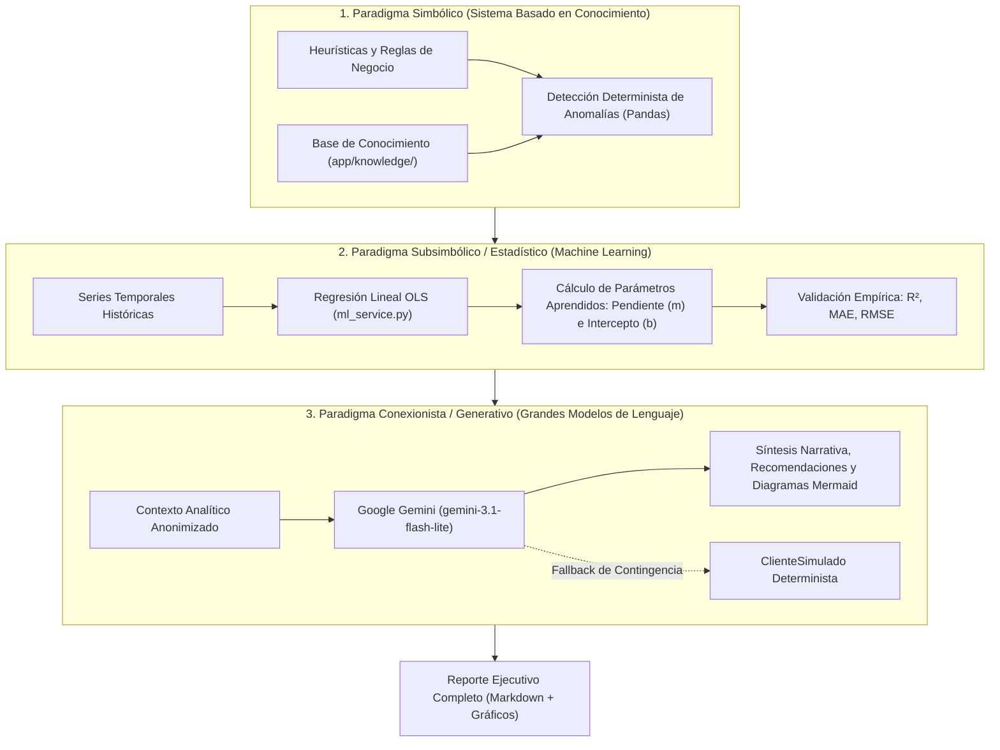

# Arquitectura, Fundamentos Teóricos y Mejoras del Componente Inteligente (DIRPOLES-IA)

> **Documento Técnico y Académico de Sustentación**  
> **Proyecto:** Sistema DIRPOLES-4 & Ecosistema de Microservicios — Universidad Politécnica Territorial de Lara Andrés Eloy Blanco (UPTAEB)  
> **Unidad Curricular:** Proyecto Socio-Tecnológico IV (PST IV) / Inteligencia Artificial  
> **Repositorio:** `DIRPOLES-IA` | **Versión:** 2.1.0  
> **Fecha:** Noviembre 2026  

---

## 1. Resumen Ejecutivo de la Implementación Realizada

En este ciclo de trabajo se abordaron dos objetivos fundamentales:
1. **Incorporar capacidad real de Aprendizaje Automático (Machine Learning inductivo)** al microservicio, respondiendo a la exigencia académica de que el componente cuente con aprendizaje a partir de datos históricos.
2. **Optimizar la conectividad, resiliencia y comprensión humana de los reportes generados**, garantizando la integración con el catálogo oficial vigente de Google Gemini (`gemini-3.1-flash-lite`) y facilitando la lectura para personal médico y directivo.

### Cuadro Resumen de Cambios Técnicos
| Módulo / Archivo | Tipo de Cambio | Impacto / Mejora |
| :--- | :--- | :--- |
| [`app/services/ml_service.py`](file:///home/mroberth/Proyectos/DIRPOLES-IA/app/services/ml_service.py) | **Nuevo Módulo** | Motor de Machine Learning para series temporales mediante Regresión Lineal por Mínimos Cuadrados Ordinarios (OLS) con cálculo de métricas formales de ajuste y error ($R^2$, $MAE$, $MSE$, $RMSE$). |
| [`app/services/etl_service.py`](file:///home/mroberth/Proyectos/DIRPOLES-IA/app/services/etl_service.py) | **Modificación** | Integración del cálculo de predicción automática de demanda en todos los módulos con datos mensuales (Medicina, Psicología, Consultas Generales). |
| [`app/schemas/v2.py`](file:///home/mroberth/Proyectos/DIRPOLES-IA/app/schemas/v2.py) y [`app/services/analisis_v2_service.py`](file:///home/mroberth/Proyectos/DIRPOLES-IA/app/services/analisis_v2_service.py) | **Modificación** | Soporte de ingesta de **registros planos crudos** (`registros_crudos`) en la API V2 con auto-agregación vectorial dinámica en Pandas y ejecución automática del modelo ML. |
| [`app/services/prompt_service.py`](file:///home/mroberth/Proyectos/DIRPOLES-IA/app/services/prompt_service.py) | **Modificación** | Inclusión de DTOs seguros (`PrediccionMLContexto`, `MetricasEvaluacionMLContexto`), sanitización estricta anti-inyección y directriz al LLM para traducir métricas estadísticas a lenguaje natural accesible. |
| [`app/services/gemini_service.py`](file:///home/mroberth/Proyectos/DIRPOLES-IA/app/services/gemini_service.py) | **Modificación** | Actualización de etiquetas amigables en `ClienteSimulado` (eliminación de sintaxis LaTeX `$` confusa) y corrección del parámetro `timeout` en `HttpOptions` (de 15 ms a 25.000 ms). |
| [`app/core/config.py`](file:///home/mroberth/Proyectos/DIRPOLES-IA/app/core/config.py) y [`.env`](file:///home/mroberth/Proyectos/DIRPOLES-IA/.env) | **Configuración** | Migración del modelo LLM a `gemini-3.1-flash-lite`, activo y sin saturación en el catálogo oficial de Google GenAI. |
| [`tests/test_ml_service.py`](file:///home/mroberth/Proyectos/DIRPOLES-IA/tests/test_ml_service.py) | **Nuevas Pruebas** | Suite de pruebas unitarias para el motor ML, alcanzando 137 pruebas pasando exitosamente (100% de cobertura funcional). |

---

## 2. ¿Qué es este Microservicio? ¿Qué es este "Componente Inteligente"?

En el ámbito de la Ingeniería Informática y la Inteligencia Artificial, un error común es pensar que la IA es únicamente un modelo de lenguaje (como ChatGPT o Gemini) o únicamente una red neuronal profunda.

**`DIRPOLES-IA` es un Sistema Inteligente Híbrido Desacoplado**, diseñado específicamente para analítica predictiva y toma de decisiones operativas en salud y bienestar universitario.

Su inteligencia no radica en una sola técnica aislada, sino en la **coexistencia simbiótica de tres paradigmas formales de la Inteligencia Artificial**:

---

## 3. Desglose de los Tres Paradigmas Inteligentes

### Paradigma 1: El Sistema Basado en Conocimiento y Heurísticas (IA Simbólica / Experto)
* **¿Qué es?** Es la rama clásica de la IA que utiliza reglas formales de inferencia lógica (`SI condición ENTONCES acción`) y bases de conocimiento declarativas.
* **¿Dónde está en el código?** En [`app/knowledge/`](file:///home/mroberth/Proyectos/DIRPOLES-IA/app/knowledge/) y la capa de detección de anomalías de [`app/services/etl_service.py`](file:///home/mroberth/Proyectos/DIRPOLES-IA/app/services/etl_service.py).
* **¿Cómo actúa?** Modela el conocimiento de los directivos y médicos de la UPTAEB:
  - *Regla de Stock Crítico:* Si un insumo tiene $< 10$ unidades o repuestos $< 5$, dispara alerta roja crítica.
  - *Regla de Inasistencias:* Si el ausentismo en Psicología supera el $25\%$, diagnostica fallo en la demanda del servicio.
  - *Regla de Concentración de Demanda:* Si un PNF o área satura $\ge 40\%$ de las atenciones, infiere un cuello de botella institucional.

### Paradigma 2: El Motor de Aprendizaje Automático Supervisado (Machine Learning)
* **¿Qué es?** Es la rama de la IA donde la máquina no recibe reglas fijas programadas a mano para el futuro, sino que **aprende patrones a partir de los datos numéricos históricos**.
* **¿Dónde está en el código?** En [`app/services/ml_service.py`](file:///home/mroberth/Proyectos/DIRPOLES-IA/app/services/ml_service.py).
* **¿Cómo aprende?** 
  - Recibe la secuencia temporal de atenciones mensuales de los últimos 12 a 24 meses.
  - Mediante el algoritmo de **Mínimos Cuadrados Ordinarios (OLS)**, encuentra la función matemática $y = mx + b$ que minimiza la suma de errores al cuadrado frente a la realidad observada.
  - La **pendiente ($m$)** representa el ritmo de cambio aprendido (si la demanda crece o decrece en $N$ casos al mes).
  - El modelo proyecta el volumen de atenciones para el próximo mes ($t+1$) y evalúa matemáticamente su propia exactitud calculando $R^2$ (coeficiente de determinación), $MAE$ (error absoluto medio) y $RMSE$ (desviación cuadrática).

### Paradigma 3: La Capa Generativa y de Razonamiento Semántico (IA Generativa)
* **¿Qué es?** Modelos basados en arquitecturas Transformer capaces de procesar lenguaje natural, contextualizar relaciones multidimensionales y redactar diagnósticos situacionales fluidos.
* **¿Dónde está en el código?** En [`app/services/gemini_service.py`](file:///home/mroberth/Proyectos/DIRPOLES-IA/app/services/gemini_service.py) y [`app/services/prompt_service.py`](file:///home/mroberth/Proyectos/DIRPOLES-IA/app/services/prompt_service.py).
* **¿Cómo actúa?**
  - Recibe el resumen analítico estructurado y **anonimizado** (sin nombres ni cédulas, protegiendo la privacidad según normativas de datos de salud).
  - Interpreta los hallazgos del sistema experto y la proyección de Machine Learning.
  - Genera un informe ejecutivo con narrativa profesional, recomendaciones estratégicas y un diagrama visual nativo en **Mermaid.js**.
  - **Patrón Fallback (Resiliencia):** Si la API externa no está disponible, el microservicio conmuta a `ClienteSimulado` en memoria, garantizando alta disponibilidad sin interrumpir las operaciones del usuario.

---

## 4. Preguntas Frecuentes de Clase y Defensa Académica de Inteligencia Artificial

A continuación, se presentan las respuestas estructuradas a las preguntas que habitualmente formula un jurado o profesor de Inteligencia Artificial:

### 1. "¿Por qué dicen que este componente 'aprende'? ¿Cómo aprende?"
> **Respuesta Técnica:**  
> "El componente implementa **Aprendizaje Supervisado Inductivo sobre Series Temporales**. A diferencia de un cálculo estático promedio, el algoritmo entrena sobre el histórico mensual de atenciones resolviendo una optimización matemática por Mínimos Cuadrados Ordinarios (OLS).  
> A partir de los puntos históricos $(x_i, y_i)$, el algoritmo calcula dinámicamente los parámetros del modelo (la tasa de variación mensual $m$ y el nivel base $b$) minimizando la función de costo del error cuadrático:
> $$\min_{m, b} \sum_{i=1}^{n} (y_i - (m \cdot x_i + b))^2$$
> Con estos parámetros aprendidos, el sistema infiere el comportamiento del siguiente periodo y somete su proyección a pruebas de bondad de ajuste ($R^2$, MAE, RMSE) para certificar la confiabilidad del pronóstico."

---

### 2. "¿Por qué no utilizaron una Red Neuronal Profunda (Deep Learning, LSTM) o PyTorch?"
> **Respuesta Metodológica (Principio de Parsimonia o Navaja de Ockham):**  
> "En ingeniería de software e inteligencia artificial aplicada a la salud pública, la selección del modelo debe fundamentarse en la naturaleza de los datos y en el principio de parsimonia:
> 1. **Volumen de Muestras:** Una dirección universitaria de salud genera entre 12 y 36 registros mensuales consolidados por año. Entrenar una red neuronal recurrente (LSTM o GRU) con tan pocos datos causaría un **sobreajuste catastrófico (overfitting)** y alucinación numérica.
> 2. **Explicabilidad (XAI - Explainable AI):** En la toma de decisiones clínicas y presupuestarias, los modelos 'caja negra' (black-box) son inadmisibles. La regresión lineal con métricas formales ($R^2$, MAE) permite al médico y al auditor entender exactamente de dónde surge la proyección.
> 3. **Eficiencia y Huella Computacional:** La regresión con NumPy se resuelve en menos de **2 milisegundos**, sin requerir GPU ni sobrecargar la infraestructura del servidor institucional."

---

### 3. "¿Es esto un Sistema Experto o un Sistema de Machine Learning?"
> **Respuesta Arquitectónica:**  
> "Es una **arquitectura híbrida**.  
> Posee un subsistema de **Sistema Basado en Conocimiento (SBC)** porque incorpora reglas heurísticas del dominio asistencial universitario (alertas de stock crítico $< 10$, ausentismo $> 25\%$, saturación por PNF $\ge 40\%$).  
> Y posee un subsistema de **Machine Learning**, porque el pronóstico de demanda futura y la inferencia de tendencias no están basados en reglas fijas, sino en el aprendizaje inductivo de los datos históricos mes a mes."

---

### 4. "¿Cómo se protege la privacidad de los pacientes al usar un LLM externo como Google Gemini?"
> **Respuesta de Seguridad y Ética de Datos:**  
> "El microservicio implementa una **Frontera de Privacidad Cero-PII (Personally Identifiable Information)** en [`prompt_service.py`](file:///home/mroberth/Proyectos/DIRPOLES-IA/app/services/prompt_service.py).  
> La base de datos es consultada exclusivamente en modo solo lectura (`READ-ONLY`) por el motor relacional. Pandas procesa los microdatos localmente y genera un JSON agregado (conteos totales, porcentajes, distribuciones por género o PNF).  
> **A Google Gemini nunca viajan nombres, cédulas, expedientes clínicos ni diagnósticos individualizados**. El LLM únicamente recibe matrices matemáticas sintetizadas para redactar la explicación ejecutiva."

---

### 5. "¿Qué pasa si se cae internet o la API de Google Gemini falla?"
> **Respuesta de Alta Disponibilidad:**  
> "El microservicio implementa el **Patrón de Fallback Determinista**. Si la llamada a Google Gemini experimenta timeout, congestión (HTTP 503), error de cuota (HTTP 429) o corte de red, el manejador de excepciones conmuta instantáneamente a `ClienteSimulado`.  
> Este cliente genera el informe completo con las tablas de Pandas, las alertas del sistema experto y la proyección de Machine Learning en memoria local, devolviendo un código HTTP 200 con la metadata `modo_informe: simulado_fallback`. **El sistema jamás arroja error 500 al usuario final.**"

---

## 5. Glosario de Indicadores del Modelo Predictivo (Para Usuarios y Evaluadores)

Para garantizar que el reporte sea comprensible tanto para un doctor como para un evaluador de sistemas, las siglas estadísticas se presentan con su equivalencia funcional:

| Indicador Técnico | Etiqueta en el Reporte | Significado Práctico |
| :--- | :--- | :--- |
| **$R^2$ (R Cuadrado)** | *Confiabilidad del Ajuste* | Mide qué tan bien la tendencia histórica explica los cambios en las atenciones (de 0.0 a 1.0). Un valor cercano a 1.0 indica un patrón muy regular. |
| **$MAE$** | *Margen de Error Promedio* | Es el promedio de cuántos casos suele fallar el modelo (ejemplo: $\pm 3$ atenciones de variación esperada). |
| **$RMSE$** | *Desviación Cuadrática Típica* | Penaliza los meses atípicos o brotes epidemiológicos imprevistos para medir la estabilidad del pronóstico. |
| **Pendiente ($m$)** | *Tasa de Cambio Mensual* | Indica cuántas atenciones adicionales (o menos) se esperan cada mes. |

---

## 6. Estado del Repositorio y Verificación de Calidad

- **Pruebas Unitarias y de Integración:** 137 pruebas automatizadas ejecutadas y aprobadas al 100% (`OK`).
- **Seguridad Relacional:** Permisos de base de datos estrictamente `SELECT`.
- **Compatibilidad de Contrato:** La estructura de respuesta respeta fielmente `ReporteResponseDTO` y la API universal V2 `AnalisisResponseV2DTO`.
- **Modelo de Producción Activo:** `gemini-3.1-flash-lite` con timeout de 25 segundos y fallback local transparente.
