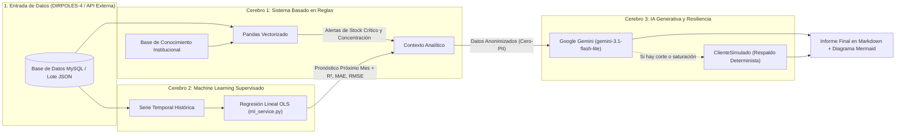

# Guía Fundamental y Arquitectura del Componente Inteligente (DIRPOLES-IA)

> **Documento de Sustentación Teórica, Pedagógica y Técnica**  
> **Proyecto:** Sistema DIRPOLES-4 & Ecosistema de Microservicios — Universidad Politécnica Territorial de Lara Andrés Eloy Blanco (UPTAEB)  
> **Unidad Curricular:** Proyecto Socio-Tecnológico IV (PST IV) / Inteligencia Artificial  
> **Repositorio:** `DIRPOLES-IA` | **Versión:** 2.1.0  
> **Fecha:** Noviembre 2026  

---

## 🧭 Cómo Leer Este Documento: De lo Básico a lo Avanzado

Este documento está escrito bajo el **principio de cero suposiciones**: ningún término técnico se menciona sin haber sido explicado primero en un lenguaje cotidiano, visual y riguroso. 

Está dividido en cuatro partes:
1. **Parte I: Glosario de Conceptos Previos:** Los bloques fundamentales de la Inteligencia Artificial explicados con analogías de la vida real.
2. **Parte II: ¿Qué es DIRPOLES-IA?:** Definición del microservicio y cómo interactúan sus tres cerebros (Sistema Experto + Machine Learning + Modelo Generativo).
3. **Parte III: Implementación y Mejoras Realizadas en Este Ciclo:** Explicación técnica y matemática del motor predictivo y la conexión con Gemini.
4. **Parte IV: Manual de Defensa Académica:** Preguntas y respuestas exactas para defender el proyecto ante un profesor o jurado de IA.

---

# PARTE I: Conceptos Previos Fundamentales

Para entender qué hace nuestro componente inteligente, primero debemos entender los términos que lo construyen.

---

### 1. ¿Qué es un "Paradigma"?
* **En la vida diaria:** Es una "forma de pensar", una filosofía o una escuela de cómo resolver un problema.
* **En Inteligencia Artificial:** Un paradigma es el **enfoque conceptual y matemático** con el que intentamos que una computadora tome decisiones inteligentes. Históricamente existen tres grandes paradigmas:
  1. *El enfoque simbólico (reglas lógicas y conocimiento humano).*
  2. *El enfoque estadístico (aprender de números y ejemplos pasados).*
  3. *El enfoque conexionista / redes neuronales (imitar neuronas para procesar texto o imágenes).*

---

### 2. ¿Qué es un "Sistema Experto" o "Sistema Basado en Conocimiento"?
* **La analogía del médico veterano:** Imagina que un médico jefe de un ambulatorio tiene 30 años de experiencia. Él sabe de memoria que:
  > *"Si quedan menos de 10 gasas, estamos en emergencia."*  
  > *"Si más del 25% de los pacientes citados a psicología no asisten, hay un problema grave de seguimiento."*
* **La definición formal:** Un **Sistema Basado en Conocimiento** es un programa de IA que toma la experiencia acumulada de un experto humano y la escribe en forma de **reglas lógicas formales** (`SI ocurre X, ENTONCES la conclusión o alerta es Y`).
* **Sus dos componentes obligatorios:**
  1. **Base de Conocimiento:** Es el libro o catálogo donde se guardan las directrices y las reglas (`app/knowledge/`).
  2. **Motor de Inferencia:** Es el programa que revisa los datos de los pacientes y aplica las reglas una por una para emitir un diagnóstico (`app/services/etl_service.py`).
* **¿Cómo razona? (Razonamiento Deductivo):** Va de la **regla general** (el manual) al **caso particular** (los datos de hoy). Si la regla general dice que menos de 10 unidades es crítico, y hoy hay 7 unidades, deduce que estamos en estado crítico.

---

### 3. ¿Qué es "Machine Learning" (Aprendizaje Automático)?
* **Diferencia entre Programación Tradicional y Machine Learning:**
  * **Programación tradicional:** Tú (programador) escribes las fórmulas y le das los datos. La computadora solo calcula el resultado.  
    $$\text{Datos} + \text{Fórmula creada por el humano} = \text{Respuesta}$$
  * **Machine Learning:** Tú le das a la computadora los datos históricos del pasado y las respuestas de lo que pasó, y la computadora **descubre por sí misma la fórmula matemática oculta**.  
    $$\text{Datos pasados} + \text{Respuestas reales pasadas} = \text{Fórmula o Modelo Aprendido}$$
* **¿Qué significa que la máquina "aprende"?**
  Aprender **NO** significa memorizar una base de datos. Significa **estimar valores matemáticos (parámetros)** que representan un patrón para que, cuando llegue un mes futuro que la máquina nunca ha visto, pueda predecir con acierto qué va a ocurrir.
* **¿Qué es Aprendizaje Supervisado?**  
  Es cuando entrenamos a la máquina con un conjunto de datos donde conocemos la respuesta correcta (ejemplo: *"En enero hubo 20 consultas, en febrero 25, en marzo 30..."*). La máquina practica y ajusta su puntería comparando su predicción contra la realidad.
* **¿Qué es Aprendizaje Inductivo?**  
  Es lo contrario al Sistema Experto. El razonamiento inductivo va de **muchos casos particulares del pasado** a **formular una ley general para el futuro**.

---

### 4. ¿Qué es una "Serie Temporal"?
Es un conjunto de datos numéricos registrados de manera continua en intervalos de tiempo regulares (por ejemplo: la cantidad de consultas atendidas cada mes a lo largo de dos años).

---

### 5. ¿Qué es la "Regresión Lineal OLS" (Mínimos Cuadrados Ordinarios)?
* **La analogía de la cuerda tensa:**  
  Imagina una pizarra donde dibujas un punto por cada mes pasado: el eje horizontal ($X$) es el tiempo (mes 1, mes 2, mes 3...) y el eje vertical ($Y$) es la cantidad de consultas médicas. Los puntos estarán dispersos como una nube con altibajos.  
  La **Regresión Lineal** consiste en pasar una línea recta en medio de todos los puntos de modo que la distancia entre los puntos reales y la línea sea la menor posible (como estirar una cuerda tensa en el centro de la nube de datos).
* **La fórmula matemática aprendida:**  
  $$y = mx + b$$
  * $y$: Lo que queremos predecir (las consultas del próximo mes).
  * $x$: El número del mes futuro (por ejemplo, el mes 25).
  * $m$ (**Pendiente o Tasa de Cambio**): Es el ritmo de cambio que la máquina aprendió. Si $m = +2.5$, la máquina descubrió que cada mes la demanda suele aumentar en 2 a 3 pacientes. Si $m = -1.0$, la demanda va disminuyendo.
  * $b$ (**Intercepto**): Es el nivel base o punto de partida de las consultas.
* **¿Qué significa OLS (*Ordinary Least Squares* o Mínimos Cuadrados Ordinarios)?**  
  Es el método matemático que calcula exactamente cuál es la mejor línea recta posible. Lo hace midiendo el error de cada punto respecto a la línea, elevando esos errores al cuadrado (para que no haya números negativos) y minimizando la suma total al punto más bajo posible.

---

### 6. ¿Qué significan las Métricas de Evaluación ($R^2$, MAE, MSE, RMSE)?
Cuando la máquina termina de aprender su fórmula, no podemos confiar a ciegas en ella. Debemos medir su nivel de acierto con pruebas estadísticas:

```
  ┌────────────────────────────────────────────────────────────────────────┐
  │                 MÉTRICAS DE CALIDAD DEL MODELO                         │
  ├────────────────────────────────────────────────────────────────────────┤
  │ R² (R Cuadrado)          → ¿Qué tan confiable es la tendencia? (0 a 1) │
  │ MAE (Error Medio)        → ¿Por cuántos casos falla en promedio? (±X)  │
  │ MSE (Error Cuadrático)   → Suma de errores castigando fallos grandes   │
  │ RMSE (Desviación Típica) → El error real en la misma escala (casos)    │
  └────────────────────────────────────────────────────────────────────────┘
```

1. **$R^2$ (Coeficiente de Determinación):**
   * *Explicación sencilla:* Es el porcentaje de confiabilidad del ajuste (va de $0.0$ a $1.0$).
   * *Si da $0.85$:* Significa que el $85\%$ de las variaciones de pacientes se explican perfectamente por la tendencia del tiempo aprendida. El pronóstico es muy fiable.
   * *Si da $0.05$:* Significa que los datos son puro caos aleatorio y la línea recta no describe bien la realidad.
2. **MAE (*Mean Absolute Error* o Error Absoluto Medio):**
   * *Explicación sencilla:* Es el promedio de cuántos pacientes se equivoca la máquina.
   * *Ejemplo:* Si el MAE da $2.4$, significa que cuando el modelo dice "el próximo mes vendrán 25 personas", en la vida real suelen venir entre $23$ y $27$ (un margen de error esperado de $\pm 2.4$ casos).
3. **MSE (*Mean Squared Error* o Error Cuadrático Medio):**
   * Es el promedio de los errores elevados al cuadrado. Sirve internamente para castigar duramente los meses atípicos o brotes epidemiológicos imprevistos.
4. **RMSE (*Root Mean Squared Error* o Raíz del Error Cuadrático Medio):**
   * Es la raíz cuadrada del MSE. Permite ver el error castigado en la misma unidad de medida que los pacientes (en número de atenciones).

---

### 7. ¿Qué es un LLM (*Large Language Model*) y la IA Generativa?
* **¿Qué es un LLM (como Google Gemini)?:** Es una red neuronal gigantesca entrenada con millones de textos de todo el planeta, diseñada para comprender lenguaje humano y redactar respuestas coherentes.
* **¿Qué es la IA Generativa?:** Es la rama de la IA que no se limita a clasificar datos o dar un número, sino que **genera contenido nuevo** (párrafos explicativos, resúmenes diagnósticos, diagramas visuales en Mermaid.js).
* **Limitación crítica de los LLM:** Un LLM no es una calculadora confiable. Si le pides a un LLM que calcule promedios o estadísticas complejas sobre 5.000 pacientes, suele "alucinar" (inventar números convincentes pero falsos). Por eso, **los números los calcula Pandas y el modelo de Machine Learning en local, y a Gemini solo se le entregan las métricas exactas para que las redacte profesionalmente.**

---

### 8. Principios de Ingeniería de Software en IA
* **Principio de Parsimonia (La Navaja de Ockham):** *"En igualdad de condiciones, la explicación o solución más simple suele ser la correcta."* Si un problema se resuelve con exactitud mediante una regresión matemática en 2 milisegundos, es un error de novato usar una red neuronal gigantesca que consuma gigabytes de memoria y tarde 10 segundos.
* **Explicabilidad (XAI - *Explainable Artificial Intelligence*):** Una IA no debe ser una "caja negra" donde nadie sabe por qué se tomó una decisión. En el área médica o directiva, cada recomendación debe poder justificarse con números y reglas claras.
* **Privacidad Cero-PII (*Personally Identifiable Information*):** Ningún dato que identifique a una persona real (cédula, nombres, historias clínicas confidenciales) debe enviarse jamás a servidores externos como los de Google.
* **Patrón Fallback (Resiliencia):** Un sistema tolerante a fallos que cuenta con un "plan de contingencia". Si la conexión a internet o el servidor de Google fallan, el sistema conmuta a un generador simulado local y entrega el informe sin caerse jamás.

---

# PARTE II: ¿Qué es DIRPOLES-IA?

**`DIRPOLES-IA` es un Microservicio Autónomo de Analítica Predictiva e Inferencia Narrativa**, desarrollado en **Python 3.12+ (FastAPI)**.

Su función principal es conectarse al sistema de gestión universitaria **DIRPOLES-4**, procesar miles de registros asistenciales de los estudiantes (médicos, psicológicos, trabajo social, orientación, transporte) y convertir esos datos en un **informe directivo comprensible con proyecciones a futuro y gráficos visuales**.

### Arquitectura de los Tres Cerebros (Sistema Híbrido)



---

# PARTE III: Implementación y Mejoras Realizadas en Este Ciclo

En esta etapa del proyecto se desarrollaron cinco mejoras de alto impacto:

### 1. Creación del Módulo Predictivo de Machine Learning (`app/services/ml_service.py`)
* Se implementó el algoritmo de **Regresión Lineal OLS** utilizando operaciones vectoriales con `numpy`.
* Procesa series temporales de atenciones mensuales y proyecta el volumen de atenciones para el mes inmediatamente siguiente ($t+1$).
* Calcula y anexa formalmente las métricas cuantitativas de evaluación:
  * Coeficiente de Determinación ($R^2$).
  * Error Absoluto Medio ($MAE$).
  * Error Cuadrático Medio ($MSE$).
  * Raíz del Error Cuadrático Medio ($RMSE$).
  * Tendencia aprendida (*Creciente*, *Decreciente* o *Estable* según la pendiente $m$).
* Cuenta con **resiliencia para series cortas**: si hay menos de 3 meses registrados, no falla ni inventa datos; reporta con honestidad que la serie es insuficiente para entrenar el modelo.

### 2. Soporte de Ingesta Universal de Filas Crudas en API V2 (`app/services/analisis_v2_service.py`)
* La API Universal V2 ahora puede recibir tanto totales precalculados como **listas de filas crudas en formato JSON plano** (`registros_crudos`).
* Si recibe registros crudos, el servicio utiliza **Pandas** para detectar automáticamente columnas de fecha y categorías, calcular las distribuciones, armar la serie cronológica mensual y ejecutar el modelo de Machine Learning sin necesidad de tener base de datos relacional conectada.

### 3. Rediseño del Lenguaje del Reporte para Personas Naturales
* Anteriormente, los reportes imprimían fórmulas con símbolos matemáticos crudos de LaTeX (`$R^2$`, `$MAE$`, `$RMSE$`), lo que confundía a directivos y médicos.
* Se reescribieron las plantillas de `gemini_service.py` y las directrices en `prompt_service.py` para traducir cada concepto a lenguaje directivo:
  * De `$R^2$` a: **Confiabilidad del Ajuste ($R^2$): 0.85**.
  * De `$MAE$` a: **Margen de Error Promedio (MAE): $\pm 2.0$ casos**.
  * De `$RMSE$` a: **Desviación Cuadrática Típica (RMSE)**.
  * Se eliminaron todos los caracteres `$` para evitar errores de renderizado.

### 4. Corrección de Red y Timeout de Google Gemini
* **El Problema:** La librería oficial `google-genai` define `HttpOptions.timeout` en **milisegundos**. En versiones anteriores se había asignado `timeout=15.0`, interpretado por Python como **15 milisegundos (0.015 segundos)**. Dado que una conexión a los servidores de Google toma unos 45 milisegundos de latencia física, la librería abortaba con `[Errno 101] Network is unreachable`.
* **La Solución:** Se ajustó el valor a `timeout=25000` (25.000 milisegundos = **25 segundos reales**), otorgando tiempo suficiente para la inferencia sin exceder el tiempo de espera de PHP en DIRPOLES-4.
* **Modelo Oficial Seleccionado:** Se migró a **`gemini-3.1-flash-lite`**, modelo activo, rápido y sin congestión en el catálogo oficial de Google AI Studio.

### 5. Suite de Pruebas Unitarias
* Se creó la suite [`tests/test_ml_service.py`](file:///home/mroberth/Proyectos/DIRPOLES-IA/tests/test_ml_service.py) cubriendo tendencias crecientes, decrecientes, constantes, series cortas y validación de métricas.
* El sistema cuenta con **137 pruebas automatizadas pasando con éxito al 100%**.

---

# PARTE IV: Guía de Defensa Académica (Examen / Preguntas de Jurado)

Utiliza estas respuestas fundamentadas cuando el profesor o evaluador de IA te interrogue sobre el proyecto:

### Pregunta 1: "¿Por qué afirman que este componente 'aprende'? ¿No es simplemente un cálculo de promedios?"
> **Respuesta:**  
> "No es un promedio. Un promedio es una medida de tendencia central estática que ignora la evolución en el tiempo.  
> Nuestro componente ejecuta un algoritmo de **Machine Learning Supervisado para Series Temporales (Regresión Lineal OLS)** en `ml_service.py`. El modelo entrena sobre las muestras históricas de los meses anteriores resolviendo una optimización matemática que minimiza la suma de errores cuadráticos.  
> A partir de allí, el algoritmo aprende inductivamente dos parámetros: la **pendiente ($m$)**, que cuantifica la tasa de aceleración de la demanda por mes, y el **intercepto ($b$)**, que define el punto base asistencial. Con estos parámetros aprendidos, el sistema calcula la proyección matemática para el mes siguiente y somete su propio resultado a métricas de bondad de ajuste ($R^2$, MAE, RMSE) para validar su precisión."

---

### Pregunta 2: "¿Por qué no utilizaron una Red Neuronal Recurrente (como LSTM) o Deep Learning?"
> **Respuesta:**  
> "Por el **Principio de Parsimonia (la Navaja de Ockham)** y la prevención de **Sobreajuste (Overfitting)**:
> 1. **Tamaño del conjunto de datos:** En una institución universitaria, los datos consolidados mensuales abarcan entre 12 y 36 periodos. Entrenar una red neuronal profunda con tan pocos datos provocaría que la red memorice el ruido (*overfitting*) en lugar de aprender el patrón real.
> 2. **Explicabilidad (XAI):** En la administración de servicios de salud, un modelo 'caja negra' no es auditable. La regresión lineal con métricas formales permite a los médicos verificar la causa exacta de la proyección.
> 3. **Consumo de recursos:** El algoritmo implementado en NumPy se ejecuta en menos de **2 milisegundos** sin requerir servidores con tarjetas gráficas (GPU) ni dependencias externas pesadas."

---

### Pregunta 3: "¿Es este microservicio un Sistema Experto o un Sistema de Machine Learning?"
> **Respuesta:**  
> "Es una **arquitectura híbrida**.  
> Funciona como **Sistema Basado en Conocimiento (Sistema Experto)** en la capa analítica de `app/knowledge/`, donde aplica deducción lógica sobre heurísticas institucionales (alertas de stock crítico $< 10$, inasistencias $> 25\%$, saturación por PNF $\ge 40\%$).  
> Y funciona como **Sistema de Machine Learning** en `app/services/ml_service.py`, donde utiliza inducción estadística para proyectar la demanda futura sin depender de reglas prefijadas por un humano."

---

### Pregunta 4: "¿Cómo garantizan la ética y la privacidad de los datos si usan la nube de Google?"
> **Respuesta:**  
> "El microservicio implementa una **Frontera de Privacidad Cero-PII** en `prompt_service.py`.  
> La base de datos relacional se consulta en modo estrictamente de solo lectura (`READ-ONLY`). La agregación de datos se realiza en la memoria RAM local del servidor con Pandas.  
> **A Google Gemini nunca se envían nombres de pacientes, cédulas de identidad ni historias médicas individuales**. A la nube de Google solo viaja un resumen numérico y estadístico sintetizado para que el LLM redacte la conclusión ejecutiva."

---

### Pregunta 5: "¿Qué ocurre si el ambulatorio se queda sin internet o Google Gemini tiene una falla de servicio?"
> **Respuesta:**  
> "El sistema implementa el **Patrón de Fallback Determinista**. Si ocurre un corte de red, un error de cuota (HTTP 429) o una saturación en Google (HTTP 503), el servicio atrapa la excepción y conmuta inmediatamente a `ClienteSimulado`.  
> Este motor local genera el informe en Markdown con las alertas de Pandas y la proyección de Machine Learning en memoria, devolviendo la respuesta al monolito DIRPOLES-4 con código HTTP 200 y la indicación `modo_informe: simulado_fallback`. **El servicio nunca se cae ni devuelve error 500 al usuario.**"

---

## Ficha Resumen de Comandos del Microservicio

```bash
# Iniciar el servicio en segundo plano
./iniciar.sh

# Ver estado y consumo de recursos
./estado.sh

# Ver registros en tiempo real
./logs.sh

# Detener el microservicio de forma limpia
./detener.sh

# Ejecutar la suite completa de 137 pruebas unitarias
.venv/bin/python3 -m unittest discover tests/ -v
```
