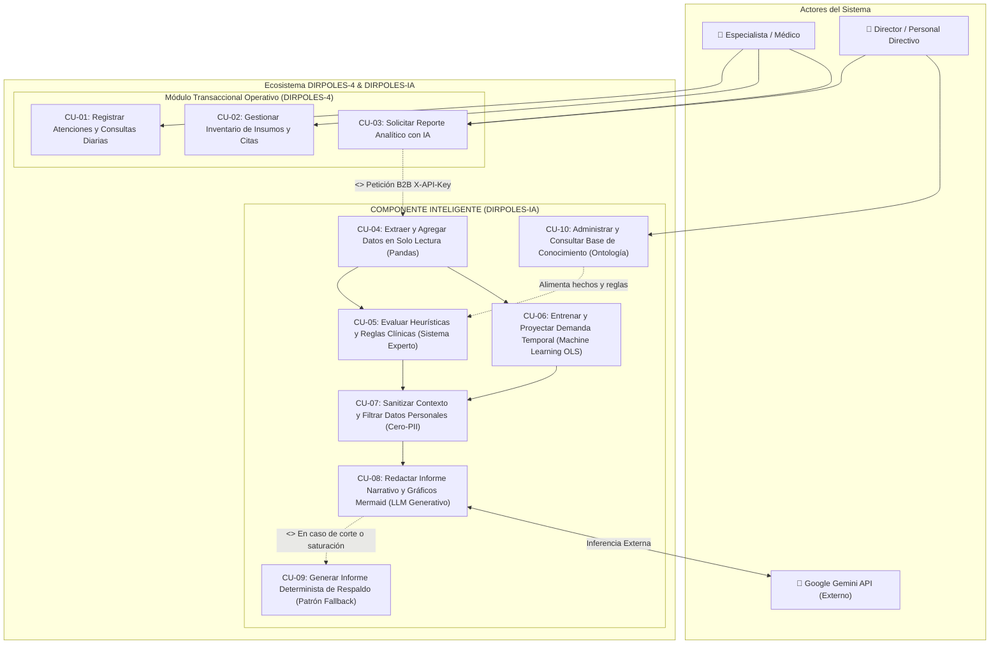
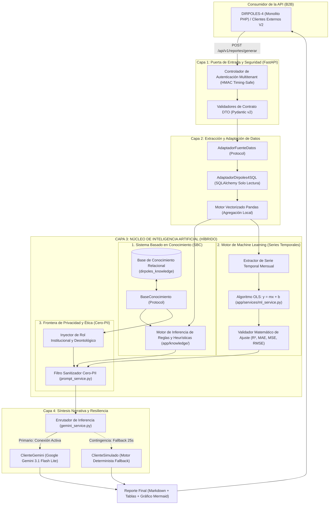

# Documento de Defensa: Diagramas del Sistema y Base de Conocimiento (DIRPOLES-IA)

> **Material Oficial de Sustentación Académica para Impresión**  
> **Proyecto:** Sistema DIRPOLES-4 & Microservicio DIRPOLES-IA — Ecosistema de Bienestar Estudiantil  
> **Institución:** Universidad Politécnica Territorial de Lara Andrés Eloy Blanco (UPTAEB)  
> **Unidad Curricular:** Proyecto Socio-Tecnológico IV (PST IV) / Inteligencia Artificial  
> **Fecha:** Noviembre 2026  

---

> [!NOTE] **Instrucciones para Impresión / Exportación a PDF:**  
> Este documento cuenta con separadores de página (`page-break`) estructurados. Para imprimirlo o guardarlo en PDF:
> 1. Ábrelo en tu navegador o visor Markdown (ej. VS Code / Antigravity IDE con vista previa Markdown).
> 2. Presiona `Ctrl + P` (Imprimir).
> 3. En Destino selecciona **"Guardar como PDF"** o selecciona tu impresora física.
> 4. Asegúrate de marcar la casilla **"Gráficos de fondo"** (*Background graphics*) para que los diagramas y tablas se impriman con sus colores y bordes nítidos.

---

<div style="page-break-after: always;"></div>

# SECCIÓN 1: Diagrama General de Casos de Uso del Sistema (Con Evidencia del Componente Inteligente)

### 1.1. Descripción de Actores y Alcance
El sistema opera bajo un esquema colaborativo donde el monolito de gestión operativa (**DIRPOLES-4**) y el microservicio de inteligencia artificial (**DIRPOLES-IA**) trabajan de forma coordinada pero desacoplada:

* **Actores Humanos:**
  * **Especialista / Médico / Psicólogo:** Interactúa con el sistema para registrar consultas diarias y solicitar análisis clínicos de su área de atención.
  * **Director / Personal Directivo:** Solicita diagnósticos estratégicos globales, proyecciones de demanda asistencial y auditorías operativas.
* **Actores de Sistema (Servicios / Nodos):**
  * **DIRPOLES-4 (Backend Monolítico PHP):** Orquesta las solicitudes de usuario, valida sesiones y consume la API del microservicio mediante llamadas backend-to-backend autenticadas con `X-API-Key`.
  * **DIRPOLES-IA (Microservicio Python FastAPI):** Procesa datos vectorizados, aplica la base de conocimiento y ejecuta el aprendizaje automático.
  * **Servicio LLM Google Gemini (Nube Externa):** Genera la narrativa sintética en lenguaje natural.

---

### 1.2. Diagrama de Casos de Uso (UML)



---

### 1.3. Matriz de Trazabilidad de Casos de Uso Inteligentes

| Identificador | Caso de Uso | Actor Principal | Componente de IA Responsable | Tipo de Inferencia / Técnica |
| :--- | :--- | :--- | :--- | :--- |
| **CU-05** | Evaluar Heurísticas y Reglas Clínicas | DIRPOLES-IA | Sistema Basado en Conocimiento | **Deductiva / Simbólica:** Inferencia mediante reglas de producción y umbrales críticos sobre hechos actuales. |
| **CU-06** | Entrenar y Proyectar Demanda Asistencial | DIRPOLES-IA | Motor de Machine Learning | **Inductiva / Estadística:** Regresión Lineal OLS sobre series temporales con cálculo de $R^2$, MAE y RMSE. |
| **CU-07** | Sanitizar Contexto y Filtrar PII | DIRPOLES-IA | Filtro de Seguridad y XAI | **Determinista:** Anonimización estricta, validación Pydantic v2 y control ético de privacidad médica. |
| **CU-08** | Redactar Informe Narrativo y Gráficos | Google Gemini | Capa de IA Generativa | **Generativa:** Síntesis del diagnóstico situacional y renderizado visual en Mermaid.js. |
| **CU-09** | Generar Reporte de Respaldo | DIRPOLES-IA | Cliente Simulado Fallback | **Resiliencia Determinista:** Garantiza alta disponibilidad continua ante desconexión de red o caída del LLM. |

---

<div style="page-break-after: always;"></div>

# SECCIÓN 2: Arquitectura del Componente Inteligente (Subcomponentes de IA)

### 2.1. Descripción de la Arquitectura
El microservicio `DIRPOLES-IA` está construido bajo una **arquitectura por capas desacoplada** donde convergen tres paradigmas de inteligencia artificial:
1. **Subsistema Simbólico (Sistema Basado en Conocimiento):** Implementa reglas de producción para auditoría clínica y de inventario.
2. **Subsistema Estadístico (Machine Learning Supervisado):** Aprende inductivamente patrones de demanda asistencial a lo largo del tiempo.
3. **Subsistema Generativo y de Razonamiento Semántico (LLM):** Redacta el informe para el usuario final con lenguaje profesional comprensible.

---

### 2.2. Diagrama de Arquitectura de Componentes Inteligentes



---

### 2.3. Funciones Específicas de los Componentes Inteligentes

1. **Motor de Reglas y Heurísticas (`app/knowledge/`):**
   * Evalúa las condiciones operativas de la institución mediante reglas parametrizables:
     * *Alerta de Desabastecimiento:* Dispara alerta crítica cuando el stock de insumos es menor al umbral ($< 10$ unidades médicas o $< 5$ repuestos vehiculares).
     * *Alerta de Vencimiento:* Detecta insumos vencidos o con fecha de caducidad en los próximos 30 días.
     * *Alerta de Ausentismo Clínico:* Dispara bandera de alerta si la inasistencia a citas de psicología o medicina supera el $25\%$.
     * *Alerta de Sobresaturación:* Detecta si una carrera o PNF concentra más del $40\%$ de la demanda total.

2. **Motor Predictivo de Machine Learning (`app/services/ml_service.py`):**
   * Aplica **Mínimos Cuadrados Ordinarios (OLS)** para encontrar la pendiente óptima ($m$) y el intercepto ($b$) de la ecuación lineal:
     $$y = m \cdot x + b$$
   * Proyecta el volumen esperado de atenciones para el siguiente periodo mensual ($t+1$).
   * Computa las cuatro métricas de auditoría del modelo:
     * **$R^2$ (Coeficiente de Determinación):** Grado en que la tendencia histórica explica el fenómeno ($0.0 \le R^2 \le 1.0$).
     * **MAE (Error Absoluto Medio):** Variación promedio esperada en número exacto de pacientes.
     * **MSE y RMSE:** Medidas de penalización ante fluctuaciones abruptas o brotes imprevistos.

3. **Capa Generativa y Fallback (`app/services/gemini_service.py`):**
   * Conecta con `gemini-3.1-flash-lite` utilizando un timeout de **25.000 milisegundos**.
   * Traduce los datos tabulares a un reporte narrativo formal con secciones ejecutivas, alertas prioritarias y gráficos visuales nativos Mermaid (`pie` o `xychart-beta`).
   * **Resiliencia Automática:** Ante caídas de internet o saturación de Google (503/429), `ClienteSimulado` genera localmente el reporte garantizando continuidad operativa sin errores HTTP 500.

---

<div style="page-break-after: always;"></div>

# SECCIÓN 3: Modelo Relacional de la Base de Conocimiento (`dirpoles_knowledge`)

### 3.1. Justificación y Fundamentación Teórica
En un Sistema Basado en Conocimiento formal, el conocimiento **no debe estar codificado rígidamente dentro del código fuente** (*hardcoded*). Debe residir en una estructura de datos persistente que permita auditar, actualizar y enriquecer las reglas, los roles y los hechos institucionales sin necesidad de reiniciar o recompilar el software.

El esquema **`dirpoles_knowledge`** almacena la ontología institucional de la UPTAEB, los catálogos autorizados, las directrices deontológicas y las reglas de producción para la detección de anomalías.

---

### 3.2. Diagrama Entidad-Relación de la Base de Conocimiento (ERD)

```mermaid
erDiagram
    CONOCIMIENTO_SISTEMA ||--o{ CONOCIMIENTO_ROLES_PROMPTS : "define roles para"
    CONOCIMIENTO_SISTEMA ||--o{ CONOCIMIENTO_CATALOGOS_AUTORIZADOS : "restringe dominios para"
    CONOCIMIENTO_SISTEMA ||--o{ CONOCIMIENTO_REGLAS_ALERTAS : "aplica reglas en"
    CONOCIMIENTO_SISTEMA ||--o{ CONOCIMIENTO_DIRECTRICES_ENFOQUE : "establece directrices para"
    CONOCIMIENTO_SISTEMA ||--o{ CONOCIMIENTO_MODELOS_ML : "configura algoritmos para"

    CONOCIMIENTO_MODULO ||--o{ CONOCIMIENTO_ROLES_PROMPTS : "asocia especialidad a"
    CONOCIMIENTO_MODULO ||--o{ CONOCIMIENTO_REGLAS_ALERTAS : "rige condiciones de"

    CONOCIMIENTO_SISTEMA {
        varchar(50) id_sistema PK "ej: dirpoles4, dirpoles_app, externo"
        varchar(100) nombre_sistema "Nombre formal de la institución o subsistema"
        text descripcion "Alcance y competencias del sistema"
        tinyint activo "1=Activo, 0=Inactivo"
        datetime fecha_registro "Marca de tiempo de registro"
    }

    CONOCIMIENTO_MODULO {
        varchar(50) id_modulo PK "ej: medicina, psicologia, transporte"
        varchar(100) nombre_modulo "Nombre público del servicio asistencial"
        varchar(150) tabla_base_relacional "Nombre de tabla principal en dirpoles_business"
        tinyint activo "1=Activo, 0=Inactivo"
    }

    CONOCIMIENTO_ROLES_PROMPTS {
        int id_rol_prompt PK "Identificador único"
        varchar(50) id_sistema FK "Referencia al sistema consumidor"
        varchar(50) id_modulo FK "Referencia al módulo asistencial"
        text descripcion_rol "Personalidad y especialidad inyectada al LLM"
        text tono_comunicacion "Formal, clínico, directivo, orientador"
        tinyint activo "1=Vigente, 0=Obsoleto"
    }

    CONOCIMIENTO_CATALOGOS_AUTORIZADOS {
        int id_catalogo PK "Identificador único de catálogo"
        varchar(50) id_sistema FK "Referencia al sistema consumidor"
        varchar(50) tipo_catalogo "ej: pnf, genero, tipo_bien, tipo_discapacidad"
        varchar(150) nombre_oficial "Nombre institucional oficial (ej: PNF Informática)"
        varchar(20) codigo_interno "Código interno institucional"
        tinyint activo "1=Vigente, 0=Desincorporado"
    }

    CONOCIMIENTO_REGLAS_ALERTAS {
        int id_regla PK "Identificador único de la regla de producción"
        varchar(50) id_sistema FK "Referencia al sistema"
        varchar(50) id_modulo FK "Referencia al módulo asistencial"
        varchar(100) codigo_regla "Identificador único de regla (ej: R_MED_STOCK_CRITICO)"
        varchar(100) metrica_evaluada "Columna o agregado analizado (ej: stock_actual)"
        varchar(10) operador_logico "Operador: <, <=, >, >=, ==, IN, PCT_CONCENTRACION"
        decimal valor_umbral "Valor cuantitativo de activación (ej: 10.00)"
        varchar(20) nivel_alerta "Nivel de criticidad: critico, advertencia, info"
        text plantilla_mensaje "Texto canónico parametrizado con regex"
        tinyint activo "1=Regla activa, 0=Regla suspendida"
    }

    CONOCIMIENTO_DIRECTRICES_ENFOQUE {
        int id_directriz PK "Identificador de directriz"
        varchar(50) id_sistema FK "Referencia al sistema"
        varchar(50) intencion "resumen_ejecutivo, alertas, tendencias, recomendaciones"
        text directriz_analitica "Instrucción metodológica de análisis"
        text directriz_deontologica "Restricción ética y de no divulgación de PII"
        tinyint activo "1=Activa, 0=Inactiva"
    }

    CONOCIMIENTO_MODELOS_ML {
        int id_config_ml PK "Identificador de ajuste del modelo"
        varchar(50) id_sistema FK "Referencia al sistema"
        varchar(50) id_modulo FK "Módulo al que aplica (o 'global')"
        varchar(50) algoritmo "Nombre del algoritmo (ej: OLS_LINEAR_REGRESSION)"
        int periodos_minimos_entrenamiento "Mínimo de meses para entrenar (defecto: 3)"
        decimal umbral_r2_confiable "Valor mínimo de R² para considerar la tendencia sólida"
        tinyint activo "1=Activo, 0=Inactivo"
    }
```



---

<div style="page-break-after: always;"></div>

### 3.3. Diccionario de Datos de las Tablas de la Base de Conocimiento

#### Tabla 1: `conocimiento_sistema`
Define los sistemas o aplicaciones que interactúan con la base de conocimiento (multitenancy).
* **`id_sistema`** (`VARCHAR(50)`, **PK**): Clave única del sistema (ej: `dirpoles4`, `dirpoles_app`, `externo_logistica`).
* **`nombre_sistema`** (`VARCHAR(100)`): Nombre formal de la entidad institucional.
* **`descripcion`** (`TEXT`): Propósito y contexto de la institución.
* **`activo`** (`TINYINT(1)`): Estado de vigencia (1=Activo, 0=Inactivo).
* **`fecha_registro`** (`DATETIME`): Fecha de alta del sistema.

#### Tabla 2: `conocimiento_modulo`
Define los dominios asistenciales o áreas funcionales de la institución.
* **`id_modulo`** (`VARCHAR(50)`, **PK**): Clave del módulo (`medicina`, `psicologia`, `orientacion`, `discapacidad`, `trabajo_social`, `referencias`, `jornadas`, `mobiliario`, `transporte`, `general`).
* **`nombre_modulo`** (`VARCHAR(100)`): Denominación funcional del servicio asistencial.
* **`tabla_base_relacional`** (`VARCHAR(150)`): Tabla de negocio en `dirpoles_business` que origina los datos.
* **`activo`** (`TINYINT(1)`): Bandera de activación del módulo.

#### Tabla 3: `conocimiento_roles_prompts`
Almacena las personalidades de los agentes inteligentes que el microservicio inyecta a Google Gemini según el módulo consultado.
* **`id_rol_prompt`** (`INT AUTO_INCREMENT`, **PK**): Identificador numérico.
* **`id_sistema`** (`VARCHAR(50)`, **FK**): Referencia a `conocimiento_sistema(id_sistema)`.
* **`id_modulo`** (`VARCHAR(50)`, **FK**): Referencia a `conocimiento_modulo(id_modulo)`.
* **`descripcion_rol`** (`TEXT`): Competencia profesional del agente (ej. *"Especialista en gestión de servicios médicos universitarios, morbilidad clínica y administración de inventario de salud"*).
* **`tono_comunicacion`** (`TEXT`): Tono del discurso (clínico, preventivo, directivo).
* **`activo`** (`TINYINT(1)`): Estado de vigencia.

#### Tabla 4: `conocimiento_catalogos_autorizados`
Almacena la ontología institucional cerrada para prevenir alucinaciones de la IA y validar datos de entrada.
* **`id_catalogo`** (`INT AUTO_INCREMENT`, **PK**): Identificador numérico de la entrada.
* **`id_sistema`** (`VARCHAR(50)`, **FK**): Referencia al sistema.
* **`tipo_catalogo`** (`VARCHAR(50)`): Tipo de colección (`pnf`, `genero`, `estado_cita`, `grado_discapacidad`).
* **`nombre_oficial`** (`VARCHAR(150)`): Nombre canónico institucional oficial (ejemplo: *"PNF Informática"*, *"PNF Agroalimentación"*, *"PNF Turismo"*, etc.).
* **`codigo_interno`** (`VARCHAR(20)`): Código de carrera o referencia interna.
* **`activo`** (`TINYINT(1)`): Vigencia del catálogo.

#### Tabla 5: `conocimiento_reglas_alertas`
Almacena las reglas de producción (`SI <condicion> ENTONCES <alerta>`) que ejecuta el Sistema Experto.
* **`id_regla`** (`INT AUTO_INCREMENT`, **PK**): Identificador de la regla.
* **`id_sistema`** (`VARCHAR(50)`, **FK**): Sistema al que aplica la regla.
* **`id_modulo`** (`VARCHAR(50)`, **FK**): Módulo asistencial al que pertenece.
* **`codigo_regla`** (`VARCHAR(100)`): Código nemotécnico (ej: `R_MED_STOCK_CRITICO`, `R_PSI_INASISTENCIA_ALTA`).
* **`metrica_evaluada`** (`VARCHAR(100)`): Variable evaluada (`stock_disponible`, `tasa_inasistencia`, `concentracion_pnf`).
* **`operador_logico`** (`VARCHAR(10)`): Operador relacional (`<`, `<=`, `>`, `>=`, `==`, `PCT_CONCENTRACION`).
* **`valor_umbral`** (`DECIMAL(10,2)`): Cifra límite de disparo (ej: `10.00` para insumos, `25.00` para % de inasistencias).
* **`nivel_alerta`** (`VARCHAR(20)`): Criticidad (`critico`, `advertencia`, `info`).
* **`plantilla_mensaje`** (`TEXT`): Expresión regular y mensaje canónico verificado (ej: `"{cantidad} insumo(s) por debajo del umbral crítico ({umbral} unidades)."`).
* **`activo`** (`TINYINT(1)`): Estado de la regla.

#### Tabla 6: `conocimiento_directrices_enfoque`
Almacena las directrices metodológicas de análisis según el objetivo del reporte solicitado.
* **`id_directriz`** (`INT AUTO_INCREMENT`, **PK**): Identificador único.
* **`id_sistema`** (`VARCHAR(50)`, **FK**): Referencia al sistema.
* **`intencion`** (`VARCHAR(50)`): Clave de intención (`resumen_ejecutivo`, `alertas_y_anomalias`, `tendencias_y_patrones`, `recomendaciones`).
* **`directriz_analitica`** (`TEXT`): Directriz de análisis (ej: *"Prioriza totales, distribuciones porcentuales y comparativa mensual"*).
* **`directriz_deontologica`** (`TEXT`): Mandatos éticos de privacidad (Cero-PII, no emitir juicios de valor sin sustento numérico).
* **`activo`** (`TINYINT(1)`): Vigencia de la directriz.

#### Tabla 7: `conocimiento_modelos_ml`
Almacena los parámetros de configuración y auditoría para los algoritmos de Machine Learning.
* **`id_config_ml`** (`INT AUTO_INCREMENT`, **PK**): Identificador de configuración.
* **`id_sistema`** (`VARCHAR(50)`, **FK**): Referencia al sistema consumidor.
* **`id_modulo`** (`VARCHAR(50)`, **FK**): Módulo donde aplica el modelo predictivo.
* **`algoritmo`** (`VARCHAR(50)`): Algoritmo de aprendizaje (`OLS_LINEAR_REGRESSION`).
* **`periodos_minimos_entrenamiento`** (`INT`): Cantidad mínima de meses requeridos para entrenar (defecto: `3`).
* **`umbral_r2_confiable`** (`DECIMAL(4,2)`): Valor a partir del cual el modelo califica la tendencia como altamente confiable (ej: `0.70`).
* **`activo`** (`TINYINT(1)`): Bandera de activación del motor de predicción.

---

<div style="page-break-after: always;"></div>

### 3.4. Script DDL SQL de Creación del Esquema de Conocimiento (MariaDB / MySQL)

Para fines de verificación y defensa académica ante el jurado, se anexa el código SQL formal que implementa el esquema de la base de conocimiento:

```sql
-- Creación del Esquema de la Base de Conocimiento
CREATE DATABASE IF NOT EXISTS `dirpoles_knowledge`
  DEFAULT CHARACTER SET utf8mb4
  DEFAULT COLLATE utf8mb4_unicode_ci;

USE `dirpoles_knowledge`;

-- 1. Tabla de Sistemas Consumidores
CREATE TABLE `conocimiento_sistema` (
    `id_sistema` VARCHAR(50) NOT NULL,
    `nombre_sistema` VARCHAR(100) NOT NULL,
    `descripcion` TEXT NULL,
    `activo` TINYINT(1) NOT NULL DEFAULT 1,
    `fecha_registro` DATETIME NOT NULL DEFAULT CURRENT_TIMESTAMP,
    PRIMARY KEY (`id_sistema`)
) ENGINE=InnoDB;

-- 2. Tabla de Módulos Asistenciales
CREATE TABLE `conocimiento_modulo` (
    `id_modulo` VARCHAR(50) NOT NULL,
    `nombre_modulo` VARCHAR(100) NOT NULL,
    `tabla_base_relacional` VARCHAR(150) NOT NULL,
    `activo` TINYINT(1) NOT NULL DEFAULT 1,
    PRIMARY KEY (`id_modulo`)
) ENGINE=InnoDB;

-- 3. Tabla de Roles y Personalidades de IA
CREATE TABLE `conocimiento_roles_prompts` (
    `id_rol_prompt` INT AUTO_INCREMENT NOT NULL,
    `id_sistema` VARCHAR(50) NOT NULL,
    `id_modulo` VARCHAR(50) NOT NULL,
    `descripcion_rol` TEXT NOT NULL,
    `tono_comunicacion` VARCHAR(100) NOT NULL DEFAULT 'clínico-directivo',
    `activo` TINYINT(1) NOT NULL DEFAULT 1,
    PRIMARY KEY (`id_rol_prompt`),
    CONSTRAINT `fk_rol_sistema` FOREIGN KEY (`id_sistema`) REFERENCES `conocimiento_sistema` (`id_sistema`),
    CONSTRAINT `fk_rol_modulo` FOREIGN KEY (`id_modulo`) REFERENCES `conocimiento_modulo` (`id_modulo`)
) ENGINE=InnoDB;

-- 4. Tabla de Catálogos Oficiales e Institucionales (Ontología)
CREATE TABLE `conocimiento_catalogos_autorizados` (
    `id_catalogo` INT AUTO_INCREMENT NOT NULL,
    `id_sistema` VARCHAR(50) NOT NULL,
    `tipo_catalogo` VARCHAR(50) NOT NULL,
    `nombre_oficial` VARCHAR(150) NOT NULL,
    `codigo_interno` VARCHAR(20) NULL,
    `activo` TINYINT(1) NOT NULL DEFAULT 1,
    PRIMARY KEY (`id_catalogo`),
    CONSTRAINT `fk_cat_sistema` FOREIGN KEY (`id_sistema`) REFERENCES `conocimiento_sistema` (`id_sistema`)
) ENGINE=InnoDB;

-- 5. Tabla de Reglas de Inferencia y Alertas (Sistema Experto)
CREATE TABLE `conocimiento_reglas_alertas` (
    `id_regla` INT AUTO_INCREMENT NOT NULL,
    `id_sistema` VARCHAR(50) NOT NULL,
    `id_modulo` VARCHAR(50) NOT NULL,
    `codigo_regla` VARCHAR(100) NOT NULL UNIQUE,
    `metrica_evaluada` VARCHAR(100) NOT NULL,
    `operador_logico` VARCHAR(10) NOT NULL,
    `valor_umbral` DECIMAL(10,2) NOT NULL,
    `nivel_alerta` ENUM('critico', 'advertencia', 'info') NOT NULL,
    `plantilla_mensaje` TEXT NOT NULL,
    `activo` TINYINT(1) NOT NULL DEFAULT 1,
    PRIMARY KEY (`id_regla`),
    CONSTRAINT `fk_regla_sistema` FOREIGN KEY (`id_sistema`) REFERENCES `conocimiento_sistema` (`id_sistema`),
    CONSTRAINT `fk_regla_modulo` FOREIGN KEY (`id_modulo`) REFERENCES `conocimiento_modulo` (`id_modulo`)
) ENGINE=InnoDB;

-- 6. Tabla de Directrices de Enfoque y Deontología
CREATE TABLE `conocimiento_directrices_enfoque` (
    `id_directriz` INT AUTO_INCREMENT NOT NULL,
    `id_sistema` VARCHAR(50) NOT NULL,
    `intencion` VARCHAR(50) NOT NULL,
    `directriz_analitica` TEXT NOT NULL,
    `directriz_deontologica` TEXT NOT NULL,
    `activo` TINYINT(1) NOT NULL DEFAULT 1,
    PRIMARY KEY (`id_directriz`),
    CONSTRAINT `fk_dir_sistema` FOREIGN KEY (`id_sistema`) REFERENCES `conocimiento_sistema` (`id_sistema`)
) ENGINE=InnoDB;

-- 7. Tabla de Configuración de Modelos de Machine Learning
CREATE TABLE `conocimiento_modelos_ml` (
    `id_config_ml` INT AUTO_INCREMENT NOT NULL,
    `id_sistema` VARCHAR(50) NOT NULL,
    `id_modulo` VARCHAR(50) NOT NULL,
    `algoritmo` VARCHAR(50) NOT NULL DEFAULT 'OLS_LINEAR_REGRESSION',
    `periodos_minimos_entrenamiento` INT NOT NULL DEFAULT 3,
    `umbral_r2_confiable` DECIMAL(4,2) NOT NULL DEFAULT 0.70,
    `activo` TINYINT(1) NOT NULL DEFAULT 1,
    PRIMARY KEY (`id_config_ml`),
    CONSTRAINT `fk_ml_sistema` FOREIGN KEY (`id_sistema`) REFERENCES `conocimiento_sistema` (`id_sistema`),
    CONSTRAINT `fk_ml_modulo` FOREIGN KEY (`id_modulo`) REFERENCES `conocimiento_modulo` (`id_modulo`)
) ENGINE=InnoDB;
```

---

### 3.5. Ejemplos de Hechos Iniciales Cargados en la Base de Conocimiento (Seeds)

```sql
-- Carga de Sistema y Módulos
INSERT INTO `conocimiento_sistema` (`id_sistema`, `nombre_sistema`, `descripcion`) VALUES
('dirpoles4', 'DIRPOLES-4 UPTAEB', 'Sistema Integral de Bienestar Estudiantil de la UPTAEB');

INSERT INTO `conocimiento_modulo` (`id_modulo`, `nombre_modulo`, `tabla_base_relacional`) VALUES
('medicina', 'Servicio Médico', 'consulta_medica'),
('psicologia', 'Servicio Psicológico', 'consulta_psicologica'),
('transporte', 'Gestión de Transporte', 'vehiculos');

-- Carga de Reglas Heurísticas del Sistema Experto
INSERT INTO `conocimiento_reglas_alertas` 
(`id_sistema`, `id_modulo`, `codigo_regla`, `metrica_evaluada`, `operador_logico`, `valor_umbral`, `nivel_alerta`, `plantilla_mensaje`) VALUES
('dirpoles4', 'medicina', 'R_MED_STOCK_CRITICO', 'stock_actual', '<', 10.00, 'critico', '{cantidad} insumo(s) por debajo del umbral crítico ({umbral} unidades).'),
('dirpoles4', 'medicina', 'R_MED_VENCIDOS', 'dias_para_vencer', '<=', 0.00, 'critico', '{cantidad} insumo(s) con fecha de vencimiento vencida.'),
('dirpoles4', 'psicologia', 'R_PSI_INASISTENCIA', 'tasa_no_asistio', '>', 25.00, 'critico', 'El {porcentaje}% de las citas terminó en "No asistió".'),
('dirpoles4', 'transporte', 'R_TRA_REPUESTOS_BAJOS', 'cantidad_repuesto', '<', 5.00, 'critico', '{cantidad} repuesto(s) con cantidad menor a {umbral} unidades.');

-- Carga del Catálogo Oficial de Carreras (Ontología PNF)
INSERT INTO `conocimiento_catalogos_autorizados` (`id_sistema`, `tipo_catalogo`, `nombre_oficial`, `codigo_interno`) VALUES
('dirpoles4', 'pnf', 'PNF Informática', 'PNF-INFO'),
('dirpoles4', 'pnf', 'PNF Deporte', 'PNF-DEP'),
('dirpoles4', 'pnf', 'PNF Agroalimentación', 'PNF-AGRO'),
('dirpoles4', 'pnf', 'PNF Sistemas de Calidad y Ambiente', 'PNF-SCA'),
('dirpoles4', 'pnf', 'PNF Turismo', 'PNF-TUR'),
('dirpoles4', 'pnf', 'PNF Higiene y Seguridad Laboral', 'PNF-HSL'),
('dirpoles4', 'pnf', 'PNF Ciencias de la Información', 'PNF-CDI'),
('dirpoles4', 'pnf', 'PNF Administración', 'PNF-ADM');
```

---

<div style="page-break-after: always;"></div>

# SECCIÓN 4: Resumen de Puntos Clave para la Defensa Oral

Al entregar las hojas impresas al jurado, enfócate en estos tres mensajes directos:

1. **Sobre el Diagrama de Casos de Uso:**  
   *"Demuestra que el componente inteligente no es un agregado cosmético ni un botón aislado: está formalmente integrado mediante casos de uso de extracción segura (`CU-04`), evaluación heurística de reglas (`CU-05`), proyección predictiva con Machine Learning (`CU-06`) y redacción multimodal (`CU-08`), con un caso de uso de contingencia (`CU-09`) que garantiza resiliencia permanente."*

2. **Sobre el Diagrama de Arquitectura del Componente:**  
   *"Muestra que DIRPOLES-IA es una arquitectura híbrida de tres cerebros: une el razonamiento deductivo de un Sistema Experto para alertas normativas, el aprendizaje inductivo de un modelo de Machine Learning (Regresión OLS) para predecir la demanda futura con métricas auditables ($R^2$, MAE), y un modelo generativo (Google Gemini) protegido por una frontera estricta de Cero-PII que impide la fuga de datos médicos."*

3. **Sobre las Tablas de la Base de Conocimiento:**  
   *"Evidencia que las reglas de negocio, los umbrales críticos ($<10$ insumos, $>25\%$ inasistencias), los roles de los analistas y la ontología institucional (PNF oficiales) no están quemadas en código duro, sino estructuradas en un modelo relacional de 7 entidades (`dirpoles_knowledge`) totalmente auditable y configurable."*
