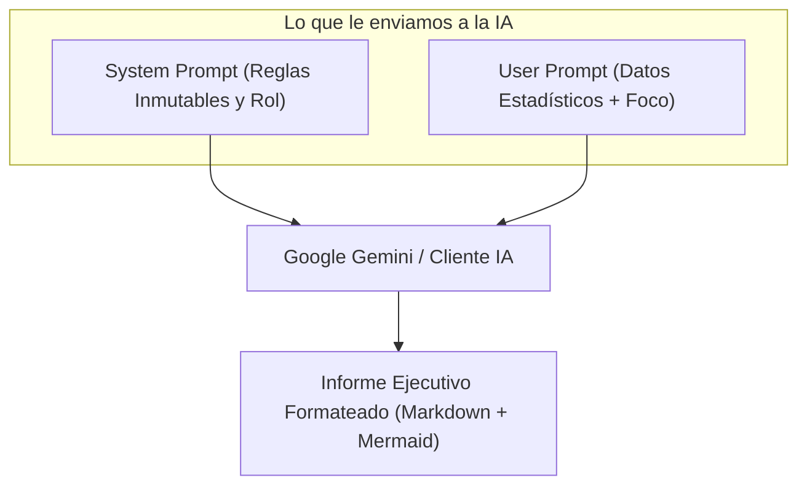
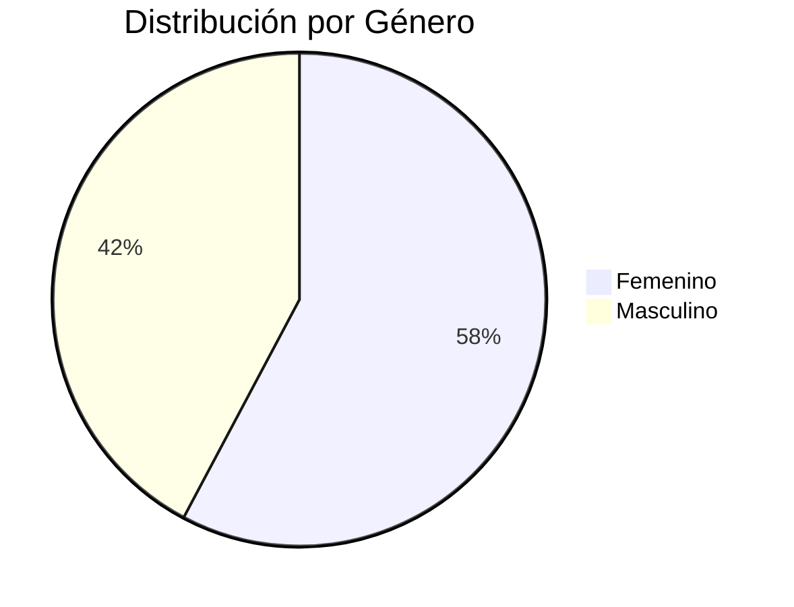
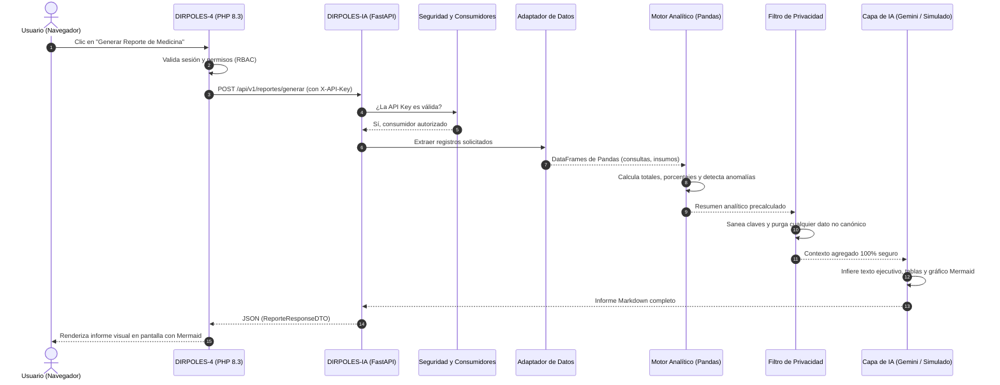

# 🧠 Guía Práctica de DIRPOLES-IA: El Componente de Inteligencia Artificial Explicado para Desarrolladores

> **Autor:** Equipo de Desarrollo DIRPOLES  
> **Proyecto:** Ecosistema DIRPOLES-4 / Componente de Inteligencia Artificial  
> **Repositorio:** `DIRPOLES-IA`  
> **Nivel:** Desde conceptos básicos hasta arquitectura del microservicio  

---

## 1. ¿Qué es DIRPOLES-IA en palabras sencillas?

Imagina que en la universidad tienes una enorme base de datos con miles de consultas médicas, citas de psicología, solicitudes de becas, datos de transporte y compras de repuestos. 

Si un director o decano te pide: *"Dame un informe ejecutivo de cómo estuvo medicina este mes, dime si hay anomalías críticas y dibújame un gráfico con la distribución de estudiantes por carrera"*, un programador tradicional tendría que escribir decenas de consultas SQL complejas, calcular porcentajes en PHP o Python, y luego ponerse a concatenar texto a mano para armar párrafos que suenen profesionales.

**DIRPOLES-IA hace exactamente eso, pero de manera inteligente, automatizada y en cuestión de segundos:**
1. Toma los datos estadísticos de lo que pasó en la universidad.
2. Calcula automáticamente las matemáticas (totales, aumentos o caídas mes a mes, categorías donde se concentra mucha gente).
3. Detecta anomalías (ej: *"¡Ojo! Quedan menos de 10 unidades de este insumo crítico"* o *"El 80% de las citas psicológicas se cancelaron"*).
4. Le pide a un modelo de Inteligencia Artificial (Google Gemini) que redacte un **informe narrativo ejecutivo de alto nivel**, con lenguaje profesional, tablas ordenadas y un gráfico visual interactivo (Mermaid.js).
5. Y si internet se cae o Google no responde, el servicio **no se rompe**: genera el informe de forma local e idéntica mediante un motor de respaldo.

---

## 2. Conceptos teóricos que necesitas dominar (Sin rodeos ni tecnicismos oscuros)

Para entender cómo está construido este proyecto, no necesitas ser un experto en ciencia de datos ni en redes neuronales. Solo necesitas tener claros estos 8 conceptos clave:

---

### 2.1. ¿Qué es un LLM (Large Language Model)?
Un **LLM** (Modelo de Lenguaje Grande), como *Google Gemini*, *ChatGPT* o *Claude*, no es un cerebro consciente ni una base de datos mágica. Es un **motor estadístico gigantesco entrenado para predecir qué palabra viene después de otra**.

* **La ventaja:** Es increíble redactando, resumiendo, cambiando el tono de un texto (de informal a ejecutivo) y estructurando ideas.
* **La debilidad:** No sabe matemáticas exactas y no tiene acceso a la realidad a menos que tú se la des en la petición.

---

### 2.2. El peligro de las "Alucinaciones"
En Inteligencia Artificial se llama **alucinación** al fenómeno en el que el LLM inventa datos, números o historias falsas, pero te las escribe con una seguridad y elocuencia tan grandes que parecen reales.

> ❌ **El gran error de los novatos en IA:** Decirle al modelo *"Oye Gemini, dime cuántos estudiantes se enfermaron en la UPTAEB en enero"*.  
> Como Gemini no tiene tu base de datos, **alucinará** inventándose que fueron 425 estudiantes y dará diagnósticos ficticios.
>
> ✅ **Cómo lo resolvemos en DIRPOLES-IA:** La IA **nunca calcula los números**. Nuestro código en Python calcula las cifras exactas con precisión matemática y le dice a la IA: *"Aquí tienes la tabla exacta: fueron 150 consultas. Redacta el informe basándote ÚNICAMENTE en estos números. Tienes terminantemente prohibido inventar cifras"*.

---

### 2.3. Privacidad y PII (Cero Fuga de Datos Personales)
**PII** significa *Personally Identifiable Information* (Información de Identificación Personal). Incluye nombres de personas, números de cédula, correos electrónicos, teléfonos e historias clínicas.

> ⚠️ **Regla Innegociable de la Universidad y de la Ética del Software:**  
> **NUNCA debes enviar la cédula, el nombre o la patología de un estudiante a los servidores de una empresa externa en la nube (como Google, OpenAI o Microsoft).** Eso violaría normativas de privacidad y expondría a la institución.

En DIRPOLES-IA implementamos una **Frontera de Privacidad Recursiva**. Si en la base de datos hay una consulta de *"Juan Pérez, C.I. 25.123.456, con Depresión Mayor"*, esa fila **jamás sale del servidor local**. El microservicio transforma los datos en agregaciones anónimas:  
`{"total_consultas": 1, "distribucion_genero": {"Masculino": 1}, "tipo_consulta": "Salud Mental"}`.  
A Google Gemini solo le llegan estadísticas frías y agregadas.

---

### 2.4. Prompts: System Prompt vs. User Prompt
Un **Prompt** es la instrucción de texto que se le envía al LLM para decirle qué hacer. Se divide en dos capas:



1. **System Prompt (Instrucción de Sistema):** Le dice a la IA quién es y cuáles son sus límites.  
   *Ejemplo:* *"Eres un Médico Especialista en Salud Universitaria. Tu tarea es redactar un informe ejecutivo para el Director. Reglas: usa tablas Markdown, incluye un diagrama Mermaid, sé conciso y no inventes datos"*.
2. **User Prompt (Instrucción de Usuario):** Contiene los datos específicos de la petición.  
   *Ejemplo:* *"Módulo: Medicina. Periodo: 01/01/2026 al 30/06/2026. Datos procesados: 450 consultas, 5 insumos por vencer. Directriz: Resumir alertas principales"*.

---

### 2.5. ETL (Extract, Transform, Load) y Pandas
* **ETL:** Son las siglas de *Extraer* (sacar datos de las tablas MySQL), *Transformar* (filtrar, agrupar, contar y sacar porcentajes) y *Cargar* (preparar la estructura lista para el prompt).
* **Pandas:** Es la librería reina de Python para análisis de datos. Permite manejar millones de registros en memoria mediante estructuras llamadas **DataFrames** (que son como hojas de cálculo de Excel hiperrápidas). En lugar de hacer 20 consultas SQL lentas con `COUNT` y `GROUP BY`, hacemos una extracción limpia y Pandas calcula las distribuciones y series temporales en milisegundos.

---

### 2.6. Resiliencia Absoluta y el Patrón Fallback (Modo Simulado)
¿Qué pasa si se corta la conexión internacional a internet, o Google tiene una caída de servidores, o se agotan los créditos de la API Key de Gemini?

Si el sistema dependiera ciegamente de Google, la pantalla del usuario en DIRPOLES-4 daría un error 500 de color rojo diciendo *"Fallo en el servidor"*. Eso es inaceptable en un sistema institucional.

Por eso DIRPOLES-IA tiene un **Fallback Determinista (`ClienteSimulado`)**:
* El sistema intenta llamar a Google Gemini.
* Si ocurre cualquier error (timeout, falta de red, error 429 de límite de cuota, o si la variable `MOCK_LLM=True` está activada para pruebas), el código atrapa la excepción y activa inmediatamente el `ClienteSimulado`.
* El `ClienteSimulado` es un motor propio escrito en Python que toma los datos de Pandas y **redacta localmente el informe en Markdown con tablas y gráficos Mermaid**, con una estructura tan cuidada que el usuario final recibe su informe perfecto sin notar la caída externa.
* **Resultado:** El microservicio jamás devuelve un error 500 por culpa de la IA.

---

### 2.7. Visualización Nativa con Mermaid.js (Sin imágenes pesadas)
Normalmente, para que una IA muestre un gráfico, muchos servicios generan imágenes PNG pesadas que gastan almacenamiento y no se pueden editar.

En su lugar, DIRPOLES-IA utiliza **Mermaid.js**, que es un estándar donde los gráficos se escriben como simple texto de código que el navegador dibuja vectorialmente.

Por ejemplo, la IA responde este bloque de texto:
````markdown

````
Y la aplicación web en DIRPOLES-4 lo transforma automáticamente en un gráfico circular interactivo y nítido para el usuario.

---

### 2.8. Arquitectura Backend-to-Backend (B2B)
El navegador del usuario (Chrome, Firefox) **nunca** se comunica directamente con `DIRPOLES-IA`.
* El usuario interactúa con DIRPOLES-4 (PHP 8.3).
* El servidor PHP valida los permisos y la sesión del usuario.
* Si el usuario tiene permiso, PHP hace una llamada HTTP interna (de servidor a servidor) hacia Python (`http://127.0.0.1:8000/api/...`) enviando una cabecera secreta `X-API-Key`.
* Python valida la clave en tiempo constante (`hmac.compare_digest` para evitar ataques de temporización) y le devuelve el resultado en JSON a PHP, quien se lo muestra al usuario.

---

## 3. ¿Cómo funciona DIRPOLES-IA por dentro? (El Viaje de una Petición)

Veamos el recorrido completo que hace una solicitud desde que se pide un reporte hasta que se entrega:



---

## 4. Las dos formas de consumir el microservicio (V1 vs. V2)

Para lograr que DIRPOLES-IA no se quede atado de por vida a DIRPOLES-4, el microservicio ofrece **dos modalidades de consumo**:

### Modalidad 1: Modo "Pull" (API V1 — Para DIRPOLES-4)
* **Endpoint:** `POST /api/v1/reportes/generar`
* **Cómo funciona:** DIRPOLES-4 le dice a la IA: *"Quiero el informe del módulo 'medicina' para el empleado ID 15"*.
* DIRPOLES-IA se conecta mediante su adaptador relacional (`AdaptadorDirpoles4SQL`) en **modo solo-lectura (READ-ONLY)** a la base de datos de DIRPOLES-4, ejecuta las consultas optimizadas y procesa los datos.
* **Ventaja:** DIRPOLES-4 no tiene que calcular nada; la IA hace la extracción y el análisis por completo.

### Modalidad 2: Modo "Push" (API V2 Universal — Para cualquier otro sistema)
* **Endpoint:** `POST /api/v2/analizar`
* **Cómo funciona:** Imagina que el día de mañana construyes un nuevo sistema en **Node.js**, **Python**, **Laravel** o **Go** (por ejemplo, para el inventario de un almacén o el registro de admisiones).
* En lugar de darle a DIRPOLES-IA acceso a tu base de datos, tu sistema le envía los datos ya totalizados en el cuerpo del JSON:
  ```json
  {
    "dominio": "logistica_envios",
    "intencion": "resumen_ejecutivo",
    "metricas": {
      "totales": { "envios_totales": 1200, "a_tiempo": 1140 },
      "distribuciones": {
        "por_zona": [
          { "valor": "Norte", "cantidad": 600 },
          { "valor": "Sur", "cantidad": 600 }
        ]
      }
    },
    "rol_analista": "Director de Operaciones Logísticas"
  }
  ```
* **Ventaja:** ¡Desacoplamiento total! El nuevo sistema no tiene que compartir bases de datos ni esquemas relacionales. DIRPOLES-IA analiza los números, detecta anomalías y devuelve el informe con gráficos Mermaid listo para mostrar.

---

## 5. El Gran Salto: El Antes vs. El Después del Microservicio

Para entender por qué se realizó esta refactorización y por qué es la solución más óptima, analicemos cómo estaba el proyecto antes y cómo quedó ahora:

| Dimensión | 🏚️ ANTES (Acoplado como apéndice de DIRPOLES-4) | 🚀 AHORA (Microservicio Autónomo y Reutilizable) |
| :--- | :--- | :--- |
| **Independencia** | El microservicio solo servía para DIRPOLES-4. Tenía los nombres de las tablas y columnas de bienestar estudiantil incrustados en su lógica central. | **Microservicio Universal:** DIRPOLES-4 es solo un cliente de referencia. Cualquier otro sistema puede usarlo mediante la API V2 sin tocar una sola línea de código Python. |
| **Acceso a Datos** | El código de análisis dependía de consultas SQL fijas contra MySQL. Si no había base de datos, nada funcionaba. | **Arquitectura de Adaptadores:** Dispone de un `AdaptadorDirpoles4SQL` para bases relacionales y un `AdaptadorPayloadDirecto` para recibir datos en memoria sin tocar bases de datos. |
| **Base de Conocimiento** | Los roles de los especialistas y los catálogos de carreras (PNF) estaban mezclados dentro de las funciones que llamaban a la IA. | **Conocimiento Modular Aislado:** La base de conocimiento de la universidad reside en `app/knowledge/dirpoles4/`. Si mañana entra un hospital o una empresa, se crea su propia carpeta de conocimiento sin alterar el núcleo. |
| **Seguridad de Clientes** | Una única API Key en el archivo `.env`. Todos los sistemas compartían la misma clave fija. | **Multitenancy B2B:** Registro de consumidores (`PerfilConsumidor`) que permite dar de alta distintas API Keys para distintos sistemas, habilitarlos o suspenderlos (`activo=false`) y registrar consumos independientes. |
| **Privacidad de Datos** | Existían funciones de ejemplo (`_muestra`) que llegaban a enviar fragmentos de filas reales con nombres y patologías al prompt. | **Frontera Estricta de Privacidad:** Purga total de PII. Solo se transmiten métricas agregadas numéricas y plantillas canónicas cerradas. |
| **Resiliencia ante Fallos** | Si la IA fallaba o había una discrepancia de texto, se podían generar errores o reportes vacíos. | **Fallback Robusto Verificado:** Si el LLM falla, `ClienteSimulado` genera el informe determinista local en milisegundos con 100% de éxito garantizado. |
| **Cobertura de Pruebas** | Pruebas acopladas que fallaban ante alertas libres o requerían dependencias de producción. | **125 Pruebas Automatizadas:** 123 pruebas unitarias y de contrato pasando al 100% sin requerir internet ni bases de datos de producción activas. |

---

## 6. ¿Por qué esta solución es la más óptima para la Universidad?

Aparte de ser un requisito académico y metodológico de la **UPTAEB** para la modernización de su ecosistema tecnológico, esta arquitectura aporta tres beneficios fundamentales:

1. **Sostenibilidad y Ahorro en Mantenimiento:**
   Si la universidad decide renovar el monolito PHP DIRPOLES-4 en unos años por una aplicación móvil en Flutter o un sistema en React/Node.js, **no tendrá que botar a la basura el componente de Inteligencia Artificial**. El microservicio seguirá funcionando exactamente igual consumiendo la API V2.
2. **Seguridad Jurídica y Académica:**
   Garantiza que la información personal de estudiantes y profesores **nunca salga de los servidores locales hacia la nube**. La universidad cumple con los más altos estándares de protección de datos institucionales.
3. **Cero Costos Ocultos por Caídas de Servicio:**
   Al contar con el modo determinista local (`ClienteSimulado`), la universidad no está atada a pagar cuotas permanentes a proveedores de IA externos para que el sistema funcione: el microservicio puede operar de forma 100% gratuita y autónoma en modo simulado para el día a día, y conectar Gemini solo cuando se requiera redacción enriquecida en la nube.

---

## 7. Glosario Rápido de Términos para el Desarrollador

* **DTO (Data Transfer Object):** Clase de Python (usando Pydantic) que define exactamente qué campos y tipos de datos se permiten recibir o responder en la API, rechazando datos extraños.
* **Pydantic v2:** Librería de Python ultrarrápida (escrita en Rust) que valida tipos, cadenas, rangos numéricos y formatos antes de que los datos entren a la lógica del programa.
* **Timing-Safe (`hmac.compare_digest`):** Función de comparación de cadenas que tarda exactamente el mismo tiempo sin importar si la clave coincide al principio o al final, impidiendo que un atacante adivine la API Key midiendo los microsegundos que tarda la respuesta.
* **Stateless (Sin Estado):** El microservicio no guarda sesiones ni cookies; cada petición HTTP debe ser autosuficiente e incluir su autenticación.
* **Token:** Unidad básica de texto con la que trabajan los LLMs (aproximadamente 4 caracteres o 0.75 palabras).

---
*Documento elaborado para el equipo de desarrollo y soporte institucional de DIRPOLES.*
