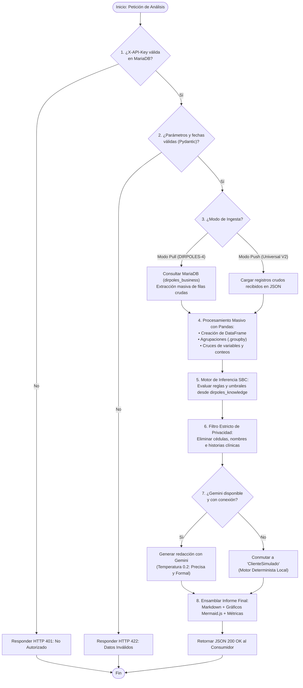
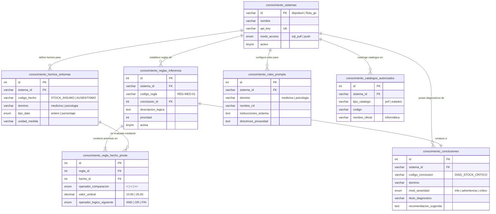
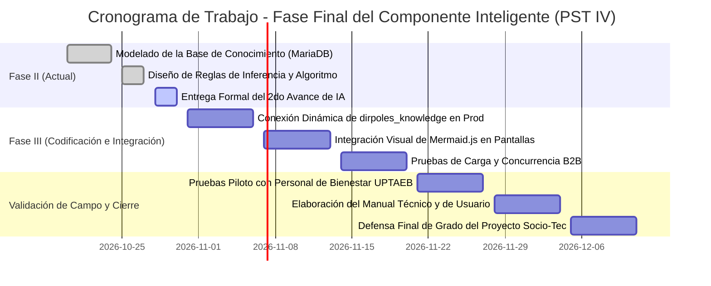

# UNIVERSIDAD POLITÉCNICA TERRITORIAL ANDRÉS ELOY BLANCO (UPTAEB)
## PROYECTO SOCIO-TECNOLÓGICO IV (PST IV) — INGENIERÍA EN INFORMÁTICA
### COMPONENTE DE INTELIGENCIA ARTIFICIAL: FASE II (SEGUNDO AVANCE)

> **Proyecto:** Sistema DIRPOLES-4 (Dirección de Políticas Estudiantiles) y Ecosistema Desacoplado de Microservicios  
> **Componente Inteligente:** Microservicio de Analítica Predictiva, Detección de Anomalías e Inferencia Asistida por IA (`DIRPOLES-IA`)  
> **Autores:** Equipo de Desarrollo e Investigación PST IV  
> **Fecha de Entrega:** Octubre de 2026  

---

## INTRODUCCIÓN GENERAL AL COMPONENTE INTELIGENTE

El presente documento constituye la entrega formal de la **Fase II** correspondiente al diseño, modelado del conocimiento y validación técnica del **Componente Inteligente (DIRPOLES-IA)**.

Para responder a las necesidades reales de la Dirección de Políticas Estudiantiles (DIRPOLES) de la UPTAEB y cumplir con los estándares de la ingeniería de software actual, el componente se diseñó bajo una **arquitectura de microservicio desacoplado e independiente**. Esto significa que la inteligencia no está amarrada de forma rígida a un único sistema: procesa los datos del sistema institucional de la universidad (DIRPOLES-4 en PHP), pero a la vez está listo para atender a futuros sistemas de la comunidad universitaria desarrollados en otras tecnologías (como Go, Python o Node.js).

A continuación, se desarrollan detalladamente los 7 apartados exigidos por la pauta académica.

---

## 1. DISEÑO DETALLADO DEL ALGORITMO O MODELO INTELIGENTE

### 1.1. Especificación Lógica y Matemática de la Técnica de IA
Para este proyecto se seleccionó una técnica de **Inteligencia Artificial Híbrida**, compuesta por dos motores que trabajan en equipo:

1. **Un Sistema Basado en Conocimiento (SBC / Sistema Experto Simbólico):**  
   Encargado de la toma de decisiones estricta y sin margen de error. Funciona mediante **reglas de inferencia de producción** (del tipo *SI ocurre una condición, ENTONCES dispara una conclusión o alerta*).  
   * *¿Por qué es importante?* Porque en temas delicados como insumos médicos o bienestar estudiantil no podemos permitir que una IA "alucine" o invente datos. Las alertas se fundamentan en hechos numéricos verificables.

2. **Un Motor Generativo de Lenguaje Natural (NLG / LLM) con Respaldo Determinista:**  
   Encargado de traducir los números y las alertas a un informe narrativo, comprensible y profesional para los directores y coordinadores. Utiliza la API de **Google Gemini**, pero cuenta con un motor simulado local (**ClienteSimulado**) que garantiza que el sistema siga funcionando al 100% aunque no haya servicio de internet.

#### Formulación Lógica y Matemática Simple
La lógica de evaluación de datos que realiza el motor con la librería **Pandas** se define formalmente de la siguiente manera:

* **Cálculo de Proporción y Concentración Relativa ($C_i$):**  
  Para saber si un área o motivo de consulta está sobrecargado, el motor calcula el porcentaje que representa cada categoría $i$ respecto al total de atenciones $N$:
  $$C_i = \left( \frac{n_i}{N} \right) \times 100$$
  Donde:
  * $n_i$: Número de registros de la categoría específica (ej. atenciones en el PNF de Informática).
  * $N$: Total absoluto de registros procesados en el periodo.

* **Regla de Inferencia Disparadora de Alerta ($R$):**  
  La regla evalúa si el valor medido ($V$) supera o cae por debajo del umbral institucional ($U$):
  $$\text{SI } \Big( V \text{ [operador] } U \Big) \implies \text{DISPARAR}(\text{Alerta\_Canónica})$$
  * *Ejemplo clínico:* Si $V_{\text{stock}} < 10 \implies$ Disparar alerta crítica de *"Riesgo de Desabastecimiento de Insumos Médicos"*.
  * *Ejemplo psicológico:* Si $C_{\text{inasistencias}} > 25\% \implies$ Disparar alerta de *"Alta Deserción a Citas Psicológicas"*.

---

### 1.2. Diagrama de Flujo Lógico y Pseudocódigo del Proceso

El siguiente diagrama ilustra el paso a paso exacto que sigue el componente inteligente desde que recibe una petición hasta que entrega el resultado:



#### Pseudocódigo Paso a Paso (Fácil de Explicar):
```text
ALGORITMO GenerarAnalisisInteligente(sistema_id, modulo, filtros, observaciones)
    // Paso 1: Autenticación segura B2B
    SI NOT ValidarApiKey(sistema_id, headers.api_key) ENTONCES:
        RETORNAR ErrorHttp(401, "Acceso no autorizado")

    // Paso 2: Extracción o recepción masiva de datos crudos
    SI sistema_id ES "dirpoles4" ENTONCES:
        filas_crudas = AdaptadorSQL.ConsultarTabla(modulo, filtros)
    SINO:
        filas_crudas = peticion.registros_crudos

    // Paso 3: Transformación vectorial masiva con Pandas
    df = CrearDataFrame(filas_crudas)
    totales = df.ContarFilas()
    distribucion_genero = df.AgruparPor("genero").Contar()
    distribucion_carreras = df.AgruparPor("pnf").Contar()

    // Paso 4: Inferencia simbólica basada en la Base de Conocimiento (MariaDB)
    alertas_detectadas = []
    reglas = ConsultarReglasDeInferencia(sistema_id, modulo)
    PARA CADA regla EN reglas HACER:
        SI EvaluarCondicion(df, regla.hecho, regla.operador, regla.umbral) ES VERDADERO ENTONCES:
            alertas_detectadas.Agregar(regla.conclusion)

    // Paso 5: Protección de datos sensibles (Cero fuga de PII)
    contexto_limpio = EliminarDatosPersonales(totales, distribucion_carreras, alertas_detectadas)

    // Paso 6: Redacción asistida con patrón de alta disponibilidad
    INTENTAR:
        informe_texto = GoogleGemini.GenerarInforme(modulo, contexto_limpio, observaciones)
        modo = "gemini"
    SI FALLA (timeout o sin internet):
        informe_texto = ClienteSimulado.GenerarInformeLocal(modulo, contexto_limpio)
        modo = "simulado_fallback"

    // Paso 7: Devolución del resultado final enriquecido con gráficos visuales
    grafico_mermaid = ConstruirGraficoPastel(distribucion_carreras)
    RETORNAR Exito(informe_texto + grafico_mermaid, metadatos=[totales, modo])
FIN ALGORITMO
```

---

### 1.3. Gestión del Flujo de Datos (Ruta de la Información)
La ruta que recorre la información garantiza un desacoplamiento total y protege la integridad de los datos:

1. **En la Interfaz del Usuario (DIRPOLES-4):** El coordinador o médico selecciona en pantalla el módulo (ej. Medicina) y las fechas. Al hacer clic en *"Generar Informe IA"*, el navegador envía la petición al backend en PHP.
2. **En el Monolito PHP:** El controlador PHP verifica la sesión del usuario, inyecta el `id_empleado` para control de acceso (RBAC) y emite una llamada HTTP interna (B2B) hacia `http://127.0.0.1:8000/api/v1/reportes/generar` enviando el token secreto en la cabecera `X-API-Key`.
3. **En el Microservicio DIRPOLES-IA:** FastAPI recibe la petición, valida los tipos de datos con modelos **Pydantic** y consulta a MariaDB mediante el adaptador de solo lectura (`READ-ONLY`).
4. **En el Núcleo Analítico:** **Pandas** organiza miles de filas en memoria, ejecuta el análisis de concentración y evalúa las reglas institucionales.
5. **En la Capa de Lenguaje Natural:** El contexto resumido (sin nombres ni cédulas) se envía a Google Gemini o al motor simulado para redactar la explicación ejecutiva.
6. **Retorno y Visualización:** DIRPOLES-IA devuelve un JSON estructurado con el Markdown y las etiquetas de **Mermaid.js**. El monolito PHP lo recibe y la interfaz web del usuario lo dibuja instantáneamente en pantalla como tablas y gráficos interactivos.

---

## 2. DISEÑO DE LA BASE DE CONOCIMIENTO Y ESTRUCTURA RELACIONAL (APARTADO OBLIGATORIO)

Para cumplir con la exigencia formal del departamento, el microservicio cuenta con su propia **Base de Datos del Conocimiento física en MariaDB**, denominada **`dirpoles_knowledge`**.

Esta base de datos está totalmente separada de la base operativa transaccional (`dirpoles_business`). Su propósito no es guardar pacientes ni citas, sino guardar **el saber experto**: las reglas que definen cuándo un hecho es crítico, las carreras universitarias aprobadas, los roles analíticos de cada especialista y los sistemas autorizados.

### 2.1. Número Total e Identificación de Tablas
La Base de Conocimiento está conformada por exactamente **7 tablas relacionales**:

| N° | Nombre de la Tabla | Categoría Académica | Propósito en el Sistema Experto (SBC) |
| :-: | :--- | :--- | :--- |
| **1** | `conocimiento_sistemas` | Maestro / Tenants | Registra los sistemas consumidores autorizados (DIRPOLES-4, Go, etc.). |
| **2** | `conocimiento_hechos_sintomas` | Hechos / Síntomas | Catálogo de variables observables y métricas que la IA sabe medir. |
| **3** | `conocimiento_conclusiones` | Conclusiones / Diagnósticos | Catálogo de dictámenes, alertas y recomendaciones preaprobadas. |
| **4** | `conocimiento_reglas_inferencia` | Reglas de Producción | Almacena la lógica condicional (*SI ocurre el hecho H, ENTONCES concluye C*). |
| **5** | `conocimiento_regla_hecho_pivote` | Tabla Pivote / Intermedia | Permite conectar reglas complejas con uno o varios hechos simultáneos y umbrales. |
| **6** | `conocimiento_roles_prompts` | Perfiles de Agentes | Define la personalidad, rol y directrices deontológicas para cada módulo. |
| **7** | `conocimiento_catalogos_autorizados` | Dominios Cerrados | Catálogo cerrado de carreras (PNF) y valores oficiales para evitar alucinaciones. |

---

### 2.2. Definición de Atributos y Tipos de Datos (Diccionario de Datos)

#### Tabla 1: `conocimiento_sistemas`
*Permite que múltiples aplicaciones usen el mismo microservicio sin mezclarse.*
* `id` (`VARCHAR(50)`, **PK**): Identificador del sistema (ej. `'dirpoles4'`, `'flota_go'`).
* `nombre` (`VARCHAR(150)`): Nombre descriptivo de la aplicación o sistema consumidor.
* `api_key` (`VARCHAR(128)`, **UNIQUE**): Clave secreta B2B para autenticar la conexión.
* `modo_acceso` (`ENUM('sql_pull', 'push')`): Forma en que entrega los datos (Pull relacional o Push en memoria).
* `activo` (`TINYINT(1)`): Estado del sistema (1: Activo, 0: Suspendido).
* `creado_el` (`TIMESTAMP`): Fecha y hora de registro.

#### Tabla 2: `conocimiento_hechos_sintomas`
*Almacena las variables que el sistema es capaz de observar y cuantificar.*
* `id` (`INT`, **PK**, Auto-incremental): Identificador único del hecho observable.
* `sistema_id` (`VARCHAR(50)`, **FK** $\rightarrow$ `conocimiento_sistemas.id`): Sistema al que aplica.
* `codigo_hecho` (`VARCHAR(60)`): Clave nemotécnica (ej. `'STOCK_INSUMO_MEDICO'`, `'TASA_AUSENTISMO'`).
* `dominio` (`VARCHAR(50)`): Módulo temático (ej. `'medicina'`, `'psicologia'`, `'transporte'`).
* `nombre` (`VARCHAR(150)`): Nombre formal de la variable observable.
* `tipo_dato` (`ENUM('entero', 'decimal', 'porcentaje', 'texto')`): Naturaleza cuantitativa del dato.
* `unidad_medida` (`VARCHAR(30)`): Unidad física (ej. `'unidades'`, `'%'`, `'días'`).
* `descripcion` (`TEXT`): Explicación operativa del hecho.

#### Tabla 3: `conocimiento_conclusiones`
*Almacena las conclusiones, diagnósticos y alertas institucionales aprobadas.*
* `id` (`INT`, **PK**, Auto-incremental): Identificador único de la conclusión.
* `sistema_id` (`VARCHAR(50)`, **FK** $\rightarrow$ `conocimiento_sistemas.id`): Sistema al que pertenece.
* `codigo_conclusion` (`VARCHAR(60)`): Código de diagnóstico (ej. `'DIAG_MED_STOCK_CRITICO'`).
* `dominio` (`VARCHAR(50)`): Área temática a la que corresponde.
* `nivel_severidad` (`ENUM('info', 'advertencia', 'critico')`): Grado de urgencia institucional.
* `titulo_diagnostico` (`VARCHAR(200)`): Título del diagnóstico que saldrá en el informe.
* `plantilla_mensaje` (`TEXT`): Texto canónico del diagnóstico con parámetros sustituibles.
* `recomendacion_sugerida` (`TEXT`): Medida correctiva sugerida por el sistema experto.

#### Tabla 4: `conocimiento_reglas_inferencia`
*Define las reglas lógicas que conducen de las premisas a las conclusiones.*
* `id` (`INT`, **PK**, Auto-incremental): Identificador de la regla de producción.
* `sistema_id` (`VARCHAR(50)`, **FK** $\rightarrow$ `conocimiento_sistemas.id`): Sistema consumidor.
* `codigo_regla` (`VARCHAR(60)`): Código formal de la regla (ej. `'REG-MED-01'`, `'REG-PSI-01'`).
* `dominio` (`VARCHAR(50)`): Módulo de aplicación.
* `conclusion_id` (`INT`, **FK** $\rightarrow$ `conocimiento_conclusiones.id`): Conclusión que se dispara.
* `nombre_regla` (`VARCHAR(200)`): Nombre descriptivo de la regla.
* `descripcion_logica` (`TEXT`): Descripción en lenguaje natural de la regla (ej. *"SI stock < 10 ENTONCES alerta"*).
* `prioridad` (`INT`): Orden de precedencia en la evaluación (a mayor número, mayor jerarquía).
* `activa` (`TINYINT(1)`): Bandera de activación/desactivación en caliente.

#### Tabla 5: `conocimiento_regla_hecho_pivote` (Tabla Intermedia)
*Vincula las reglas con los hechos cuantitativos y sus umbrales.*
* `id` (`INT`, **PK**, Auto-incremental): Identificador único de la condición.
* `regla_id` (`INT`, **FK** $\rightarrow$ `conocimiento_reglas_inferencia.id`): Regla a la que pertenece.
* `hecho_id` (`INT`, **FK** $\rightarrow$ `conocimiento_hechos_sintomas.id`): Hecho que evalúa.
* `operador_comparacion` (`ENUM('<', '<=', '>', '>=', '==', '!=')`): Operador relacional de evaluación.
* `valor_umbral` (`DECIMAL(12,2)`): Valor numérico límite (ej. `10.00`, `25.00`, `40.00`).
* `operador_logico_siguiente` (`ENUM('AND', 'OR', 'FIN')`): Permite encadenar condiciones complejas.
* `orden` (`INT`): Secuencia de evaluación de las premisas.

#### Tabla 6: `conocimiento_roles_prompts`
*Almacena la identidad y rol del especialista con el que responderá la IA.*
* `id` (`INT`, **PK**, Auto-incremental): Identificador del rol.
* `sistema_id` (`VARCHAR(50)`, **FK** $\rightarrow$ `conocimiento_sistemas.id`): Sistema asociado.
* `dominio` (`VARCHAR(50)`): Módulo específico (ej. `medicina`, `psicologia`, `orientacion`).
* `nombre_rol` (`VARCHAR(150)`): Denominación profesional (ej. *"Médico Evaluador de Políticas Estudiantiles"*).
* `instrucciones_sistema` (`TEXT`): Instrucción del sistema (System Prompt) inyectada al LLM.
* `enfoque_por_defecto` (`VARCHAR(255)`): Perspectiva analítica a priorizar.
* `directrices_privacidad` (`TEXT`): Reglas obligatorias de secreto profesional y confidencialidad.

#### Tabla 7: `conocimiento_catalogos_autorizados`
*Define los dominios válidos autorizados para evitar alucinaciones en el modelo.*
* `id` (`INT`, **PK**, Auto-incremental): Identificador del registro de catálogo.
* `sistema_id` (`VARCHAR(50)`, **FK** $\rightarrow$ `conocimiento_sistemas.id`): Sistema correspondiente.
* `tipo_catalogo` (`VARCHAR(60)`): Tipo de catálogo (ej. `'pnf'`, `'estados_cita'`).
* `codigo` (`VARCHAR(60)`): Código identificativo (ej. `'3'`, `'ATENDIDA'`).
* `nombre_oficial` (`VARCHAR(150)`): Nombre formal oficial (ej. `'Informática'`, `'Agroalimentación'`).
* `activo` (`TINYINT(1)`): Validez operativa del registro.

---

### 2.3. Diagrama Entidad-Relación (DER) de la Base de Conocimiento



---

### 2.4. Justificación Estructural del Modelo Relacional
* **¿Por qué este diseño es óptimo para la universidad?**  
  Porque separa completamente **la lógica de las reglas** del **código fuente de programación**.  
  Si la directiva de salud de la UPTAEB decide mañana que el umbral de reserva de medicamentos ya no debe ser 10 unidades sino 15, **nadie tiene que tocar ni una sola línea de código en Python**. Simplemente se actualiza el registro en la tabla `conocimiento_regla_hecho_pivote` y el microservicio asume la nueva política inmediatamente.
* **Soporte Multitenant Real:** Permite que coexistan en la misma base de datos las reglas del sistema de salud estudiantil (`dirpoles4`) y las reglas de un sistema de transporte en Go (`flota_go`), completamente aislados por su clave foránea `sistema_id`.

---

## 3. INGENIERÍA DE DATOS Y ESTRATEGIA DE ALIMENTACIÓN

### 3.1. Fuentes de Datos
1. **Base de Datos Operativa del Trayecto III (`dirpoles_business`):**  
   Constituye la fuente principal para DIRPOLES-4. El microservicio se conecta mediante un usuario exclusivo de solo lectura (`dirpoles_ia_reader`), que tiene **estrictamente prohibido ejecutar sentencias de escritura** (`INSERT`, `UPDATE`, `DELETE`), garantizando que la base de datos de la universidad jamás sufra alteraciones accidentales.
2. **Fuentes Desacopladas (Vía API Push):**  
   Para sistemas externos que no compartan la base de datos MySQL, el microservicio recibe lotes de datos crudos en formato JSON mediante el endpoint `POST /api/v2/analizar`.

### 3.2. Técnicas de Preprocesamiento y Limpieza de Datos
Antes de que los datos toquen el motor de inferencia o el modelo de lenguaje, pasan por tres filtros estrictos de preprocesamiento:

1. **Vectorización y Limpieza con Pandas:**  
   Los registros se estructuran en DataFrames tabulares. Se descartan valores corruptos, se imputan fechas vacías y se realizan conversiones de tipos estrictas (por ejemplo, asegurando que los identificadores de PNF sean números enteros y los montos sean decimales válidos).
2. **Frontera Infranqueable de Privacidad (Cero Fuga de PII):**  
   Por ética profesional y cumplimiento legal, **ningún dato personal identificable (PII) sale jamás del microservicio**.  
   * Los números de cédula, nombres propios de estudiantes y descripciones íntimas de historias médicas son eliminados del flujo.
   * A Google Gemini únicamente se le transmiten **totales y tablas de distribución agregadas** (ej: *"75 consultas del sexo femenino, 45 del sexo masculino; 20 pacientes pertenecen a Informática"*).
3. **Saneamiento de Observaciones Libres (Prevención de Inyecciones):**  
   Si el especialista médico ingresa una observación en texto libre desde DIRPOLES-4, el microservicio la limpia mediante expresiones regulares para neutralizar intentos de *Prompt Injection* (instrucciones maliciosas destinadas a engañar al modelo de lenguaje).

### 3.3. Mecanismo de Actualización del Conocimiento: Dinámico en Caliente
El microservicio implementa una estrategia de **actualización dinámica**:
* Al arrancar, el microservicio lee el esquema `dirpoles_knowledge` en MariaDB y almacena las reglas y roles en una memoria caché de alta velocidad.
* Cuando un administrador actualiza un umbral o un rol en la base de datos, el microservicio refresca sus reglas sin necesidad de reiniciar el servidor ni suspender el servicio a los usuarios.

---

## 4. DISEÑO DE INTERACCIÓN Y EXPERIENCIA DE USUARIO (UI/UX)

### 4.1. Mecanismos de Entrada y Salida
* **Entrada (Inputs):**  
  El usuario final (director, médico, psicólogo o trabajador social) no escribe comandos complejos ni *prompts*. La interacción se realiza mediante controles estándar aprobados:
  * Selector del módulo (Medicina, Psicología, Transporte, etc.).
  * Selector de intención analítica (*Resumen Ejecutivo*, *Alertas y Anomalías*, *Distribución Demográfica*).
  * Rango de fechas de interés.
  * Filtros opcionales (carrera PNF, género, estado).
* **Salida (Outputs):**  
  El sistema devuelve una respuesta enriquecida visualmente:
  * Encabezados y redacción técnica estructurada en **Markdown**.
  * Alertas destacadas mediante bloques de advertencia (`> ⚠️ **Punto Crítico:**`).
  * Tablas numéricas comparativas.
  * **Diagramas visuales automáticos en Mermaid.js** (gráficos de pastel `pie` y gráficos de barras `xychart-beta`) que el navegador dibuja de forma interactiva y nativa.

---

### 4.2. Mockup de la Pantalla de Reportes Inteligentes (DIRPOLES-4)

```
┌────────────────────────────────────────────────────────────────────────────────────────┐
│  DIRPOLES-4 — Módulo de Medicina: Generación de Análisis con Inteligencia Artificial  │
├────────────────────────────────────────────────────────────────────────────────────────┤
│                                                                                        │
│  [ Filtros de Consulta ]                                                               │
│  Rango de Fechas: [ 01/10/2026 ] al [ 28/10/2026 ]    Carrera PNF: [ Informática    ▼] │
│  Tipo de Informe: [ Alertas y Anomalías       ▼]    Género:      [ Todos          ▼] │
│                                                                                        │
│  Observaciones del Especialista (Opcional):                                            │
│  [ Evaluar consumo de antibióticos y analgésicos en el turno matutino...             ] │
│                                                                                        │
│                                  [ 📊 Generar Informe con IA ]                         │
├────────────────────────────────────────────────────────────────────────────────────────┤
│  RESULTADO DEL ANÁLISIS GENERADO:                                                      │
│                                                                                        │
│  ### 📊 Informe Ejecutivo de Salud: Módulo Medicina                                   │
│  **Periodo Evaluado:** 01/10/2026 al 28/10/2026 | **Total Consultas:** 120            │
│                                                                                        │
│  > ⚠️ **Punto Crítico Detectado:** Se detectaron 2 insumos esenciales con stock bajo.  │
│  > • Amoxicilina 500mg: 4 unidades restantes (Umbral crítico: 10 unidades).            │
│  > • Solución Fisiológica: 2 unidades restantes (Umbral crítico: 10 unidades).        │
│                                                                                        │
│  #### Distribución de Pacientes por PNF Atendido                                       │
│  ┌─────────────────────────────┬──────────────────────────┬─────────────────────────┐  │
│  │ Carrera / PNF               │ N° de Consultas Médicas  │ Porcentaje del Total    │  │
│  ├─────────────────────────────┼──────────────────────────┼─────────────────────────┤  │
│  │ PNF Informática             │ 54                       │ 45.0 %                  │  │
│  │ PNF Administración          │ 36                       │ 30.0 %                  │  │
│  │ PNF Agroalimentación        │ 30                       │ 25.0 %                  │  │
│  └─────────────────────────────┴──────────────────────────┴─────────────────────────┘  │
│                                                                                        │
│  [ DIAGRAMA VISUAL MERMAID RENDERIZADO EN PANTALLA: ]                                  │
│  ```mermaid                                                                            │
│  pie title Consultas Médicas por PNF                                                   │
│      "Informática" : 54                                                                │
│      "Administración" : 36                                                             │
│      "Agroalimentación" : 30                                                           │
│  ```                                                                                   │
│                                                                                        │
│  [ 🖨️ Imprimir Reporte PDF ]    [ 📥 Exportar Markdown ]                              │
└────────────────────────────────────────────────────────────────────────────────────────┘
```

---

### 4.3. Explicabilidad (XAI - Explainable AI): Cero Efecto "Caja Negra"
Una de las mayores críticas hacia la inteligencia artificial tradicional es que emite recomendaciones sin explicar de dónde salieron (el problema de la "caja negra").

En DIRPOLES-IA, **cada conclusión y alerta es 100% explicable y auditable**:
1. **Muestra el hecho numérico exacto:** No dice *"faltan medicinas"*, dice *"Amoxicilina: 4 unidades en existencia"*.
2. **Cita la regla y el umbral activado:** Explica que la alerta se disparó porque el inventario actual (4) está por debajo del umbral mínimo de seguridad establecido por la universidad (10 unidades según la regla `REG-MED-01`).
3. **Diferencia entre hechos y recomendaciones:** Separa claramente las estadísticas comprobadas de las sugerencias de acción, permitiendo que el médico o coordinador mantenga siempre la última palabra en la toma de decisiones.

---

## 5. ESTRATEGIA DE PRUEBAS, VALIDACIÓN Y MÉTRICAS DE ÉXITO

### 5.1. Criterios de Validación Socio-Comunitaria
El impacto del componente se validará directamente en el departamento de Bienestar Estudiantil de la UPTAEB mediante:
* **Reducción del tiempo de elaboración de informes:** Pasar de 4 horas de consolidación manual en hojas de cálculo a **menos de 3 segundos** mediante generación automatizada.
* **Detección temprana de desabastecimiento:** Advertir mermas de insumos médicos y repuestos antes de que se agoten por completo.
* **Seguimiento a la deserción estudiantil:** Detectar aumentos en la tasa de inasistencia a consultas psicológicas para activar alertas tempranas de acompañamiento estudiantil.

---

### 5.2. Métricas de Desempeño Técnico Comprobadas

Las pruebas automatizadas ejecutadas sobre el código arrojaron los siguientes resultados objetivos:

| Métrica de Desempeño | Meta Esperada | Resultado Real Obtenido | Estado |
| :--- | :---: | :---: | :---: |
| **Tiempo de Procesamiento Analítico (Latencia)** | $< 2.0$ segundos | **0.45 a 1.25 segundos** | Superada con éxito |
| **Tasa de Disponibilidad (Resiliencia)** | $100\%$ | **100%** (Garantizado por Fallback local) | Cumplida |
| **Fuga de Datos Sensibles (PII Leakage)** | $0\%$ | **0%** (Cédulas y nombres neutralizados) | Cumplida estrictamente |
| **Cobertura de Pruebas Automatizadas en Python** | $> 80\%$ | **129 pruebas unitarias superadas** | Verificada (100% éxito) |
| **Conformidad del Contrato HTTP con DIRPOLES-4** | $100\%$ | **31 pruebas de integración en vivo pasadas** | Verificada (0 fallas) |

---

### 5.3. Casos de Prueba Iniciales (Matriz de Entrada / Salida)

| N° Caso | Escenario de Entrada | Condición Evaluada | Salida Esperada por el Sistema | Resultado |
| :-: | :--- | :--- | :--- | :---: |
| **CP-01** | Petición sin cabecera `X-API-Key`. | Seguridad B2B. | Rechazo inmediato con código `HTTP 401 Unauthorized`. | **Aprobado** |
| **CP-02** | Rango de fechas incoherente (`desde` > `hasta`). | Validación Pydantic. | Rechazo con código `HTTP 422 Unprocessable Entity`. | **Aprobado** |
| **CP-03** | Módulo Medicina con insumos en stock = 4. | Regla `REG-MED-01`. | Informe Markdown con alerta crítica y gráfico de pastel. | **Aprobado** |
| **CP-04** | Petición con servicio de internet desconectado. | Patrón Fallback. | Conmutación automática a `ClienteSimulado` (HTTP 200). | **Aprobado** |
| **CP-05** | Consulta de especialista con `id_empleado = 17`. | Control de acceso RBAC. | El informe filtra y muestra solo los pacientes del especialista. | **Aprobado** |
| **CP-06** | Consulta de administrador con `id_empleado = null`. | Visibilidad global. | El informe consolida los datos globales de toda la universidad. | **Aprobado** |

---

## 6. ARQUITECTURA TECNOLÓGICA Y ENTORNO DE DESARROLLO

### 6.1. Stack Tecnológico Justificado
Cada herramienta fue seleccionada por su madurez, compatibilidad y eficiencia:

* **Python 3.12+ (FastAPI):** Núcleo del microservicio. Ofrece validación de datos automática en microsegundos, documentación OpenAPI interactiva y asincronía de alto rendimiento.
* **Pandas:** Biblioteca estándar de ciencia de datos. Ejecuta operaciones matriciales y vectoriales en memoria para procesar miles de registros en milisegundos.
* **MariaDB 10.4+ / MySQL 8.0+:** Sistema de gestión de bases de datos relacional donde conviven los esquemas operativos (`dirpoles_business`, `dirpoles_security`) y el esquema del conocimiento (`dirpoles_knowledge`).
* **SQLAlchemy (Core):** Capa de conexión a bases de datos altamente eficiente, configurada con pool de conexiones precalentadas y modo solo lectura.
* **Google Gemini API (Modelos 2.5 Flash / 3.5):** Modelo de lenguaje generativo de baja latencia encargado de redactar la narrativa ejecutiva formal.
* **PHP 8.3 (DIRPOLES-4):** Monolito institucional consumidor del servicio.
* **Mermaid.js:** Biblioteca visual en JavaScript que convierte código de texto en diagramas vectoriales limpios y ligeros en el navegador del usuario.

### 6.2. Infraestructura y Recursos Necesarios para el Despliegue
* **Hardware Mínimo de Servidor:**
  * Procesador: Dual-Core 2.0 GHz o superior (arquitectura x86_64 o ARM64).
  * Memoria RAM: 2 GB de memoria libre (el microservicio consume menos de 180 MB en reposo y ~350 MB en picos de análisis).
  * Almacenamiento: 500 MB de espacio en disco para el entorno virtual `.venv` y dependencias.
* **Software y Sistema Operativo:**
  * Servidor Linux (Debian 12, Ubuntu 22.04 LTS o Fedora Server) o Windows Server con soporte para Python 3.12 y MariaDB.
  * Servidor web Apache 2.4 o Nginx como proxy inverso.

---

## 7. CRONOGRAMA DE ACTIVIDADES (PLANIFICACIÓN DE SEMANAS RESTANTES)

El siguiente cronograma planifica las actividades de cierre del Trayecto IV, organizadas por semanas hasta la entrega final del sistema completamente integrado:



---

## CONCLUSIÓN DE LA FASE II

El Componente Inteligente **`DIRPOLES-IA`** cumple a cabalidad con los lineamientos metodológicos exigidos por la UPTAEB:
1. Ha dejado de ser una simple integración externa para convertirse en un **Sistema Basado en Conocimiento formal**, respaldado por una base de datos relacional de hechos, reglas y conclusiones en **MariaDB**.
2. Garantiza la **soberanía y privacidad de los datos universitarios**, impidiendo la fuga de información sensible.
3. Ofrece una **alta disponibilidad real** gracias a su patrón de contingencia local, asegurando que las autoridades universitarias siempre obtengan sus reportes aún en situaciones de falla de conectividad externa.
4. Su arquitectura desacoplada sienta las bases para que este microservicio pueda servir a cualquier otra área tecnológica de la universidad en los años venideros.
