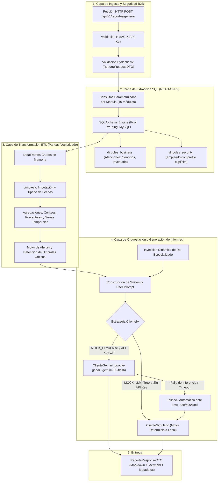

# ESPECIFICACIÓN DE PIPELINES DE ANALÍTICA E INTELIGENCIA ARTIFICIAL (DIRPOLES-IA)

> **Documento Satélite de Dominio — Nivel 2**  
> **Sistema:** DIRPOLES-4 (Universidad Politécnica Territorial de Lara Andrés Eloy Blanco - UPTAEB)  
> **Componente:** Microservicio Analítico `DIRPOLES-IA`  
> **Archivo Canónico:** `docs/PIPELINES_IA.md`  
> **Referencia Constitucional:** [`AGENTS.md`](../AGENTS.md)

---

## 1. Arquitectura General del Pipeline Analítico

El microservicio `DIRPOLES-IA` implementa un flujo unidireccional desacoplado en 4 capas para transformar registros relacionales masivos en informes narrativos ejecutivos de alta fidelidad:



---

## 2. Los 10 Módulos Analíticos: Mapeo SQL, ETL y Roles

### 2.1. Módulo `general` (Consolidado Institucional)
* **Objetivo de Negocio:** Visión global unificada de todas las atenciones prestadas en los 7 servicios institucionales de bienestar estudiantil.
* **Permiso DIRPOLES-4:** Exclusivo Administrador (`verificarAccesoReporte(..., true)`).
* **Mapeo SQL (`app/db/queries/general_queries.py`):**
  - Aplica `UNION ALL` sobre 7 tablas de atención: `becas` (bp), `exoneracion` (ep), `fames` (fp), `consulta_medica` (mp), `orientacion` (op), `discapacidad` (dp), `consulta_psicologica` (cp).
  - Todas las ramas cruzan con `solicitud_de_servicio ss` y `beneficiario b`, vinculando `pnf`.
  - Filtro opcional por empleado: `ss.id_empleado = :id_empleado`.
* **Colecciones Extraídas:** `atenciones` (DataFrame con columnas: `id_beneficiario`, `nombres`, `apellidos`, `cedula`, `genero`, `id_pnf`, `nombre_pnf`, `area`, `fecha`).
* **Transformaciones ETL (`etl_service._transformar_general`):**
  - Distribución por servicio/área (`_distribucion(df, "area")`).
  - Distribución por género (`M`: Masculino, `F`: Femenino).
  - Distribución por carrera académica (`nombre_pnf`, top 8).
  - Serie temporal mensual y cálculo de comparativa mensual de variaciones relativas.
  - Alerta de concentración: si un área concentra $\ge 40\%$ de las atenciones, se emite alerta de advertencia.
* **Rol Especializado:** *«Analista Ejecutivo de Datos de la Dirección de Políticas Estudiantiles, con visión integral de salud, desarrollo social y logística universitaria.»*

---

### 2.2. Módulo `medicina` (Salud Médica e Insumos)
* **Objetivo de Negocio:** Monitorizar morbilidad ambulatoria, patologías recurrentes y niveles de existencias críticas de insumos médicos.
* **Mapeo SQL (`app/db/queries/medicina_queries.py`):**
  - Colección `consultas`: `consulta_medica cm` cruzada con `solicitud_de_servicio ss`, `beneficiario b`, y `pnf`. Filtros: `cm.fecha_creacion`, `b.genero`, `b.id_pnf`, `ss.id_empleado`.
  - Colección `insumos`: `insumos i` con `LEFT JOIN presentacion_insumo pi`. Determina estatus computado: si `fecha_vencimiento < CURDATE()`, fuerza `'Vencido'`, caso contrario `i.estatus`.
* **Transformaciones ETL (`etl_service._transformar_medicina`):**
  - Top diagnósticos clínicos (`_top_concentracion(df, "diagnostico", umbral=20.0)`).
  - Distribución por motivos de consulta y presentaciones de insumos.
  - Alertas automáticas de inventario (`_insumos_alertas`):
    * 🔴 **Crítico:** Insumos con fecha de caducidad superada (`dias < 0`).
    * 🔴 **Crítico:** Insumos con cantidad $< \text{UMBRAL\_STOCK\_CRITICO\_INSUMOS}$ (por defecto 10 unidades).
    * 🟡 **Advertencia:** Insumos que caducan en los próximos 30 días.
* **Rol Especializado:** *«Especialista en gestión de servicios médicos universitarios, morbilidad clínica y administración de inventario de insumos de salud.»*

---

### 2.3. Módulo `psicologia` (Salud Mental y Citas)
* **Objetivo de Negocio:** Analizar motivos de atención psicológica, diagnósticos y cumplimiento de citas agendadas.
* **Mapeo SQL (`app/db/queries/psicologia_queries.py`):**
  - Colección `morbilidad`: `consulta_psicologica cp` cruzada con `solicitud_de_servicio ss`, `beneficiario b`, `pnf`. Filtro por `cp.tipo_consulta` (Diagnóstico, Retiro temporal, Cambio de carrera).
  - Colección `citas`: `cita c` con `beneficiario b`, `pnf`, `estado_cita ec` y cruce explícito a `{seguridad}.empleado e` para el psicólogo asignado.
* **Transformaciones ETL (`etl_service._transformar_psicologia`):**
  - Distribución por tipo de consulta psicológica y diagnósticos prevalentes.
  - Distribución de estados de agenda de citas (Pendiente, Confirmada, Atendida, Cancelada, No asistió).
  - Alertas automáticas:
    * 🟡 **Advertencia:** Si la tasa de inasistencia ("No asistió" + "Cancelada") supera el 25% de las citas agendadas.
* **Rol Especializado:** *«Especialista en salud mental universitaria, morbilidad psicológica y gestión de agenda de atención clínica.»*

---

### 2.4. Módulo `orientacion` (Desarrollo Psicopedagógico)
* **Objetivo de Negocio:** Seguimiento a casos de orientación vocacional, rendimiento académico y problemáticas conductuales.
* **Mapeo SQL (`app/db/queries/orientacion_queries.py`):**
  - Colección `casos`: `orientacion o` unida a `solicitud_de_servicio ss`, `beneficiario b` y `pnf`. Extrae `motivo_orientacion`, `descripcion_orientacion`, e `indicaciones_orientacion`.
* **Transformaciones ETL (`etl_service._transformar_orientacion`):**
  - Distribución de motivos de orientación más frecuentes.
  - Distribución por PNF y género.
  - Serie mensual y comparativa del volumen de casos atendidos.
* **Rol Especializado:** *«Especialista en orientación educativa, psicopedagogía y desarrollo integral del estudiante universitario.»*

---

### 2.5. Módulo `discapacidad` (Diversidad Funcional)
* **Objetivo de Negocio:** Registro y censo de estudiantes con necesidades educativas especiales o diversidad funcional.
* **Mapeo SQL (`app/db/queries/discapacidad_queries.py`):**
  - Colección `registros`: `discapacidad d` unida a `solicitud_de_servicio ss`, `beneficiario b`, `pnf`. Campos: `tipo_discapacidad` (Física, Sensorial, Intelectual, Múltiple, Otro), `grado` (Leve, Moderado, Grave), `requiere_asistencia` (Sí/No) y `carnet_discapacidad` (Sí/No).
* **Transformaciones ETL (`etl_service._transformar_discapacidad`):**
  - Distribución por tipo de discapacidad y grado de severidad.
  - Porcentaje de estudiantes que requieren asistencia personal/técnica.
  - Cobertura de carnetización oficial (CONAPDIS/institucional).
  - Alertas:
    * 🔴 **Crítico:** Casos con grado Grave que declaran requerir asistencia inmediata.
    * 🟡 **Advertencia:** Baja tasa de carnetización ($< 50\%$).
* **Rol Especializado:** *«Especialista en políticas de inclusión universitaria, accesibilidad y atención a la diversidad funcional.»*

---

### 2.6. Módulo `trabajo_social` (Programas de Protección Social)
* **Objetivo de Negocio:** Evaluación socioeconómica y seguimiento de asignaciones en los 4 programas de bienestar.
* **Mapeo SQL (`app/db/queries/trabajo_social_queries.py`):**
  - Aplica `UNION ALL` sobre:
    * `becas bec` (`CONCAT('Banco: ', bec.tipo_banco)`)
    * `exoneracion exo` (`CONCAT('Motivo: ', COALESCE(exo.motivo, 'No indicado'))`)
    * `fames fam` (`CONCAT('Ayuda: ', fam.tipo_ayuda)`)
    * `gestion_emb emb` (`CONCAT('Semanas de gestación: ', emb.semanas_gest)`)
* **Transformaciones ETL (`etl_service._transformar_trabajo_social`):**
  - Distribución por submódulo de protección (`Becas`, `Exoneración`, `FAMES`, `Gestión Embarazo`).
  - Distribución por PNF de los beneficiarios asistidos.
  - Alertas automáticas:
    * 🟡 **Advertencia:** Casos de gestación en semanas avanzadas ($\ge 34$ semanas) que requieran seguimiento prioritario.
* **Rol Especializado:** *«Especialista en trabajo social universitario, evaluación socioeconómica y programas de protección (Becas, Exoneraciones, FAMES y Gestión de Embarazo).»*

---

### 2.7. Módulo `referencias` (Red de Remisiones e Interconsultas)
* **Objetivo de Negocio:** Monitoreo del flujo de remisiones entre servicios internos (ej. Medicina remitido a Psicología o FAMES).
* **Mapeo SQL (`app/db/queries/referencias_queries.py`):**
  - Colección `remisiones`: `referencias r` con `beneficiario b`, `servicio so` (origen) y `servicio sd` (destino). Filtros por `r.estado` (Pendiente, Aceptada, Rechazada) y `r.id_servicio_destino`.
* **Transformaciones ETL (`etl_service._transformar_referencias`):**
  - Distribución por estado de la referencia.
  - Matriz de rutas de flujo: pares servicio origen $\to$ servicio destino.
  - Alertas:
    * 🟡 **Advertencia:** Referencias que permanecen en estado `Pendiente` por más de 15 días o alta tasa de rechazo ($> 20\%$).
* **Rol Especializado:** *«Coordinador de la red de remisiones e interconsultas internas entre servicios de bienestar estudiantil.»*

---

### 2.8. Módulo `jornadas` (Jornadas Médicas y Comunitarias)
* **Objetivo de Negocio:** Análisis de alcance asistencial, cobertura territorial y diagnósticos en operativos especiales de salud.
* **Mapeo SQL (`app/db/queries/jornadas_queries.py`):**
  - Colección `jornadas`: `jornadas_medicas j` con subconsultas correlacionadas escalares para `total_asistentes` (`jornada_beneficiarios jb`) y `total_diagnosticos` (`jornada_diagnosticos jd`). Filtros por `j.fecha_inicio` y `j.estatus` (Activa, Cancelada, Finalizada).
* **Transformaciones ETL (`etl_service._transformar_jornadas`):**
  - Tasa de ocupación vs aforo máximo ($\text{asistentes} / \text{aforo}$).
  - Promedio de diagnósticos por beneficiario asistido.
  - Alertas:
    * 🟡 **Advertencia:** Jornadas finalizadas con aforo inferior al 40% de la capacidad planificada.
* **Rol Especializado:** *«Especialista en salud comunitaria, organización de jornadas asistenciales y prevención epidemiológica universitaria.»*

---

### 2.9. Módulo `mobiliario` (Bienes Nacionales y Equipos)
* **Objetivo de Negocio:** Control de inventario físico, equipos operativos y mobiliario en dependencias universitarias.
* **Mapeo SQL (`app/db/queries/mobiliario_queries.py`):**
  - Aplica `UNION ALL` entre:
    * `mobiliario m` con `tipo_mobiliario tm` (`tipo_bien = 'Mobiliario'`, `cantidad = m.cantidad`).
    * `equipos eq` con `tipo_equipo te` (`tipo_bien = 'Equipo'`, `cantidad = 1`).
  - Filtros: `t.tipo_bien` y `t.estatus` (Activo, Inactivo).
* **Transformaciones ETL (`etl_service._transformar_mobiliario`):**
  - Distribución por categoría de bien y tipo (`Mobiliario` vs `Equipo`).
  - Proporción de bienes activos vs inactivos/desincorporados.
  - Alertas:
    * 🟡 **Advertencia:** Alta concentración de bienes en estatus `Inactivo` que requieran informe pericial de desincorporación.
* **Rol Especializado:** *«Analista de gestión de bienes públicos, mobiliario e inventario de equipamiento institucional.»*

---

### 2.10. Módulo `transporte` (Flota, Rutas y Mantenimiento)
* **Objetivo de Negocio:** Monitoreo logístico de rutas estudiantiles, estado operativo de autobuses, repuestos y proveedores.
* **Mapeo SQL (`app/db/queries/transporte_queries.py`):**
  - Admite extracción modular según `seccion_transporte`:
    * `vehiculos`: `vehiculos v` con subconsultas para `asignaciones_activas` y `total_mantenimientos`.
    * `rutas`: `rutas r` con conteo de asignaciones activas.
    * `proveedores`: `proveedores p` con datos de contacto y estatus.
    * `repuestos`: `repuestos_vehiculos rp` con `proveedores p`.
    * `asignaciones`: `asignaciones_rutas ar` con `rutas r`, `vehiculos v` y cruce a `{seguridad}.empleado e` para el chofer.
    * `mantenimientos`: `mantenimiento_vehiculos mv` con `vehiculos v`.
* **Transformaciones ETL (`etl_service._transformar_transporte`):**
  - Estado operativo de la flota vehicular (Operativo, En taller, Fuera de servicio).
  - Alertas de inventario de repuestos:
    * 🔴 **Crítico:** Repuestos con existencia $< \text{UMBRAL\_STOCK\_CRITICO\_REPUESTOS}$ (por defecto 5 unidades).
    * 🟡 **Advertencia:** Unidades vehiculares con más de 3 mantenimientos en el periodo o sin asignación de ruta activa.
* **Rol Especializado:** *«Analista de gestión de flotas, logística de transporte universitario, rutas y mantenimiento vehicular.»*

---

## 3. Matriz de Intenciones y Comportamiento del Prompt

El parámetro `intencion` modula la narrativa y el foco del informe generado:

| Intención (`Intencion`) | Directriz de Redacción en Prompt | Foco de las Secciones |
| :--- | :--- | :--- |
| `resumen_ejecutivo` | Visión panorámica global, síntesis de métricas totales y balance comparativo mensual. | Tablas generales de volumen y proporciones macro. |
| `alertas_y_anomalias` | Prioridad máxima en indicadores desfavorables, stock crítico, suspensiones y cuellos de botella. | Citas Markdown `> ⚠️ **Punto Crítico:**` y lista de urgencias. |
| `tendencias_y_patrones` | Comportamiento longitudinal, estacionalidad académica y cambios porcentuales mes a mes. | Gráficos `pie` y comparativas `variacion_pct`. |
| `recomendaciones` | Medidas operativas concretas, accionables, asignación de responsables y mitigación de riesgos. | Listas numeradas y plan de acción priorizado. |

---

## 4. Estructura de Salida: Markdown y Visualizaciones Mermaid.js

Todo informe (sea emitido por `ClienteGemini` o por `ClienteSimulado`) sigue esta convención visual obligatoria:

1. **Encabezado Institucional:**
   ```markdown
   ### 📊 Informe de Análisis Inteligente: Módulo [Nombre]
   **Periodo:** YYYY-MM-DD al YYYY-MM-DD  
   **Intención:** [Intención formateada]  
   **Registros procesados:** N
   ```
2. **Sección 1: Resumen Ejecutivo:** Totales del periodo, variaciones porcentuales y tabla síntesis.
3. **Sección 2: Hallazgos Clave y Puntos Críticos:**
   - Lista de alertas con indicadores visuales (🔴 Crítico, 🟡 Advertencia, 🔵 Info).
   - Tablas de distribución en formato Markdown limpio.
   - **Al menos un bloque de gráfico Mermaid.js** embebido nativamente:
     ```mermaid
     pie title Distribución por Área
         "Medicina" : 45
         "Psicología" : 30
         "Becas" : 25
     ```
4. **Sección 3: Recomendaciones Operativas:** Acciones jerarquizadas derivadas estrictamente de los datos observados.

---

## 5. Motor Determinista (`ClienteSimulado`) y Estrategia Fallback

El microservicio garantiza disponibilidad continua del 100% mediante el patrón **Strategy + Resilient Fallback**:

```python
# Flujo en app/api/v1/endpoints/reportes.py
cliente = gemini_service.obtener_cliente()
try:
    informe = cliente.generar_informe(system_prompt, user_prompt, contexto)
    modo = cliente.modo
except Exception:
    # Degradación automática elegante: cero errores 500 para el frontend
    informe = gemini_service.ClienteSimulado().generar_informe(system_prompt, user_prompt, contexto)
    modo = "simulado_fallback"
```

* **Comportamiento de `ClienteSimulado`:**
  - Consume el diccionario `resumen` de Pandas directamente.
  - Formatea tablas de distribución reales con sus porcentajes exactos.
  - Sintetiza alertas a partir de los datos analizados.
  - Construye diagramas Mermaid sintácticamente válidos escapando comillas.
  - Inserta nota al pie: `*Informe generado por DIRPOLES-IA en modo simulado (sin conexión al proveedor de IA).*`

---

## 6. Verificación, Suite de Pruebas y Comandos Operativos

El comportamiento de los pipelines se valida mediante las pruebas unitarias y de integración en `tests/`:

* `tests/test_schemas.py`: Valida validadores Pydantic, rangos de fecha y catálogos de estado por módulo.
* `tests/test_etl_service.py`: Prueba transformaciones, series mensuales y alertas vectorizadas sin base de datos activa.
* `tests/test_prompt_service.py`: Verifica la inyección de roles especializados y la estructura de los prompts.
* `tests/test_gemini_simulado.py`: Garantiza que el informe del `ClienteSimulado` cumpla con los encabezados Markdown y Mermaid.
* `tests/test_api_contrato.py`: Verifica respuestas HTTP 200, 401 (sin API key) y 422 (validación).
* `tests/test_flujo_bd_api.py` / `test_integracion_bd.py`: Pruebas de integración directa contra la base de datos MySQL (marcadas con `@pytest.mark.bd`).

### Comandos de Verificación Recomendados
```bash
# 1. Verificación de estilo y sintaxis
ruff check app tests

# 2. Verificación de formateo
ruff format --check app tests

# 3. Verificación de tipos estáticos
mypy app

# 4. Ejecución de pruebas unitarias (excluyendo pruebas que requieran BD activa)
pytest -m "not bd"

# 5. Ejecución completa con cobertura (requiere MySQL local activo)
pytest --cov=app --cov-report=term-missing
```
